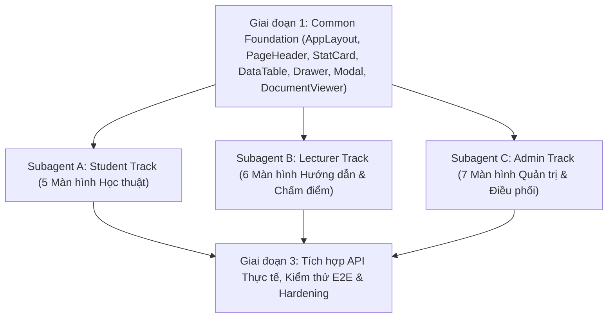

# KẾ HOẠCH TỔNG THỂ REDESIGN ĐỒNG THỜI 3 GIAO DIỆN (STUDENT, LECTURER, ADMIN)
**Dự án: Hệ thống Quản lý Đồ án & Khóa luận Tốt nghiệp (DACN)**  
**Phương pháp thực hiện:** Đồng bộ Token & Component Dùng chung trước $\rightarrow$ Phân chia 3 Subagents chuyên trách triển khai song song $\rightarrow$ Kiểm thử & Xác thực API Thực tế.  
**Chuẩn thiết kế áp dụng:** Open Design (`public-portal-dacn.html`, `student-dacn-prototype.html`, `lecturer-dacn-prototype.html`, `admin-dacn-prototype.html`), `design-system` token architecture, `ui-ux-pro-max` ergonomics, và `vercel-react-best-practices`.

---

## 1. NGUYÊN TẮC KIẾN TRÚC & PHÂN BỔ KỸ NĂNG (UI SKILLS)

| Kỹ năng UI | Vai trò trong dự án | Nội dung áp dụng cụ thể |
| :--- | :--- | :--- |
| **`design-system`** | **Kiến trúc Token 3 Tầng** | Xây dựng bộ Design Tokens đồng nhất: **Primitive** (màu cơ bản, thang độ sáng), **Semantic** (Alpine Teal `#0F766E`, Emerald Success `#10B981`, Amber Warning `#F59E0B`, Rose Danger `#EF4444`, Slate Canvas `#F8FAFC`), **Component-level** (biến CSS cho Cards, Tables, Drawers, Modals). |
| **`ui-ux-pro-max`** | **Trải nghiệm & Công thái học (Ergonomics)** | - Bố cục giữ ngữ cảnh (**Context Preservation**) với Side Drawer thay vì modal che khuất màn hình. - Ghép cặp phân công 2 cột (**Master-Detail Two-Column Matcher**) cho Hội đồng & Gán đề tài. - Thước đo chỉ tiêu trực quan (**Quota Meters**) kiểm soát nghiêm ngặt `1 SV / 1 Đề tài` và `1 GVHD tối đa 10 SV`. - Hiệu ứng chuyển động mượt mà với đường cong gia tốc `cubic-bezier(0.16, 1, 0.3, 1)`. |
| **`vercel-react-best-practices`** | **Hiệu năng & Trạng thái React** | - Tránh re-render thừa bằng `useMemo` và `useCallback`. - Phân tách cấu trúc Component hạt nhân (atomic/composable). - Tải trang nhanh, tối ưu hóa bundle CSS/JS. |

---

## 2. GIAI ĐOẠN 1: XÂY DỰNG NỀN TẢNG DÙNG CHUNG (COMMON FOUNDATION)
*Thời gian thực hiện: Ưu tiên triển khai trước tiên để cả 3 Subagent tái sử dụng ngay lập tức.*

### 2.1. Chuẩn hóa Khung sườn ứng dụng (`AppLayout.jsx` & Navigation Shell)
- **Responsive Sidebar**: Thanh điều hướng bên trái có thể thu gọn (collapsed 72px) / mở rộng (260px), hiển thị phân nhóm chức năng (Overview, Academic Core, Communication, Settings), có badge đếm số lượng việc cần xử lý.
- **Top App Header**:
  - Logo TDMU trong suốt.
  - Bộ chọn Học kỳ hoạt động (`SemesterSwitcher` dropdown kết nối `semesterService.getPublic()`).
  - Hộp tìm kiếm thông minh (`QuickCommandSearch`).
  - Chuông thông báo (`NotificationBellPopover` với danh sách thông báo chưa đọc).
  - Khối định danh người dùng (Avatar, Họ tên, Badge học hàm học vị, Menu chuyển đổi quyền kiêm nhiệm đối với Giảng viên kiêm Chủ nhiệm/Hội đồng, Nút Đăng xuất).

### 2.2. Thư viện Component Dùng chung (`src/components/common/`)

1. **`PageHeader.jsx`**:
   - Tiêu đề màn hình, mô tả ngắn, breadcrumbs điều hướng, nhãn đợt tốt nghiệp hiện tại.
   - Khu vực nút tác vụ chính (Primary Action Button, Xuất file Excel, Bộ lọc nhanh).
2. **`StatCard.jsx` & Metrics Grid**:
   - Thẻ thống kê chuẩn OpenDesign: Icon container nền pastel, con số kích thước lớn (`font-variant-numeric: tabular-nums`), nhãn mô tả, badge chỉ số % thay đổi, thanh mini-progress bar.
3. **`DataTable.jsx` / Table Primitives**:
   - Thanh công cụ lọc đa diện (**Faceted Filter Toolbar**): Ô tìm kiếm real-time, Tabs phân đoạn trạng thái (Segmented Status Tabs), Dropdown bộ môn/học kỳ.
   - Bảng hiển thị dữ liệu chuẩn công thái học: Sticky Header, Checkbox chọn dòng, Hover nhấc nhẹ.
   - Thanh tác vụ hàng loạt nổi (**Floating Batch Action Bar**): Xuất hiện ở đáy màn hình khi chọn $\ge 1$ dòng (Duyệt hàng loạt, Nhắc nhở, Xuất Excel).
   - Phân trang chuẩn và trạng thái rỗng (`EmptyState.jsx`).
4. **`StatusBadge.jsx` & `statusMap.js`**:
   - Chuẩn hóa các nhãn trạng thái xuyên suốt 6 chặng học thuật:
     - `PROPOSED` (Đã đề xuất - Xanh lam nhạt)
     - `ASSIGNED` / `APPROVED` (Đã duyệt / Giao SV - Xanh thông ngọc)
     - `IN_PROGRESS` (Đang triển khai - Xanh lá mạ)
     - `DEFENDED` (Đã bảo vệ - Tím học thuật)
     - `COMPLETED` (Lưu chiểu hoàn tất - Xanh lục đậm)
     - `REJECTED` / `WITHDRAWN` (Từ chối / Rút đề tài - Đỏ gạch)
5. **`OpenDrawer.jsx` (Ngăn kéo trượt bên phải)**:
   - Ngăn kéo trượt mượt mà (chiều rộng 480px - 720px) để xem chi tiết hồ sơ, thẩm định đề cương, chấm điểm rubric mà không làm gián đoạn vị trí cuộn trang hiện tại.
6. **`OpenModal.jsx` (Hộp thoại tương tác)**:
   - Modal pop chuẩn tiếp cận WCAG với hiệu ứng `modalPop`, backdrop mờ, hỗ trợ đóng bằng phím ESC hoặc click bên ngoài.
7. **`SimulatedDocumentViewer.jsx` (Trình giả lập văn bản A4 số hóa)**:
   - Mô phỏng trang văn bản A4 tiêu chuẩn (Quốc hiệu, Tiêu ngữ, Số văn bản, Dấu mộc số đỏ, Ký số SHA-256).
   - Tái sử dụng cho: Biểu mẫu BM01 (Đề cương), BM02 (Đăng ký), BM03 (Gặp GVHD), BM04 (Nhận xét bảo vệ), BM05 (Biên bản chấm điểm), Giấy chứng nhận hoàn thành.
8. **`QuotaMeter.jsx` (Thước đo định mức 10 SV / GVHD)**:
   - Thanh đo tải trọng hướng dẫn của GVHD (Xanh ngọc khi $<8$ SV, Vàng hổ phách khi $8-9$ SV, Đỏ cảnh báo khi chạm trần $10/10$ SV).

---

## 3. GIAI ĐOẠN 2: TRIỂN KHAI ĐỒNG THỜI 3 SUBAGENTS CHUYÊN TRÁCH

Sau khi hoàn thành Thư viện Dùng chung ở Giai đoạn 1, hệ thống kích hoạt **3 Subagents chuyên trách độc lập** chạy song song:

---

### 3.1. SUBAGENT TRACK A: PHÂN HỆ SINH VIÊN (`STUDENT WORKSPACE`)
*Đối chiếu Prototype:* `student-dacn-prototype.html` (5.184 dòng code mẫu)  
*Thư mục làm việc:* `frontend/src/pages/student/`

| STT | Màn hình | File mã nguồn | Các tính năng & UI cần chuyển đổi |
| :---: | :--- | :--- | :--- |
| **A1** | **Bàn làm việc Sinh viên** | `StudentDashboardPage.jsx` | - **Hành trình 6 Chặng (Academic Stepper)**: Hiển thị mốc hiện hành, nhiệm vụ kế tiếp, hạn nộp còn lại. - **Thẻ đề tài của tôi**: Tên đề tài, GVHD, trạng thái phê duyệt BM01/BM02, nút liên hệ nhanh. - **Grid Thống kê**: Hạn chót kế tiếp, điểm rèn luyện, tình trạng hồ sơ. - **Dòng hoạt động gần đây**: Lịch sử GV nhận xét, thông báo học vụ liên quan. |
| **A2** | **Danh mục Đề tài** | `TopicListPage.jsx` | - **Ngân hàng đề tài mở**: Xem danh sách đề tài của các Bộ môn. - **Bộ lọc thông minh**: Lọc theo Chuyên ngành, Lĩnh vực công nghệ, Giảng viên. - **Quy tắc 1 SV / 1 Đề tài**: Thẻ đề tài hiển thị rõ chỉ tiêu (`0/1` hoặc `1/1 Đã có SV`). Nút "Đăng ký" tự động vô hiệu hóa nếu SV đã có đề tài được duyệt. - **Modal Đề xuất đề tài mới**: Form gửi ý tưởng đề tài lên GVHD mong muốn. |
| **A3** | **Tiến độ & Nộp bài** | `SubmissionPage.jsx` | - **Timeline nộp biểu mẫu BM01 $\rightarrow$ BM05**: Trạng thái từng mốc kèm tệp đính kèm. - **Khu vực tải tệp kéo thả (Drag & Drop File Upload)**: Hỗ trợ tệp PDF/DOCX/ZIP, kiểm tra dung lượng. - **Báo cáo kiểm tra đạo văn (Turnitin Preview)**: Tỷ lệ tương đồng, báo cáo chi tiết. - **Lịch sử sửa đổi (Revision History)**: Nhật ký các phiên bản nộp và phản hồi từ GVHD. |
| **A4** | **Gặp gỡ & Nhật ký BM03** | `StudentMeetingsPage.jsx` (hoặc tích hợp trong tab Progress) | - **Lịch hẹn gặp GVHD**: Đặt lịch tư vấn học thuật, ghi chú nội dung trao đổi. - **Biên bản gặp gỡ BM03 số hóa**: Tự động tổng hợp các buổi gặp thành nhật ký hợp lệ cho kỳ bảo vệ. |
| **A5** | **Kết quả Bảo vệ & Chứng nhận** | `GradeViewPage.jsx` | - **Bảng điểm Hội đồng 3 thành viên**: Điểm Chủ tịch, Thư ký, Phản biện theo Rubric tiêu chí. - **Nhận xét của Hội đồng**: Ý kiến đánh giá, yêu cầu chỉnh sửa hậu bảo vệ. - **Giấy chứng nhận hoàn thành**: Mô phỏng bản in A4 có mã QR truy xuất lưu chiểu số. |

---

### 3.2. SUBAGENT TRACK B: PHÂN HỆ GIẢNG VIÊN (`LECTURER WORKSPACE`)
*Đối chiếu Prototype:* `lecturer-dacn-prototype.html` (3.984 dòng code mẫu)  
*Thư mục làm việc:* `frontend/src/pages/lecturer/`

| STT | Màn hình | File mã nguồn | Các tính năng & UI cần chuyển đổi |
| :---: | :--- | :--- | :--- |
| **B1** | **Bàn làm việc Giảng viên** | `LecturerDashboardPage.jsx` | - **Thước đo định mức hướng dẫn**: Đo đếm chính xác `X / 10 SV` (cảnh báo khi chạm mốc 10). - **Hàng đợi cần xử lý (Action Queue)**: Danh sách SV chờ duyệt đề tài, SV cần ký BM03, SV chờ chốt BM04. - **Radar lịch bảo vệ**: Lịch phân công tham gia Hội đồng chấm khóa luận sắp tới. - **Thống kê nhanh**: Tỷ lệ hoàn thành đề cương, tiến độ chung của nhóm đồ án. |
| **B2** | **Quản lý Đề tài của tôi** | `TopicManagementPage.jsx` | - **Danh sách đề tài đã ra**: Trạng thái duyệt của Bộ môn, SV đang nhận (mỗi đề tài 1 SV). - **Drawer Thêm/Sửa đề tài**: Form chuẩn gồm Mục tiêu, Yêu cầu công nghệ, Sản phẩm dự kiến. - **Nhân bản đề tài (Clone Topics)**: Sao chép nhanh danh mục đề tài từ học kỳ trước sang đợt mới. |
| **B3** | **Phê duyệt Đăng ký** | `TopicApprovalPage.jsx` | - **Danh sách nguyện vọng của SV**: Xem thông tin SV, GPA, chuyên ngành, CV/thư nguyện vọng. - **Quyết định 1-Click**: Nút "Chấp nhận" (kiểm tra nếu chưa quá 10 SV) hoặc "Từ chối" kèm lý do phản hồi. - **Tự động chốt chặn**: Đề tài được nhận sẽ chuyển sang `ASSIGNED` và khóa đăng ký đối với SV khác. |
| **B4** | **Theo dõi Tiến độ BM** | `ProgressTrackingPage.jsx` & `StudentProgressDetailPanel.jsx` | - **Side Drawer Master-Detail**: Bấm vào bất kỳ SV nào để mở ngăn kéo bên phải xem toàn bộ hành trình. - **Kiểm tra báo cáo tuần & Nhật ký BM03**: Phê duyệt và ghi chú phản hồi trực tiếp. - **Chốt chặn Bảo vệ BM04**: Đánh giá chính thức "Đồng ý" hoặc "Không đồng ý" cho SV ra Hội đồng bảo vệ. |
| **B5** | **Hội đồng Chấm điểm** | `GradingPage.jsx` | - **Danh sách Hội đồng tham gia**: Hiển thị vai trò (Chủ tịch / Thư ký / Phản biện), Phòng bảo vệ, Lịch chấm. - **Danh sách SV trong Hội đồng**: Xem hồ sơ, đề cương BM01, báo cáo toàn văn PDF, video demo. |
| **B6** | **Phiếu Chấm Điểm Điện Tử** | `LecturerGradingSheetPage.jsx` | - **Phiếu chấm BM05 theo Rubric**: Nhập điểm chi tiết từng tiêu chuẩn (Cơ sở lý thuyết, Giải pháp kỹ thuật, Trình bày, Trả lời câu hỏi). - **Tính toán điểm tự động**: Kiểm tra hợp lệ điểm thành phần, tổng điểm trên thang 10. - **Ký số điện tử**: Xác thực điểm số bằng chữ ký số và xuất biên bản in A4. |

---

### 3.3. SUBAGENT TRACK C: PHÂN HỆ QUẢN TRỊ (`ADMIN WORKSPACE`)
*Đối chiếu Prototype:* `admin-dacn-prototype.html` (8.567 dòng code mẫu)  
*Thư mục làm việc:* `frontend/src/pages/admin/`

| STT | Màn hình | File mã nguồn | Các tính năng & UI cần chuyển đổi |
| :---: | :--- | :--- | :--- |
| **C1** | **Trung tâm Điều hành (Dashboard)** | `DashboardPage.jsx` | - **Triage Queue khẩn cấp**: Đề tài chờ Ban chủ nhiệm duyệt, SV chậm tiến độ BM03, Hội đồng thiếu thành viên. - **Phễu học vụ 6 giai đoạn (Enrollment Funnel)**: Trực quan hóa tỷ lệ chuyển đổi từ Đăng ký $\rightarrow$ Bảo vệ $\rightarrow$ Lưu chiểu. - **Biểu đồ phân bổ tải trọng Bộ môn**: Biểu đồ thanh ngang hiển thị số lượng đề tài và tải trọng giảng viên. |
| **C2** | **Ngân hàng Đề tài Toàn trường** | `TopicManagementPage.jsx` | - **Bảng tổng hợp đề tài**: Bộ lọc phân cấp Bộ môn, GVHD, Chuyên ngành. - **Thao tác hàng loạt (Batch Bar)**: Duyệt hàng loạt 50 đề tài hoặc yêu cầu chỉnh sửa 1-click. - **Drawer Thẩm định**: Mở drawer xem chi tiết đề tài và phê duyệt không cần rời trang. |
| **C3** | **Giám sát Tiến độ Học thuật** | `ProjectOversightPage.jsx` | - **Kanban / Table Giám sát tiến độ**: Theo dõi toàn bộ 128+ sinh viên qua từng mốc BM01 - BM05. - **Bộ lọc rủi ro**: Lọc ngay các sinh viên có nguy cơ bị đình chỉ hoặc thiếu BM04. - **Cấp chứng nhận lưu chiểu**: Xác nhận nộp quyển PDF lưu chiểu và mã hóa QR. |
| **C4** | **Phân công Hội đồng Bảo vệ** | `CouncilAssignmentPage.jsx` | - **Bố cục Ghép cặp 2 Cột (Master-Detail Matcher)**: Cột trái là Danh sách SV đủ điều kiện, cột phải là Các Hội đồng bảo vệ. - **Ràng buộc Hội đồng 3 thành viên**: Bắt buộc đủ Chủ tịch, Thư ký, Phản biện. - **Cảnh báo xung đột lợi ích (Conflict Detection)**: Nghiêm cấm GVHD làm Phản biện hoặc Chủ tịch chấm chính sinh viên của mình. - **Phân phòng và khung giờ**: Điều phối phòng học, ngày giờ bảo vệ không trùng lặp. |
| **C5** | **Quản lý Tài khoản & Phân quyền** | `UserManagementPage.jsx` & `PermissionGroupPage.jsx` | - **Wizard Nhập Excel Thông minh**: Import danh sách Sinh viên, Giảng viên với kiểm tra lỗi trước khi lưu. - **Phân quyền RBAC nâng cao**: Gán quyền kiêm nhiệm (Ban Chủ nhiệm, Trưởng bộ môn, Thư ký giáo vụ). |
| **C6** | **Cấu hình Đợt Đồ án** | `ProjectPeriodPage.jsx` | - **Timeline mốc thời gian**: Thiết lập ngày bắt đầu, ngày kết thúc từng giai đoạn BM01 - BM05. - **Khóa/Mở cổng học vụ**: Đóng mở cổng đăng ký hoặc nộp báo cáo theo thời hạn quy định. |
| **C7** | **Bản tin & Quyết định Học vụ** | `AnnouncementManagementPage.jsx` | - **Quản trị văn bản học vụ**: Soạn thảo thông báo khẩn, quyết định giao đề tài, hướng dẫn kỹ thuật. - **Đính kèm tài liệu & ký số**: Đính kèm tệp văn bản mẫu có dấu mộc điện tử. |

---

## 4. GIAI ĐOẠN 3: TÍCH HỢP HỆ THỐNG, API BACKEND & KIỂM THỬ E2E

### 4.1. Cam kết Ràng buộc Kỹ thuật (Strict Rules Compliance)
1. **Tuyệt đối tuân thủ mô hình `TopicRegistration`**:
   - `1 Sinh viên = 1 Đề tài` (`maxStudents = 1`).
   - `1 Giảng viên = Tối đa 10 Sinh viên`.
   - Không phục hồi bất kỳ logic nào liên quan đến mô hình cũ `group/groupMember`.
2. **Nguyên tắc "Sửa gốc vấn đề trước"**:
   - Mọi tương tác màn hình đều phải kết nối API thực tế từ Backend (`/api/topics`, `/api/registrations`, `/api/meeting-logs`, `/api/evaluations`, `/api/councils`, `/api/semesters`).
   - Tuyệt đối không để lại mock data tạm bợ nếu Backend đã có endpoint.
3. **Mã hóa file**:
   - Tất cả các file được lưu ở chuẩn **UTF-8 (no BOM)**.

### 4.2. Kế hoạch Kiểm thử & Bàn giao
- **Kiểm thử Unit & Integration Backend**: Chạy Jest bảo đảm **95/95 test suites PASS**.
- **Kiểm thử Build Frontend**: Chạy `npm run build` kiểm tra bundle sạch, 0 lỗi TypeScript/ESLint/Vite.
- **Kiểm thử Trình duyệt đa luồng (Browser Subagent E2E)**:
  1. *Luồng Sinh viên*: Đăng nhập $\rightarrow$ Xem Lộ trình $\rightarrow$ Chọn đề tài $\rightarrow$ Đăng ký $\rightarrow$ Xem tiến độ nộp bài.
  2. *Luồng Giảng viên*: Đăng nhập $\rightarrow$ Xem tải trọng hướng dẫn $\rightarrow$ Duyệt đề tài SV $\rightarrow$ Đánh giá BM04 $\rightarrow$ Chấm điểm Hội đồng BM05.
  3. *Luồng Quản trị viên*: Đăng nhập $\rightarrow$ Triage Queue $\rightarrow$ Duyệt đề tài $\rightarrow$ Phân công Hội đồng 3 thành viên $\rightarrow$ Cấp chứng nhận lưu chiểu.

---

## 5. THỨ TỰ THỰC THI (ACTIONABLE ROADMAP)

1. **Bước 1 (P0 - Nền tảng)**: Chuẩn hóa `AppLayout.jsx` và hoàn thiện thư viện component dùng chung (`PageHeader`, `StatCard`, `DataTable`, `OpenDrawer`, `OpenModal`, `SimulatedDocumentViewer`, `QuotaMeter`).
2. **Bước 2 (P0 - Khởi tạo 3 Subagents)**:
   - Khởi chạy song song 3 Subagent theo 3 Track A, B, C độc lập.
   - Mỗi Subagent đối chiếu trực tiếp file prototype tương ứng và cập nhật trang React.
3. **Bước 3 (P1 - Tích hợp & Kiểm thử)**:
   - Ghép nối các luồng dữ liệu liên thông giữa 3 phân hệ.
   - Chạy build và audit toàn diện bằng `browser_subagent`.
