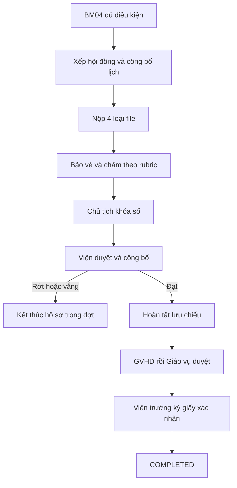

# Đặc tả nghiệp vụ: Từ BM04 đến hoàn thành đồ án

**Ngày:** 12/11/2026  
**Phạm vi:** Hồ sơ đủ điều kiện bảo vệ sau BM04, hội đồng bảo vệ, chấm và công bố kết quả, lưu chiểu, giấy xác nhận hoàn thành.  
**Mức độ:** Quyết định nghiệp vụ đã chốt; tên bảng/API phải đối chiếu repository trước khi lập implementation plan.

## 1. Quyết định tổng quan

BM04 ký với kết luận đồng ý bảo vệ làm hồ sơ đủ điều kiện ngay; nếu GVHD đề nghị không cho bảo vệ, chỉ vào luồng bảo vệ khi Viện bác đề nghị đó theo quy trình BM04 đã chốt. Tên đề tài hiển thị và lưu snapshot phải là tên có hiệu lực theo quyết định BM02 hoặc phụ lục BM02-A.

## 2. Hội đồng và lịch

- Hội đồng mặc định có ba vai trò có quyền chấm: Chủ tịch, Thư ký, Phản biện. Có thể cấu hình thêm vai trò thứ tư cũng chấm và được tính vào trung bình.
- Hội đồng có khoảng 22 sinh viên; không áp giới hạn cứng 10 sinh viên/hội đồng.
- Một ngày bảo vệ chung, hai ca: sáng 07:00–11:00 và chiều 13:00–17:00 theo giờ Việt Nam.
- Admin/Giáo vụ sắp xếp và xác nhận danh sách trước khi công bố. Chia danh sách đã xác nhận làm hai phần liên tiếp; nếu lẻ, ca sáng thêm một sinh viên. Lưu thứ tự và ca của từng sinh viên tại thời điểm công bố.
- Mỗi sinh viên có số thứ tự trong ca; không cần cam kết giờ bảo vệ riêng cho từng người.
- Thay ca hoặc thứ tự sau công bố phải là thao tác điều chỉnh có lý do, audit và thông báo người liên quan.
- Admin được thay thành viên chấm trước khi hội đồng khóa sổ, với lý do và lịch sử. Phiếu người cũ (nếu có) không còn tính điểm nhưng không bị xóa; người mới tự chấm và khóa phiếu. Thay người đã khóa phiếu cần xác nhận riêng.

## 3. Bộ sáu tài liệu bảo vệ và cửa sổ nộp

| Tài liệu | Người cung cấp | Quy tắc |
|---|---|---|
| Báo cáo Word | Sinh viên | Một loại file có nhiều phiên bản |
| Báo cáo PDF | Sinh viên | Một loại file có nhiều phiên bản |
| Video demo | Sinh viên | Một loại file có nhiều phiên bản |
| Slide PPTX | Sinh viên | Một loại file có nhiều phiên bản |
| BM03 | Hệ thống liên kết phiếu đã hoàn tất | Sinh viên không nộp lại |
| BM04 | Hệ thống liên kết phiếu GVHD đã ký | Sinh viên không nộp lại |

- Mốc gửi tài liệu cho hội đồng chuẩn bị là **00:00 trước ngày bảo vệ ba ngày** (giờ Việt Nam). Đây là hạn mềm; file thiếu hoặc nộp muộn có cảnh báo nhưng không tự động cấm bảo vệ.
- **00:00 ngày bảo vệ:** lưu snapshot các phiên bản đang có để xác định hội đồng chấm trên bộ nào. Snapshot không bị thay đổi bởi các lần nộp sau.
- Sinh viên được bổ sung file thiếu và thay phiên bản từng file nhiều lần cho đến **00:00 ngày thứ 15 sau ngày bảo vệ**, tức được nộp hết ngày thứ 14. Mỗi lần nộp lưu file riêng, người nộp, thời điểm, checksum và phiên bản; không upsert đè bản trước.
- Sau mốc đóng không mở lại quyền nộp, kể cả khi người duyệt yêu cầu sửa. Không bắt nộp lại cả bốn file nếu một file không thay đổi.
- Ví dụ bảo vệ 20/11: hạn mềm 00:00 ngày 17/11; snapshot chấm 00:00 ngày 20/11; cổng đóng 00:00 ngày 05/12, theo `Asia/Ho_Chi_Minh`.
- Tài liệu nộp sau snapshot bảo vệ chỉ phục vụ lưu chiểu, không tự thay thế phiên bản hội đồng đã dùng để chấm.

## 4. Rubric và phiếu chấm

- Một đợt bảo vệ dùng chung một rubric. Admin/Viện quản lý bản nháp, phát hành và khóa rubric **trước khi công bố danh sách sinh viên được ra bảo vệ**. Không công bố danh sách nếu chưa có rubric hợp lệ.
- Rubric cho phép sửa, thêm, bỏ, sắp thứ tự nhóm và mục thành phần; mỗi mục có tên, điểm tối đa, CLO liên quan, bốn mô tả Tốt/Khá/Trung bình/Kém. Tổng điểm tối đa các mục phải bằng 10,0.
- Mẫu tham chiếu hiện tại có 4 nhóm, 14 mục: Hình thức 1,0; Nội dung 5,0; Tính ứng dụng và triển vọng 1,0; Phần trình bày báo cáo 3,0.
- Bốn mức mô tả là hướng dẫn; giảng viên nhập điểm số từng mục trong khoảng từ 0 đến điểm tối đa. Hệ thống cộng thành điểm của thành viên.
- Rubric đã khóa bất biến trong đợt. Phiếu chấm ghi phiên bản và snapshot rubric; mẫu cho đợt sau được sao chép thành bản nháp mới.
- Mỗi thành viên có quyền chấm lưu nháp và tự khóa phiếu của mình. Chỉ các phiếu hợp lệ của danh sách người chấm đang có hiệu lực mới tham gia tính điểm.
- Điểm hội đồng = tổng điểm của các thành viên chấm đang có hiệu lực / số thành viên đó; 3 người chia 3, 4 người chia 4. Chỉ khóa sổ khi tất cả đã khóa phiếu.
- Điểm chính thức được làm tròn đến **một chữ số thập phân** theo một quy tắc làm tròn thống nhất ở backend và bản xuất. Kết luận đạt dựa trên điểm chính thức: từ 5,0 trở lên đạt; dưới 5,0 rớt. Lưu cả điểm từng mục và trung bình chưa làm tròn để kiểm tra.
- Sinh viên vắng mặt được đánh dấu `ABSENT`, có biên bản Chủ tịch xác nhận và kết thúc hồ sơ trong đợt sau khi Viện công bố; không tự gán điểm 0 hoặc tạo phiếu chấm giả nếu không có quy định khác.

## 5. Khóa sổ, phê duyệt và công bố điểm

1. Thành viên khóa phiếu cá nhân; Chủ tịch kiểm tra toàn hội đồng và khóa sổ.
2. Viện kiểm tra, phê duyệt và công bố kết quả. Trước khi công bố, điểm thành phần và điểm tổng không hiển thị cho sinh viên như kết quả chính thức.
3. Nếu phát hiện sai **trước công bố**, Admin trả sổ về hội đồng với lý do. Chỉ những phiếu cần sửa được mở lại; người chấm sửa và khóa lại, Chủ tịch khóa sổ phiên bản mới rồi gửi Viện. Giữ lịch sử các phiên bản cũ.
4. **Sau khi Viện công bố:** điểm, phiếu, kết quả và bản công bố bị khóa. Không có luồng `CORRECTION` hay sửa điểm sau công bố.
5. `DEFENSE_PASSED` chỉ mở nhánh hoàn tất lưu chiểu; `DEFENSE_FAILED` (bao gồm vắng mặt) kết thúc hồ sơ trong đợt, không cấp giấy hoàn thành. File đã nộp vẫn được lưu lịch sử.

Nút phúc khảo mock hiện tại phải gỡ khỏi giao diện; không đánh đồng nó với quyền trả sổ trước công bố.

## 6. Kiểm tra lưu chiểu và kết thúc

- Việc nộp/chỉnh sửa bốn file sau bảo vệ **không chờ công bố điểm**. Cổng đóng theo ngày bảo vệ như mục 3.
- Trong cửa sổ nộp, GVHD kiểm tra nội dung và Giáo vụ kiểm tra thủ tục, thành phần file; phản hồi `Cần sửa` phải hiện ngay cho sinh viên. Sinh viên có thể nộp phiên bản tiếp theo trong cửa sổ.
- Khi đóng cổng, snapshot bộ phiên bản cuối được giữ cố định. Người duyệt có thể hoàn tất việc kiểm tra sau hạn nhưng không cho sinh viên thay file.
- Thiếu bất kỳ loại nào trong bốn loại tại mốc đóng → `ARCHIVE_INCOMPLETE`: không `COMPLETED`, không cấp giấy, không sửa điểm bảo vệ.
- Đủ bốn loại nhưng nội dung/thủ tục cuối cùng không đạt → `ARCHIVE_REJECTED`: không `COMPLETED`, không cấp giấy, giữ điểm bảo vệ.
- Chỉ hồ sơ bảo vệ đạt, đủ file và được GVHD xác nhận chuyên môn rồi Giáo vụ/Viện duyệt thủ tục mới chuyển `PENDING_INSTITUTE_SIGNATURE`.
- Viện trưởng là người ký giấy xác nhận hoàn thành. Sau khi ký thành công, PDF được cấp cho sinh viên và hồ sơ chuyển `COMPLETED` trong cùng luồng giao dịch có kiểm soát.
- Giấy xác nhận lưu tên đề tài có hiệu lực và snapshot thông tin tại thời điểm ký; PDF đã ký bất biến, có người ký, thời điểm và audit.
- `ARCHIVE_INCOMPLETE` và `ARCHIVE_REJECTED` là kết luận lưu chiểu, khác `DEFENSE_FAILED` là kết quả bảo vệ. Hệ quả đào tạo bên ngoài đợt không được tự suy ra từ trạng thái này.

## 7. Dữ liệu và kiểm soát kỹ thuật

- Giữ `ProjectArchive` làm bản tổng hợp nếu codebase đang dùng, nhưng lưu các lần nộp trong thực thể lịch sử riêng theo loại file, phase và version. Phải phân biệt snapshot hội đồng chấm với snapshot cuối cửa sổ lưu chiểu; không upsert làm mất bản cũ.
- Hội đồng lưu danh sách ca, thứ tự, danh sách người chấm có hiệu lực và rubric đã khóa. Kết quả chấm lưu điểm từng mục, phiếu đã khóa, phiên bản khóa sổ và bản công bố.
- Kiểm tra quyền theo đúng hội đồng, người chấm, Admin điều phối, Giáo vụ và chức danh Viện trưởng. Không cấp quyền nhạy cảm chỉ bằng tên nhóm `ADMIN`.
- Dùng transaction/conditional update/idempotency cho thay thành viên, khóa phiếu/sổ, trả sổ, công bố, đóng cổng, duyệt lưu chiểu và cấp giấy. Không cập nhật trạng thái trong API GET.
- Giữ log cho thao tác nộp, đánh giá, thay người, trả sổ, phiên bản tài liệu, chữ ký và mọi mốc công bố. Không cascade delete dữ liệu đã ký/công bố.
- Báo cáo kiểm kê cần phân biệt `DEFENSE_PASSED`, `DEFENSE_FAILED`, `ARCHIVE_INCOMPLETE`, `ARCHIVE_REJECTED`, `PENDING_INSTITUTE_SIGNATURE`, `COMPLETED`; hồ sơ không được biến mất khỏi giao diện quản trị vì đổi trạng thái.

## 8. Giao diện và thông báo

- Sinh viên: lịch hội đồng, ca, thứ tự, bốn ô upload, BM03/BM04 được gắn tự động, cảnh báo file thiếu và nộp muộn, trạng thái lưu chiểu, điểm sau công bố, giấy xác nhận sau khi ký.
- Hội đồng: danh sách theo ca, snapshot file lúc 00:00 ngày bảo vệ, rubric và phiếu chấm cá nhân, tiến độ khóa phiếu, khóa sổ của Chủ tịch.
- Admin: sắp danh sách và xem trước chia ca, điều chỉnh lịch, thay người chấm có lý do, trả sổ trước công bố, theo dõi hồ sơ còn thiếu và tiến độ Giáo vụ/GVHD.
- GVHD/Giáo vụ: hàng đợi kiểm tra file trong cửa sổ 14 ngày, nhận xét theo phiên bản, xác nhận nội dung và thủ tục.
- Viện trưởng: hàng đợi ký giấy xác nhận sau khi lưu chiểu được duyệt.
- Gửi nhắc trước mốc 3 ngày, trong cửa sổ 14 ngày (7 ngày, 3 ngày, 24 giờ trước đóng), khi có phản hồi cần sửa, khi công bố điểm, khi hồ sơ bị từ chối và khi giấy hoàn thành được ký.

## 9. Tiêu chí nghiệm thu tối thiểu

1. Hội đồng 22 sinh viên được chia 11/11 theo thứ tự Admin xác nhận; sinh viên thứ 12 thuộc ca chiều. Số lẻ được làm tròn lên cho ca sáng.
2. Snapshot bảo vệ lúc 00:00 không bị sửa bởi upload sau đó; lịch sử file giữ toàn bộ phiên bản.
3. Thiếu file ở mốc mềm không chặn bảo vệ; thiếu file tại mốc đóng dẫn tới `ARCHIVE_INCOMPLETE`.
4. Rubric tổng 10,0 được khóa trước công bố danh sách; thay cấu hình sau đó không đổi phiếu cũ.
5. Ba hoặc bốn người chấm đều khóa phiếu mới được khóa sổ; người bị thay không tính điểm, phiếu cũ vẫn truy xuất được.
6. Điểm trung bình làm tròn một chữ số thập phân rồi so ngưỡng 5,0; vắng mặt là nhánh rớt riêng, không có điểm giả.
7. Trả sổ trước công bố có lý do và lịch sử; sau công bố không còn API sửa/đính chính điểm.
8. Nộp file sau bảo vệ không phụ thuộc ngày công bố điểm; cổng đóng 00:00 ngày thứ 15.
9. `ARCHIVE_REJECTED` và `ARCHIVE_INCOMPLETE` không mở nộp lại sau hạn, không làm đổi điểm bảo vệ và không cấp giấy hoàn thành.
10. Chỉ Viện trưởng ký giấy xác nhận; chỉ sau khi ký mới `COMPLETED`.

## 10. Việc cần đối chiếu với mã nguồn

Tên model, enum, route, phép lọc trạng thái, độ đầy đủ của các test và mức độ tái sử dụng dịch vụ hiện hữu trong kế hoạch sáu chặng do người dùng cung cấp **chưa được kiểm chứng trong repository tại phiên làm việc này**. Trước khi lập plan file-level cần đọc schema Prisma, services/controllers, frontend và test hiện có; kiểm tra provider CSDL, dữ liệu cũ và migration an toàn. Đặc tả này quyết định hành vi nghiệp vụ, không khẳng định code hiện tại đã hoặc chưa đáp ứng.
