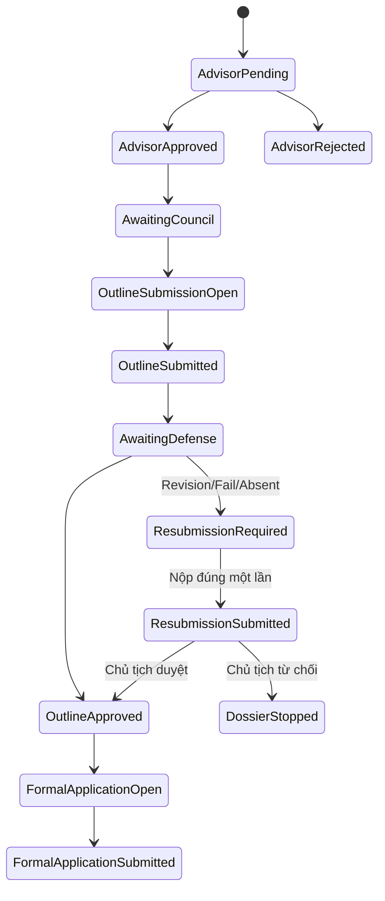
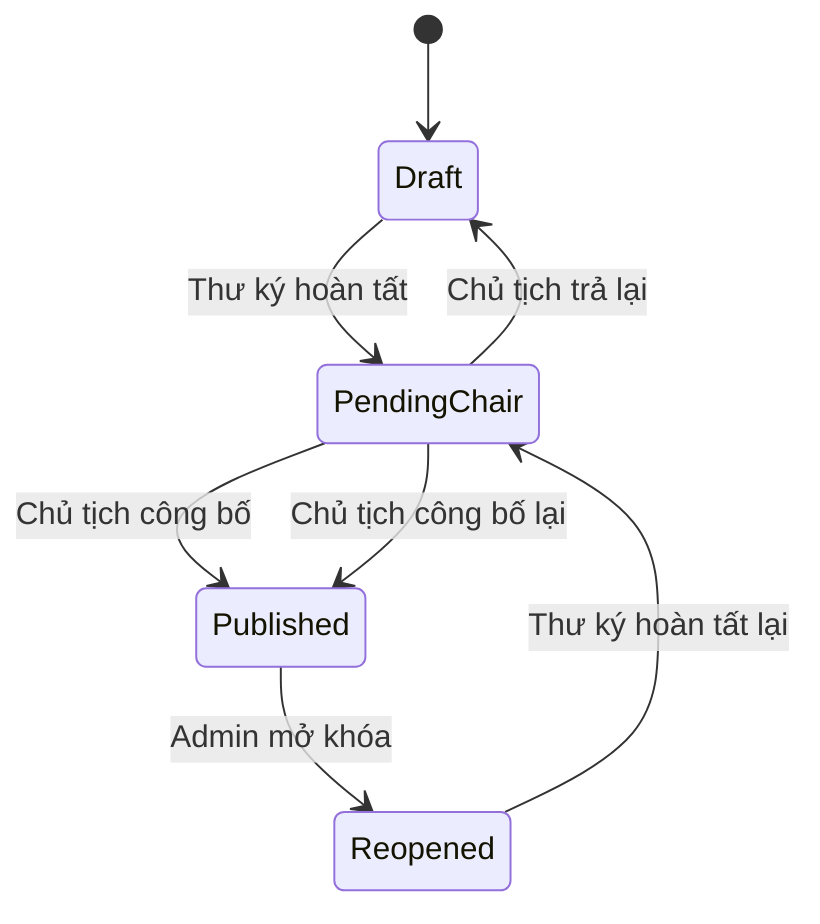

# Đặc tả kỹ thuật: Hồ sơ đồ án và xét duyệt đề cương

## 1. Mục đích

Tài liệu này đặc tả phân hệ quản lý hồ sơ đồ án từ thời điểm sinh viên đăng ký sơ bộ đề tài, được giảng viên hướng dẫn duyệt, nộp và bảo vệ đề cương, chỉnh sửa đề cương, cho đến khi đủ điều kiện nộp đơn đăng ký đề tài chính thức.

Thiết kế được xây dựng theo phương án kết hợp:

- **Hồ sơ đồ án** là nguồn dữ liệu xuyên suốt của từng sinh viên trong một đợt đồ án.
- **Hội đồng xét duyệt đề cương** quản lý thành viên, lịch bảo vệ chung, danh sách sinh viên và kết quả xét duyệt.
- **Nhiệm vụ hồ sơ** điều khiển việc sinh viên phải nộp tài liệu gì, trong thời gian nào.
- Tài liệu được quản lý theo phiên bản; không ghi đè hoặc xóa lịch sử đã dùng để xét duyệt.

## 2. Phạm vi

### 2.1. Trong phạm vi

- Đăng ký hoặc đề xuất đề tài sơ bộ.
- GVHD duyệt sơ bộ đề tài.
- Admin cấu hình thời gian nộp đề cương chung cho toàn bộ đợt đồ án.
- Admin thành lập hội đồng và phân sinh viên.
- Chủ tịch công bố một lịch bảo vệ chung cho hội đồng.
- Sinh viên nộp đề cương và các phiên bản chỉnh sửa.
- Sinh viên có kết quả `REVISION_REQUIRED`, `FAIL` hoặc `ABSENT` được nộp lại đúng một lần để chủ tịch xác nhận, không bảo vệ bổ sung.
- Thư ký nhập kết quả; chủ tịch kiểm tra và công bố.
- Kết quả có hiệu lực ngay sau khi chủ tịch công bố.
- Tự động mở nhiệm vụ nộp đơn đăng ký đề tài cho sinh viên đạt.
- Quản lý thông báo, lịch sử và ngoại lệ mở khóa.

### 2.2. Ngoài phạm vi của giai đoạn này

- Chấm điểm bảo vệ đồ án cuối kỳ.
- Thành lập hội đồng bảo vệ cuối kỳ.
- Quy trình phê duyệt cuối cùng của nhà trường.
- Tích hợp API tạo cuộc họp Microsoft Teams tự động. Phiên bản đầu chỉ lưu và hiển thị liên kết Teams do chủ tịch cung cấp.

## 3. Thuật ngữ

| Thuật ngữ | Ý nghĩa |
|---|---|
| Đợt đồ án | Khoảng thời gian tổ chức đồ án có cấu hình, sinh viên và quy trình riêng |
| Đăng ký sơ bộ | Sinh viên chọn hoặc đề xuất đề tài để GVHD duyệt trước khi xét đề cương |
| Hồ sơ đồ án | Hồ sơ xuyên suốt của một sinh viên trong một đợt đồ án |
| Đề cương | Tài liệu được nộp để hội đồng xét duyệt |
| Đơn đăng ký đề tài | Biểu mẫu chính thức chỉ được nộp sau khi đề cương đạt |
| Công bố kết quả | Hành động cuối cùng của chủ tịch; kết quả có hiệu lực ngay |
| Mở khóa kết quả | Ngoại lệ do admin thực hiện để cho phép sửa danh sách đã công bố |

## 4. Vai trò và quyền

| Chức năng | Admin | Chủ tịch | Thư ký | Thành viên | Sinh viên | GVHD |
|---|---:|---:|---:|---:|---:|---:|
| Cấu hình hạn nộp đề cương lần đầu của đợt | Có | Không | Không | Không | Không | Không |
| Tạo hội đồng và phân thành viên | Có | Không | Không | Không | Không | Không |
| Phân/chuyển sinh viên giữa hội đồng | Có | Không | Không | Không | Không | Không |
| Thiết lập lịch bảo vệ hội đồng | Không | Có | Không | Không | Không | Không |
| Công bố/thay đổi lịch bảo vệ | Không | Có | Không | Không | Không | Không |
| Xem đề cương thuộc hội đồng | Có | Có | Có | Có | Chủ hồ sơ | Sinh viên do mình hướng dẫn |
| Nhập kết quả dự thảo | Không | Có | Có | Không | Không | Không |
| Hoàn tất nhập và chuyển chủ tịch | Không | Có | Có | Không | Không | Không |
| Trả danh sách cho thư ký | Không | Có | Không | Không | Không | Không |
| Công bố kết quả | Không | Có | Không | Không | Không | Không |
| Đặt hạn nộp bản chỉnh sửa chung của hội đồng | Không | Có | Không | Không | Không | Không |
| Xác nhận bản đề cương chỉnh sửa | Không | Có | Không | Không | Không | Không |
| Mở khóa kết quả đã công bố | Có | Không | Không | Không | Không | Không |
| Nộp đề cương/đơn đăng ký | Không | Không | Không | Không | Chủ hồ sơ | Không |

Mọi quyền của chủ tịch, thư ký và thành viên phải được kiểm tra theo **tư cách thành viên của đúng hội đồng**, không chỉ dựa vào tên vai trò toàn hệ thống.

## 5. Mô hình dữ liệu đề xuất

Tên bảng/thực thể có thể điều chỉnh theo quy ước hiện tại của codebase; quan hệ và ràng buộc nghiệp vụ phải được giữ nguyên.

### 5.1. `ProjectRound` — Đợt đồ án

| Trường | Kiểu gợi ý | Bắt buộc | Mô tả |
|---|---|---:|---|
| `id` | UUID/ID | Có | Khóa chính |
| `code` | String | Có | Mã đợt, duy nhất |
| `name` | String | Có | Tên hiển thị |
| `registrationStartAt` | DateTime | Có | Mở đăng ký sơ bộ |
| `registrationEndAt` | DateTime | Có | Đóng đăng ký sơ bộ |
| `outlineSubmissionOpenAt` | DateTime | Có | Mở nhận đề cương lần đầu |
| `outlineSubmissionDeadline` | DateTime | Có | Hạn nộp đề cương chung toàn đợt |
| `outlineTemplateFileId` | ID, nullable | Không | File mẫu đề cương |
| `outlineAllowedExtensions` | String[] | Có | Định dạng được phép, ví dụ `.docx`, `.pdf` |
| `outlineMaxFileSizeBytes` | Integer | Có | Dung lượng file tối đa |
| `formalApplicationOpenAt` | DateTime, nullable | Không | Nếu rỗng, mở theo điều kiện đạt |
| `formalApplicationDeadline` | DateTime, nullable | Không | Hạn nộp đơn chính thức |
| `status` | Enum | Có | `DRAFT`, `REGISTRATION_OPEN`, `REGISTRATION_CLOSED`, `OUTLINE_PHASE`, `COMPLETED` |
| `createdBy`, `updatedBy` | ID | Có | Nhật ký quản trị |

Ràng buộc:

- `registrationStartAt < registrationEndAt`.
- `outlineSubmissionOpenAt < outlineSubmissionDeadline`.
- Không được đặt `outlineSubmissionDeadline` bằng hoặc sau lịch bảo vệ sớm nhất đã công bố của các hội đồng trong đợt.

### 5.2. `ProjectDossier` — Hồ sơ đồ án

Mỗi sinh viên có tối đa một hồ sơ hoạt động trong một đợt.

| Trường | Kiểu gợi ý | Mô tả |
|---|---|---|
| `id` | UUID/ID | Khóa chính |
| `projectRoundId` | ID | Đợt đồ án |
| `studentId` | ID | Sinh viên |
| `advisorId` | ID | GVHD |
| `topicId` | ID, nullable | Đề tài có sẵn, nếu có |
| `proposedTopicTitle` | String, nullable | Tên đề tài do sinh viên đề xuất |
| `approvedTopicTitle` | String, nullable | Tên đề tài được duyệt dùng cho hồ sơ chính thức |
| `registrationType` | Enum | `EXISTING_TOPIC`, `PROPOSED_TOPIC` |
| `advisorDecision` | Enum | `PENDING`, `APPROVED`, `REJECTED` |
| `workflowStage` | Enum | Trạng thái tổng hợp để hiển thị/điều hướng |
| `activeCouncilAssignmentId` | ID, nullable | Phân công hội đồng đang có hiệu lực |
| `version` | Integer | Optimistic locking nếu hệ thống hỗ trợ |

Ràng buộc duy nhất: `(projectRoundId, studentId)`.

`workflowStage` chỉ là trạng thái tổng hợp. Quyền nộp hoặc công bố phải dựa trên trạng thái thực của nhiệm vụ, tài liệu và hội đồng, tránh dùng một enum duy nhất làm nguồn sự thật cho mọi thao tác.

### 5.3. `OutlineCouncil` — Hội đồng xét duyệt đề cương

| Trường | Kiểu gợi ý | Mô tả |
|---|---|---|
| `id` | UUID/ID | Khóa chính |
| `projectRoundId` | ID | Đợt đồ án |
| `code`, `name` | String | Mã và tên hội đồng |
| `status` | Enum | `DRAFT`, `READY`, `SCHEDULE_PUBLISHED`, `RESULT_ENTRY`, `PENDING_CHAIR`, `RESULTS_PUBLISHED`, `REOPENED` |
| `defenseStartAt` | DateTime, nullable | Thời điểm bảo vệ chung |
| `meetingMode` | Enum, nullable | `IN_PERSON`, `MICROSOFT_TEAMS` |
| `location` | String, nullable | Bắt buộc khi trực tiếp |
| `meetingUrl` | String, nullable | Bắt buộc khi Teams |
| `schedulePublishedAt` | DateTime, nullable | Thời điểm công bố lịch |
| `revisionSubmissionDeadline` | DateTime, nullable | Hạn nộp bản chỉnh sửa chung của hội đồng |
| `resultPublishedAt` | DateTime, nullable | Thời điểm công bố kết quả |
| `resultPublishedBy` | ID, nullable | Chủ tịch công bố |
| `rowVersion` | Integer | Chống cập nhật đồng thời |

Ràng buộc:

- `defenseStartAt > ProjectRound.outlineSubmissionDeadline`.
- `IN_PERSON` yêu cầu `location`; `MICROSOFT_TEAMS` yêu cầu URL HTTPS hợp lệ.
- Chỉ có thể công bố lịch khi hội đồng có đủ chủ tịch, thư ký, thành viên tối thiểu và ít nhất một sinh viên.

### 5.4. `OutlineCouncilMember`

| Trường | Kiểu gợi ý | Mô tả |
|---|---|---|
| `councilId` | ID | Hội đồng |
| `lecturerId` | ID | Giảng viên |
| `role` | Enum | `CHAIR`, `SECRETARY`, `MEMBER` |
| `isActive` | Boolean | Còn hiệu lực |
| `assignedAt`, `assignedBy` | Audit | Lịch sử phân công |

Ràng buộc:

- Một hội đồng có đúng một chủ tịch và một thư ký đang hoạt động.
- Một giảng viên không giữ đồng thời nhiều vai trò trong cùng hội đồng.

### 5.5. `OutlineCouncilAssignment`

| Trường | Kiểu gợi ý | Mô tả |
|---|---|---|
| `id` | ID | Khóa chính |
| `councilId` | ID | Hội đồng |
| `dossierId` | ID | Hồ sơ sinh viên |
| `status` | Enum | `ACTIVE`, `TRANSFERRED`, `REMOVED` |
| `assignedAt`, `assignedBy` | Audit | Người và thời điểm phân |
| `endedAt`, `endedBy`, `reason` | Nullable | Lịch sử chuyển/rút |

Mỗi hồ sơ chỉ có một phân công `ACTIVE` trong cùng giai đoạn xét đề cương. Chuyển hội đồng không làm thay đổi hoặc xóa tài liệu đã nộp.

### 5.6. `DossierTask` — Nhiệm vụ hồ sơ

| Trường | Kiểu gợi ý | Mô tả |
|---|---|---|
| `id` | ID | Khóa chính |
| `dossierId` | ID | Hồ sơ |
| `type` | Enum | `SUBMIT_OUTLINE`, `RESUBMIT_OUTLINE`, `SUBMIT_FORMAL_APPLICATION`, `SUBMIT_ADVISOR_REVIEW` |
| `sourceType` | Enum | `PROJECT_ROUND`, `OUTLINE_COUNCIL`, `SYSTEM` |
| `sourceId` | ID | Đợt/hội đồng sinh nhiệm vụ |
| `openAt`, `deadlineAt` | DateTime | Cửa sổ thực hiện |
| `status` | Enum | `PENDING`, `OPEN`, `SUBMITTED`, `OVERDUE`, `CANCELLED`, `COMPLETED` |
| `activeSubmissionId` | ID, nullable | Phiên bản hiện dùng |
| `maxSubmissions` | Integer, nullable | Giới hạn số lần nộp; `RESUBMIT_OUTLINE = 1` |
| `submissionCount` | Integer | Số lần đã nộp thành công |
| `metadata` | JSON, nullable | Yêu cầu hoặc thông tin bổ sung |

Chỉ tạo một nhiệm vụ đang hoạt động cho cùng `(dossierId, type, sourceId)`. API tạo nhiệm vụ phải idempotent. Nhiệm vụ nộp lại sau xét duyệt chỉ nhận đúng một file thành công; không có trạng thái file nháp.

### 5.7. `DossierDocument` và `DossierDocumentVersion`

`DossierDocument` đại diện loại tài liệu; `DossierDocumentVersion` lưu từng lần nộp.

Các loại tài liệu ban đầu:

- `OUTLINE`
- `FORMAL_TOPIC_APPLICATION`
- `ADVISOR_REVIEW`
- `COUNCIL_MINUTES_ATTACHMENT`

Phiên bản tài liệu gồm:

| Trường | Kiểu gợi ý | Mô tả |
|---|---|---|
| `id` | ID | Khóa chính phiên bản |
| `documentId` | ID | Tài liệu cha |
| `taskId` | ID | Nhiệm vụ dẫn tới lần nộp |
| `versionNumber` | Integer | Tăng tuần tự |
| `fileId` | ID | File đã lưu |
| `fileName`, `mimeType`, `sizeBytes`, `checksum` | Metadata | Kiểm soát file |
| `submittedBy`, `submittedAt` | Audit | Người nộp |
| `status` | Enum | `UPLOADED`, `ACTIVE`, `LOCKED_FOR_REVIEW`, `SUPERSEDED`, `WITHDRAWN` |
| `lockedAt`, `lockedReason` | Nullable | Khóa bản dùng để xét |

Không ghi đè file cũ. Khi sinh viên nộp phiên bản mới trước hạn, phiên bản cũ chuyển `SUPERSEDED`; phiên bản cuối được khóa thành `LOCKED_FOR_REVIEW` khi hết hạn hoặc khi quy trình chốt tài liệu.

### 5.8. `OutlineReviewResult`

| Trường | Kiểu gợi ý | Mô tả |
|---|---|---|
| `id` | ID | Khóa chính |
| `councilAssignmentId` | ID | Sinh viên trong hội đồng |
| `reviewedDocumentVersionId` | ID | Đúng phiên bản đã được xét |
| `attendanceStatus` | Enum | `PRESENT`, `ABSENT`, `EXCUSED` |
| `outcome` | Enum | `PASS`, `REVISION_REQUIRED`, `FAIL`, `ABSENT` |
| `comment` | Text | Nhận xét chung |
| `revisionRequirements` | Text, nullable | Bắt buộc nếu cần chỉnh sửa |
| `entryStatus` | Enum | `DRAFT`, `SECRETARY_COMPLETED`, `PENDING_CHAIR`, `PUBLISHED`, `REOPENED` |
| `enteredBy`, `enteredAt` | Audit | Thư ký/chủ tịch nhập |
| `publishedBy`, `publishedAt` | Nullable | Chủ tịch công bố |
| `revisionApprovalStatus` | Enum | `NOT_REQUIRED`, `PENDING`, `APPROVED`, `REJECTED` |
| `revisionApprovedBy`, `revisionApprovedAt` | Nullable | Xác nhận bản sửa |

### 5.9. `CouncilResultBatch`

Quản lý thao tác theo toàn bộ danh sách hội đồng, không chỉ từng dòng sinh viên.

| Trường | Kiểu gợi ý | Mô tả |
|---|---|---|
| `id` | ID | Khóa chính |
| `councilId` | ID | Hội đồng |
| `versionNumber` | Integer | Lần công bố; tăng khi mở khóa và công bố lại |
| `status` | Enum | `DRAFT`, `PENDING_CHAIR`, `PUBLISHED`, `REOPENED`, `SUPERSEDED` |
| `secretaryCompletedBy/At` | Audit | Hoàn tất nhập |
| `chairPublishedBy/At` | Audit | Công bố |
| `returnedBy/At`, `returnReason` | Nullable | Trả lại thư ký |
| `reopenedBy/At`, `reopenReason` | Nullable | Admin mở khóa |

### 5.10. `AuditLog` và `Notification`

Các hành động bắt buộc ghi audit:

- Thay đổi hạn nộp chung của đợt.
- Công bố/thay đổi lịch hội đồng.
- Phân hoặc chuyển sinh viên.
- Thư ký hoàn tất danh sách.
- Chủ tịch trả lại hoặc công bố kết quả.
- Admin mở khóa kết quả.
- Công bố lại kết quả.
- Mở nộp muộn hoặc thay đổi hạn chỉnh sửa.

Audit tối thiểu gồm: `actorId`, `action`, `entityType`, `entityId`, `before`, `after`, `reason`, `createdAt`, `requestId`.

## 6. State machine

### 6.1. Hồ sơ đồ án

### 6.2. Danh sách kết quả hội đồng

## 7. Quy trình nghiệp vụ và giao dịch

### 7.1. Đóng đăng ký sơ bộ

Khi admin đóng đăng ký:

1. Khóa đăng ký mới.
2. Chỉ hồ sơ `advisorDecision = APPROVED` được đánh dấu đủ điều kiện phân hội đồng.
3. Không tự tạo nhiệm vụ nộp đề cương cho hồ sơ bị từ chối hoặc đang chờ GVHD.

### 7.2. Admin cấu hình hạn nộp đề cương

Hạn nộp lần đầu áp dụng chung toàn bộ đợt.

Khi cập nhật:

1. Kiểm tra thời gian mở nhỏ hơn hạn nộp.
2. Tìm lịch bảo vệ đã công bố sớm nhất trong đợt.
3. Chặn nếu hạn mới bằng hoặc sau lịch đó.
4. Cập nhật đồng bộ các nhiệm vụ `SUBMIT_OUTLINE` chưa hoàn tất.
5. Gửi thông báo khi thay đổi ảnh hưởng người dùng.

### 7.3. Phân hội đồng

Admin chỉ phân hồ sơ đủ điều kiện. Chuyển sinh viên phải đóng phân công cũ và tạo phân công mới trong cùng giao dịch; không thay đổi tài liệu hoặc lịch sử kết quả cũ.

### 7.4. Chủ tịch công bố lịch

Yêu cầu:

- Chủ tịch đúng của hội đồng.
- Hội đồng đủ thành viên và sinh viên.
- Ngày bảo vệ sau hạn nộp chung của đợt.
- Đủ địa điểm hoặc link tương ứng hình thức.

Sau khi công bố, hệ thống gửi thông báo cho sinh viên, GVHD và thành viên hội đồng. Thay đổi lịch đã công bố bắt buộc có lý do.

### 7.5. Sinh viên nộp đề cương

Cho phép khi:

- Hồ sơ thuộc đợt đang mở nộp.
- GVHD đã duyệt sơ bộ.
- Sinh viên đã được phân hội đồng hoạt động.
- Nhiệm vụ đang `OPEN` và chưa quá hạn, hoặc có ngoại lệ nộp muộn hợp lệ.
- File đạt yêu cầu loại, kích thước và kiểm tra an toàn.

Lần nộp phải tạo phiên bản mới và cập nhật `activeSubmissionId` trong cùng giao dịch.

Không có file nháp: khi người dùng nhấn **Nộp** và upload hoàn tất hợp lệ, hệ thống ghi nhận ngay một bản nộp chính thức. File không hợp lệ hoặc upload thất bại không làm tăng số lần nộp.

### 7.6. Thư ký nhập và hoàn tất kết quả

Thư ký được lưu nháp nhiều lần. Khi chọn hoàn tất:

1. Kiểm tra tất cả sinh viên hoạt động của hội đồng đều có kết quả.
2. `REVISION_REQUIRED` bắt buộc có yêu cầu chỉnh sửa.
3. Kết quả phải tham chiếu đúng phiên bản đề cương đã khóa.
4. Chuyển toàn bộ batch sang `PENDING_CHAIR`.
5. Khóa quyền sửa của thư ký cho tới khi chủ tịch trả lại.

### 7.7. Chủ tịch công bố kết quả

Đây là giao dịch quan trọng, phải idempotent và nguyên tử:

1. Khóa hội đồng/batch bằng transaction hoặc optimistic locking.
2. Xác minh người thao tác là chủ tịch đang hoạt động.
3. Xác minh batch đang `PENDING_CHAIR` và đủ kết quả.
4. Chuyển từng kết quả sang `PUBLISHED`.
5. Chuyển batch và hội đồng sang `RESULTS_PUBLISHED`.
6. Với `PASS`: tạo nhiệm vụ `SUBMIT_FORMAL_APPLICATION` nếu chưa tồn tại.
7. Với `REVISION_REQUIRED`, `FAIL` hoặc `ABSENT`: chưa mở đơn chính thức; tạo một nhiệm vụ `RESUBMIT_OUTLINE` ở trạng thái `PENDING`, sau đó kích hoạt khi chủ tịch đặt hạn nộp lại.
8. Nhiệm vụ nộp lại có `maxSubmissions = 1`; kết quả ban đầu vẫn được giữ để thống kê và audit.
9. Ghi audit và outbox notification trong cùng transaction.
10. Trả về kết quả công bố; gọi lại cùng idempotency key không tạo nhiệm vụ trùng.

Kết quả có hiệu lực ngay, không qua bước admin phê duyệt.

### 7.8. Chủ tịch đặt hạn nộp lại

- Một hạn chung cho các sinh viên có kết quả `REVISION_REQUIRED`, `FAIL` hoặc `ABSENT` thuộc hội đồng.
- Hạn phải ở tương lai và sau thời điểm công bố kết quả.
- Hệ thống tạo/kích hoạt nhiệm vụ `RESUBMIT_OUTLINE` cho đúng sinh viên, mỗi nhiệm vụ chỉ được nộp thành công một lần.
- Đổi hạn đã công bố yêu cầu lý do và gửi thông báo.

### 7.9. Chủ tịch xác nhận file nộp lại

Chủ tịch xem file nộp lại và chọn:

- `APPROVED`: hồ sơ chuyển `OUTLINE_APPROVED`, tạo nhiệm vụ nộp đơn chính thức.
- `REJECTED`: hồ sơ chuyển `DOSSIER_STOPPED`, không được nộp lại lần hai và không được nộp đơn đăng ký đề tài trong đợt.

Không tổ chức buổi bảo vệ bổ sung. Nút nộp bị vô hiệu hóa ngay sau lần upload hợp lệ đầu tiên; file đã nộp không thể thay thế hoặc xóa. Backend phải kiểm tra nguyên tử `submissionCount < maxSubmissions` để chống gửi đồng thời hoặc gửi lặp.

### 7.10. Mở khóa kết quả

- Chỉ admin thực hiện.
- Bắt buộc có lý do.
- Không xóa batch cũ; chuyển batch cũ thành phiên bản bị thay thế và tạo/đưa batch mới về `REOPENED`.
- Thư ký chỉnh sửa, hoàn tất lại; chủ tịch công bố lại.
- Nếu kết quả thay đổi làm mất điều kiện của nhiệm vụ đã tự sinh, không xóa dữ liệu đã nộp. Hệ thống chuyển nhiệm vụ sang trạng thái phù hợp và cảnh báo admin xử lý nếu sinh viên đã nộp đơn chính thức.

## 8. API REST đề xuất

Tiền tố minh họa: `/api`. Áp dụng xác thực, phân quyền theo resource, validation schema, audit và idempotency cho các endpoint chuyển trạng thái.

### 8.1. Đợt đồ án

| Method | Endpoint | Quyền | Mục đích |
|---|---|---|---|
| `GET` | `/project-rounds/:roundId/outline-config` | Người liên quan | Xem cấu hình nộp đề cương |
| `PUT` | `/project-rounds/:roundId/outline-config` | Admin | Đặt thời gian mở, hạn nộp, mẫu biểu |
| `POST` | `/project-rounds/:roundId/close-topic-registration` | Admin | Đóng đăng ký sơ bộ |

### 8.2. Hội đồng

| Method | Endpoint | Quyền | Mục đích |
|---|---|---|---|
| `POST` | `/project-rounds/:roundId/outline-councils` | Admin | Tạo hội đồng |
| `GET` | `/project-rounds/:roundId/outline-councils` | Admin/người liên quan | Danh sách hội đồng theo phạm vi |
| `GET` | `/outline-councils/:councilId` | Thành viên/admin | Chi tiết hội đồng |
| `PUT` | `/outline-councils/:councilId/members` | Admin | Cấu hình thành viên |
| `PUT` | `/outline-councils/:councilId/assignments` | Admin | Phân danh sách sinh viên |
| `POST` | `/outline-councils/:councilId/assignments/:assignmentId/transfer` | Admin | Chuyển hội đồng |
| `PUT` | `/outline-councils/:councilId/schedule` | Chủ tịch | Lưu lịch nháp |
| `POST` | `/outline-councils/:councilId/schedule/publish` | Chủ tịch | Công bố lịch |
| `POST` | `/outline-councils/:councilId/schedule/reschedule` | Chủ tịch | Đổi lịch kèm lý do |
| `PUT` | `/outline-councils/:councilId/revision-deadline` | Chủ tịch | Đặt hạn sửa chung |

### 8.3. Hồ sơ và tài liệu

| Method | Endpoint | Quyền | Mục đích |
|---|---|---|---|
| `GET` | `/project-dossiers/me` | Sinh viên | Hồ sơ của tôi theo đợt |
| `GET` | `/project-dossiers/:dossierId` | Theo phạm vi | Chi tiết hồ sơ |
| `GET` | `/project-dossiers/:dossierId/tasks` | Theo phạm vi | Nhiệm vụ hồ sơ |
| `POST` | `/dossier-tasks/:taskId/submissions` | Sinh viên sở hữu | Nộp phiên bản tài liệu |
| `GET` | `/dossier-documents/:documentId/versions` | Theo phạm vi | Lịch sử phiên bản |
| `GET` | `/dossier-document-versions/:versionId/download` | Theo phạm vi | Tải file có kiểm soát |

### 8.4. Kết quả hội đồng

| Method | Endpoint | Quyền | Mục đích |
|---|---|---|---|
| `GET` | `/outline-councils/:councilId/results` | Thành viên/admin | Danh sách kết quả |
| `PUT` | `/outline-councils/:councilId/results/:assignmentId` | Thư ký/chủ tịch khi draft | Lưu kết quả dự thảo |
| `POST` | `/outline-councils/:councilId/results/secretary-complete` | Thư ký/chủ tịch | Chuyển chủ tịch kiểm tra |
| `POST` | `/outline-councils/:councilId/results/return` | Chủ tịch | Trả lại thư ký, bắt buộc lý do |
| `POST` | `/outline-councils/:councilId/results/publish` | Chủ tịch | Công bố, có hiệu lực ngay |
| `POST` | `/outline-councils/:councilId/results/reopen` | Admin | Mở khóa, bắt buộc lý do |
| `POST` | `/outline-councils/:councilId/resubmissions/:assignmentId/approve` | Chủ tịch | Duyệt file nộp lại |
| `POST` | `/outline-councils/:councilId/resubmissions/:assignmentId/reject` | Chủ tịch | Từ chối file nộp lại và dừng hồ sơ |

Các endpoint `publish`, `reopen`, `secretary-complete`, `approve` nên nhận `Idempotency-Key` và `expectedVersion`.

## 9. Mã lỗi nghiệp vụ gợi ý

| Mã | Trường hợp |
|---|---|
| `OUTLINE_WINDOW_CLOSED` | Ngoài cửa sổ nộp đề cương |
| `DOSSIER_NOT_ELIGIBLE` | Hồ sơ chưa được GVHD duyệt hoặc chưa đủ điều kiện |
| `NO_ACTIVE_COUNCIL_ASSIGNMENT` | Sinh viên chưa thuộc hội đồng hoạt động |
| `DEFENSE_BEFORE_OUTLINE_DEADLINE` | Lịch bảo vệ không sau hạn nộp chung |
| `COUNCIL_MEMBERS_INCOMPLETE` | Thiếu chủ tịch, thư ký hoặc thành viên bắt buộc |
| `RESULT_LIST_INCOMPLETE` | Chưa nhập đủ kết quả |
| `REVISION_REQUIREMENT_REQUIRED` | Thiếu nội dung yêu cầu chỉnh sửa |
| `RESULT_BATCH_NOT_PENDING_CHAIR` | Batch không ở trạng thái có thể công bố |
| `RESULT_ALREADY_PUBLISHED` | Kết quả đã được công bố |
| `RESULT_REOPEN_REQUIRED` | Muốn sửa kết quả đã công bố nhưng chưa mở khóa |
| `REVISION_DEADLINE_NOT_SET` | Chưa có hạn nộp lại của hội đồng |
| `RESUBMISSION_ALREADY_USED` | Sinh viên đã sử dụng lần nộp lại duy nhất |
| `UNSUPPORTED_DOCUMENT_FORMAT` | Định dạng file không được cấu hình cho phép |
| `DOCUMENT_TOO_LARGE` | File vượt dung lượng tối đa |
| `STALE_VERSION` | Dữ liệu đã bị người khác thay đổi |

## 10. Giao diện

### 10.1. Sinh viên — Dashboard

- Thẻ “Việc cần làm” sắp theo hạn gần nhất.
- Lịch bảo vệ, hình thức, địa điểm hoặc nút mở Teams.
- Trạng thái nộp đề cương và phiên bản đang được xét.
- Kết quả sau khi công bố.
- Kết quả ban đầu, yêu cầu nộp lại, hạn nộp và trạng thái của lần nộp duy nhất.

### 10.2. Sinh viên — Hồ sơ đồ án

Các tab:

1. Tổng quan.
2. Tiến trình.
3. Đề cương và lịch sử phiên bản.
4. Đơn đăng ký đề tài.
5. Phiếu/biểu mẫu khác.
6. Lịch sử xử lý.

### 10.3. Admin — Cấu hình đợt

- Thời gian đăng ký sơ bộ.
- Thời gian mở và hạn nộp đề cương chung.
- File mẫu.
- Cảnh báo lịch hội đồng xung đột trước khi lưu.
- Thống kê đã nộp/chưa nộp/quá hạn.

### 10.4. Admin — Điều phối hội đồng

- Tạo hội đồng và phân vai trò.
- Phân sinh viên; bộ lọc sinh viên chưa được phân.
- Chuyển hội đồng có lý do.
- Theo dõi hội đồng chưa công bố lịch/chưa hoàn tất kết quả.
- Mở khóa kết quả đã công bố.

### 10.5. Chủ tịch/Thư ký — Chi tiết hội đồng

Các tab:

1. Tổng quan và lịch bảo vệ.
2. Thành viên.
3. Danh sách sinh viên và đề cương.
4. Nhập kết quả.
5. Xác nhận file nộp lại.
6. Biên bản và lịch sử.

Nút thao tác theo trạng thái:

- Thư ký: `Lưu nháp`, `Hoàn tất nhập kết quả`.
- Chủ tịch: `Trả lại thư ký`, `Xác nhận và công bố kết quả`, `Đặt hạn nộp bản chỉnh sửa`.
- Admin: `Mở khóa kết quả` ở màn hình quản trị, không xuất hiện cho hội đồng.

## 11. Thông báo

| Sự kiện | Người nhận |
|---|---|
| Mở nộp đề cương | Sinh viên đủ điều kiện |
| Thay đổi hạn nộp chung | Sinh viên, GVHD, hội đồng liên quan |
| Công bố/thay đổi lịch bảo vệ | Sinh viên, GVHD, thành viên hội đồng |
| Thư ký hoàn tất danh sách | Chủ tịch |
| Chủ tịch trả danh sách | Thư ký |
| Công bố kết quả | Sinh viên, GVHD |
| Đặt/thay đổi hạn nộp lại | Sinh viên có kết quả `REVISION_REQUIRED`, `FAIL` hoặc `ABSENT`, GVHD |
| Sinh viên nộp lại | Chủ tịch |
| Chủ tịch duyệt/từ chối bản nộp lại | Sinh viên, GVHD |
| Admin mở khóa kết quả | Chủ tịch, thư ký và người liên quan |

Thông báo nên dùng outbox/event queue để tránh trường hợp transaction nghiệp vụ thành công nhưng thông báo bị mất.

## 12. Yêu cầu bảo mật và toàn vẹn

- Kiểm tra quyền theo resource ở backend; không tin dữ liệu vai trò từ frontend.
- Sinh viên chỉ truy cập hồ sơ của mình.
- Giảng viên chỉ xem hồ sơ theo quan hệ GVHD hoặc thành viên hội đồng.
- URL tải file phải được kiểm tra quyền hoặc ký trong thời gian ngắn.
- Kiểm tra MIME, phần mở rộng, dung lượng và mã độc theo khả năng hệ thống.
- Chống IDOR trên mọi endpoint dùng `dossierId`, `councilId`, `assignmentId`, `versionId`.
- Không cho sửa trực tiếp bản ghi kết quả đã công bố.
- Dùng transaction cho công bố kết quả, chuyển hội đồng, tạo phiên bản tài liệu và mở khóa.
- Dùng optimistic locking hoặc row lock cho batch kết quả.
- Ghi audit bất biến cho các thao tác nhạy cảm.

## 13. Tiêu chí nghiệm thu chính

1. Admin đặt một hạn nộp đề cương chung và mọi nhiệm vụ trong đợt nhận đúng thời hạn.
2. Hệ thống chặn chủ tịch đặt lịch bảo vệ trước hoặc bằng hạn nộp đề cương.
3. Ở lần nộp đề cương ban đầu, mỗi lần nhấn nộp tạo một phiên bản chính thức; hội đồng chỉ xét đúng phiên bản cuối đã khóa.
4. Thư ký không thể hoàn tất danh sách nếu thiếu kết quả hoặc thiếu yêu cầu chỉnh sửa.
5. Sau khi thư ký hoàn tất, thư ký không thể sửa trừ khi chủ tịch trả lại.
6. Chỉ đúng chủ tịch hội đồng mới có thể công bố kết quả.
7. Công bố kết quả tạo đúng nhiệm vụ tiếp theo và không tạo trùng khi request được gửi lại.
8. Sinh viên đạt được mở nộp đơn đăng ký đề tài ngay.
9. Sinh viên có kết quả `REVISION_REQUIRED`, `FAIL` hoặc `ABSENT` chỉ nhận nhiệm vụ hoạt động sau khi chủ tịch đặt hạn chung cho hội đồng.
10. Mỗi nhiệm vụ nộp lại chỉ chấp nhận đúng một file hợp lệ; không có file nháp, không được thay thế hoặc nộp lần hai.
11. Chủ tịch duyệt hoặc từ chối file nộp lại mà không tổ chức buổi bảo vệ bổ sung.
12. Nếu chủ tịch từ chối file nộp lại, hồ sơ dừng trong đợt và không được mở nộp đơn đăng ký đề tài.
13. Admin mở khóa không xóa lịch sử; kết quả sửa phải được chủ tịch công bố lại.
14. Chuyển sinh viên sang hội đồng khác không làm mất tài liệu đã nộp.
15. Người dùng ngoài phạm vi không thể xem hoặc tải tài liệu bằng cách thay ID.

## 14. Thứ tự triển khai khuyến nghị

1. Migration và mô hình dữ liệu cốt lõi.
2. Permission guards theo resource và audit log.
3. Cấu hình đợt, hội đồng và phân sinh viên.
4. Nhiệm vụ hồ sơ, upload và quản lý phiên bản tài liệu.
5. Lịch bảo vệ và thông báo.
6. Nhập, kiểm tra, công bố và mở khóa kết quả.
7. Luồng chỉnh sửa đề cương và mở đơn đăng ký chính thức.
8. Giao diện sinh viên, admin, thư ký và chủ tịch.
9. Kiểm thử tích hợp, kiểm thử phân quyền và kiểm thử cạnh tranh dữ liệu.

## 15. Quyết định nghiệp vụ đã chốt

- Mỗi hội đồng tổ chức một buổi bảo vệ chung cho toàn bộ sinh viên.
- Admin đặt hạn nộp đề cương lần đầu chung cho toàn bộ đợt đồ án.
- Chủ tịch đặt lịch và hình thức bảo vệ của hội đồng.
- Có hai hình thức: trực tiếp hoặc Microsoft Teams.
- Thư ký nhập kết quả; chủ tịch kiểm tra và công bố danh sách.
- Kết quả có hiệu lực ngay sau khi chủ tịch công bố, không chờ admin duyệt.
- Sinh viên có kết quả `REVISION_REQUIRED`, `FAIL` hoặc `ABSENT` đều được nộp lại đúng một lần để chủ tịch xác nhận, không bảo vệ lại.
- Không có file nháp. Riêng nhiệm vụ nộp lại sau xét duyệt, file đầu tiên được upload hợp lệ là bản nộp chính thức, bị khóa và không thể thay thế.
- File nộp hỗ trợ các định dạng được cấu hình như `.docx`, `.pdf`; backend kiểm tra phần mở rộng, MIME type và dung lượng.
- Chủ tịch đặt một hạn nộp lại chung cho hội đồng của mình.
- Chủ tịch duyệt thì mở nộp đơn đăng ký đề tài; từ chối thì hồ sơ dừng trong đợt.
- Admin chỉ tham gia sau công bố khi cần mở khóa kết quả theo ngoại lệ có lý do.
