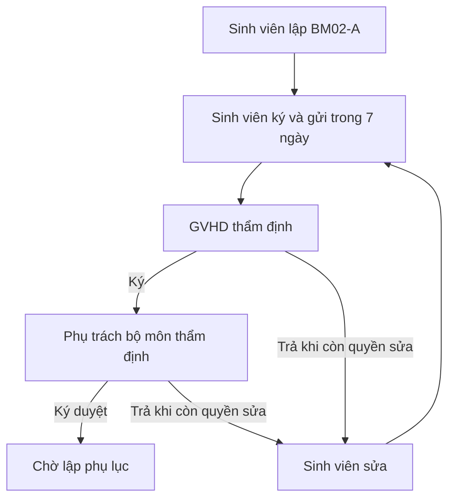

# Đặc tả thiết kế quy trình BM02–BM04

**Phạm vi:** Từ khi sinh viên đạt BM01 đến khi hoàn tất BM04 và xác định điều kiện bảo vệ  
**Trạng thái:** Đã chốt nghiệp vụ cấp thiết kế  
**Ngày cập nhật:** 11/11/2026

---

## 1. Mục tiêu

Đặc tả này thiết kế chuỗi nghiệp vụ liên tục gồm:

1. Sinh viên nộp đơn đăng ký đề tài chính thức BM02.
2. Viện thẩm định BM02 và ban hành quyết định giao đề tài.
3. Sinh viên đề nghị điều chỉnh tên đề tài bằng BM02-A trong cửa sổ 7 ngày.
4. Viện ban hành các phụ lục điều chỉnh tên theo từng đợt.
5. GVHD ghi nhận quá trình hướng dẫn và đánh giá giữa/cuối giai đoạn trong BM03.
6. GVHD lập phiếu nhận xét BM04 và xác định điều kiện bảo vệ.

Thiết kế phải bảo đảm:

- Mọi văn bản và nội dung đã ký đều bất biến.
- Mọi sửa đổi tạo phiên bản hoặc văn bản điều chỉnh mới.
- Không giả chữ ký người dùng khi hệ thống tự động xử lý quá hạn.
- Quyền được kiểm tra theo tài nguyên và permission, không chỉ theo tên nhóm.
- Các thao tác chuyển trạng thái quan trọng phải nguyên tử, idempotent và có audit.

---

## 2. Vai trò và quyền

| Vai trò | Trách nhiệm chính |
|---|---|
| Sinh viên | Nộp BM02; lập, ký và gửi BM02-A; xác nhận đã biết nội dung BM03 |
| GVHD | Ký/xác nhận BM02-A; ghi và ký từng buổi hướng dẫn; đánh giá giữa/cuối giai đoạn; ký BM03; lập và ký BM04 |
| Phụ trách bộ môn | Thẩm định và ký cuối BM02-A |
| Admin/Viện | Thẩm định BM02; ban hành quyết định; lập phụ lục; thẩm định đề nghị dừng BM03 và đề nghị không cho bảo vệ BM04 |
| Hệ thống | Tính thời hạn; gửi thông báo; xử lý tự động khi quá hạn; sinh và khóa PDF |

Các permission tối thiểu:

```text
BM02_REVIEW
TOPIC_ASSIGNMENT_DECISION_ISSUE
BM02A_ADVISOR_SIGN
BM02A_FINAL_APPROVE
TITLE_ADJUSTMENT_APPENDIX_ISSUE
BM03_MEETING_RECORD
BM03_STAGE_EVALUATE
BM03_STOP_REVIEW
BM04_CREATE_AND_SIGN
BM04_REJECTION_REVIEW
```

---

## 3. Nguyên tắc dùng tên đề tài

### 3.1. Nguồn tên có thẩm quyền

Tên đề tài tại một thời điểm được xác định theo thứ tự:

1. Tên trong mục phụ lục điều chỉnh đã `ISSUED` có `signedDate` gần nhất và không sau thời điểm cần tra cứu.
2. Nếu không có phụ lục phù hợp, dùng tên trong quyết định giao đề tài gốc.
3. Không dùng tên đang chờ duyệt hoặc tên đề xuất ban đầu làm tên chính thức.

Hàm dùng chung đề xuất:

```text
resolveEffectiveTopicTitle(topicRegistrationId, atTime)
```

### 3.2. Snapshot

BM02, BM02-A, BM03, BM04, quyết định và phụ lục phải lưu snapshot tên đề tài khi được tạo/ký. Việc tên có hiệu lực thay đổi về sau không được sửa ngược các PDF hoặc bản ghi đã hoàn tất.

---

## 4. Chặng 1A — BM02 và quyết định giao đề tài

### 4.1. Điều kiện mở BM02

Khi hồ sơ chuyển `BM01_PASSED`, hệ thống tự động tạo/mở task BM02.

Quy tắc policy:

- `Semester.periodPolicyVersionId` phải được khóa khi đợt được kích hoạt.
- Nếu hồ sơ thiếu `periodPolicyVersionId`, chỉ được kế thừa phiên bản đã khóa của đúng học kỳ.
- Không tự lấy policy mới nhất tại thời điểm nộp BM02.

### 4.2. Nội dung BM02

Sinh viên khai:

- Thông tin sinh viên và GVHD.
- Tên đề tài chính thức đề nghị.
- Lý do thay đổi tên so với tên đã được BM01 thông qua, nếu có.
- File BM02 scan/PDF có chữ ký GVHD.

Cho phép sinh viên cập nhật tên trong BM02 theo góp ý của Hội đồng BM01, nhưng:

- Chỉ thay đổi cách diễn đạt tên đề tài.
- Không được âm thầm thay đổi mục tiêu, phạm vi, chuyên ngành hoặc GVHD.
- Lưu riêng `bm01ApprovedTitle` và `bm02ProposedTitle`.
- Chỉ khi BM02 được duyệt mới hình thành tên dùng để ban hành quyết định.

### 4.3. Trạng thái BM02

```text
BM02_OPEN
BM02_SUBMITTED
BM02_REVISION_REQUIRED
BM02_RESUBMITTED
BM02_APPROVED
BM02_REJECTED
```

Viện được yêu cầu sửa BM02 tối đa một lần. Lần nộp ban đầu và lần nộp lại phải là hai task/submission độc lập hoặc hai attempt có ràng buộc rõ ràng; không cập nhật đè file cũ.

Task BM02 được đồng bộ trong cùng transaction:

- Sinh viên nộp → `SUBMITTED`.
- Viện yêu cầu sửa → `REVISION_REQUIRED`.
- Sinh viên nộp lại → `RESUBMITTED`.
- Viện duyệt → `COMPLETED`.

### 4.4. Ban hành quyết định giao đề tài

Các BM02 đã duyệt được gom vào một đợt ban hành quyết định.

Quyết định gồm:

- Số quyết định duy nhất.
- Ngày ký `decisionDate`.
- Thời điểm công bố cho sinh viên `decisionPublishedAt`.
- File quyết định.
- Danh sách hồ sơ và snapshot tên đề tài.

Quyết định đã công bố là bất biến.

### 4.5. Cửa sổ điều chỉnh tên

Cửa sổ BM02-A bắt đầu từ `decisionPublishedAt`, không phải `decisionDate`.

```text
titleAdjustmentDeadline = decisionPublishedAt + 168 giờ
```

- Đây là 7 ngày dương lịch, gồm cuối tuần và ngày lễ.
- Xử lý theo múi giờ `Asia/Ho_Chi_Minh`.
- Sinh viên phải ký và gửi BM02-A trước hoặc đúng deadline.
- GVHD và Phụ trách bộ môn được xử lý sau deadline nếu sinh viên đã gửi đúng hạn.

---

## 5. Chặng 1B — BM02-A và phụ lục điều chỉnh

### 5.1. Nội dung BM02-A

BM02-A — Phiếu đề nghị điều chỉnh tên đề tài gồm:

- Họ tên sinh viên.
- MSSV.
- Ngày tháng năm sinh.
- Nơi sinh.
- Lớp.
- Khóa.
- Chuyên ngành.
- Tên đề tài đã đăng ký.
- Tên đề tài xin điều chỉnh.
- Lý do đề nghị điều chỉnh.
- Chữ ký sinh viên.
- Chữ ký GVHD.
- Chữ ký Phụ trách bộ môn.

Thông tin nhân thân được lấy từ hồ sơ sinh viên và lưu snapshot. Sinh viên không sửa trực tiếp các trường nhân thân trong BM02-A.

### 5.2. Chữ ký điện tử mô phỏng

Hệ thống sử dụng chữ ký điện tử nội bộ, chưa phải chữ ký số PKI có chứng thư số pháp lý.

Mỗi chữ ký lưu:

```text
signerId
signerRole
action
signedAt
signatureImageId
payloadHash
ipAddress
userAgent
rejectionOrReturnReason
```

Ba chữ ký phải tham chiếu cùng `payloadHash`. Nếu nội dung thay đổi, sinh viên và GVHD phải ký lại trên phiên bản mới.

### 5.3. Luồng ký BM02-A



### 5.4. Một lượt sửa duy nhất

Một BM02-A có tối đa hai phiên bản:

- `versionNumber = 1`: lần gửi đầu.
- `versionNumber = 2`: lần sửa và gửi lại duy nhất.

Quy tắc:

- Nếu GVHD hoặc Phụ trách bộ môn trả phiên bản 1 khi còn trong cửa sổ 7 ngày, sinh viên được tạo phiên bản 2.
- Phiên bản 2 phải được sinh viên và GVHD ký lại.
- Nếu phiên bản 2 bị trả lại, yêu cầu kết thúc dù cửa sổ vẫn còn.
- Nếu bất kỳ cấp nào trả lại sau deadline, yêu cầu kết thúc.
- Không sửa đè phiên bản cũ; mọi chữ ký và lý do trả lại được giữ để audit.

Backend tạo phiên bản sửa bằng conditional update trong transaction:

```text
revisionCount = 0
AND now <= titleAdjustmentDeadline
```

### 5.5. Trạng thái BM02-A

```text
STUDENT_PREPARING
PENDING_ADVISOR
RETURNED_FOR_CORRECTION
PENDING_DEPARTMENT_APPROVAL
APPROVED_PENDING_APPENDIX
REJECTED_FINAL
EXPIRED
ASSIGNED_TO_APPENDIX
ADJUSTMENT_ISSUED
```

Sau chữ ký thứ ba, hệ thống sinh PDF BM02-A chính thức, lưu `finalPayloadHash` và khóa nội dung.

### 5.6. Phụ lục điều chỉnh chung

Viện được ban hành nhiều phụ lục theo từng đợt xử lý cho cùng một quyết định gốc.

`TitleAdjustmentAppendix` gồm:

- Quyết định gốc.
- Số phụ lục duy nhất.
- Số thứ tự trong chuỗi phụ lục của quyết định.
- Ngày ký `signedDate`.
- Thời điểm nhập/xác nhận trên hệ thống `recordedAt`.
- File phụ lục.
- Người ban hành trên hệ thống.
- Trạng thái.

`TitleAdjustmentAppendixItem` gồm:

- BM02-A tương ứng.
- Hồ sơ sinh viên.
- Tên cũ.
- Tên mới.

Trạng thái phụ lục:

```text
DRAFT
ISSUED
VOID
SUPERSEDED
```

Quy tắc:

- Chỉ BM02-A `APPROVED_PENDING_APPENDIX` được đưa vào phụ lục.
- Một BM02-A không được nằm trong hai phụ lục đang hoạt động.
- Có thể thêm/gỡ mục khi phụ lục còn `DRAFT`.
- Phụ lục `ISSUED` là bất biến.
- Tên mới có hiệu lực từ `signedDate`; không có bước công bố phụ lục.
- Nếu sai sót, ban hành văn bản điều chỉnh tiếp theo; không sửa văn bản cũ.

---

## 6. Chặng 2 — BM03 theo dõi quá trình thực hiện

### 6.1. Cấu trúc BM03

BM03 gồm:

1. Nhật ký các buổi hướng dẫn.
2. Đánh giá giữa giai đoạn.
3. Đánh giá cuối giai đoạn.
4. Kết luận của Viện nếu GVHD đề nghị dừng.
5. Chữ ký toàn phiếu của GVHD.
6. Xác nhận đã biết của sinh viên.

### 6.2. Nhật ký buổi hướng dẫn

GVHD tự quyết định số lượng buổi gặp. Mỗi buổi có:

- Ngày giờ.
- Hình thức `IN_PERSON` hoặc `ONLINE`.
- Địa điểm hoặc nền tảng/link họp.
- Nội dung trao đổi.
- Kết quả sinh viên đã thực hiện.
- Vấn đề còn tồn tại.
- Công việc giao tiếp theo.
- Thời hạn dự kiến.
- Đánh giá tiến độ: `ON_TRACK`, `AT_RISK`, `BEHIND`, `NO_PROGRESS`.
- File minh chứng nếu có.
- Chữ ký điện tử của GVHD.

Mỗi buổi chỉ cần chữ ký GVHD. Sinh viên không xác nhận từng buổi. Sau khi GVHD ký, nội dung bị khóa; sửa đổi phải tạo phiên bản mới hoặc bản điều chỉnh có audit.

### 6.3. Đánh giá giữa giai đoạn

GVHD nhập nhận xét và chọn:

```text
CONTINUE
PROPOSE_STOP
```

- `CONTINUE`: sinh viên tiếp tục bình thường.
- `PROPOSE_STOP`: chuyển Viện thẩm định; chưa dừng ngay.

### 6.4. Đánh giá cuối giai đoạn

GVHD nhập nhận xét tổng kết và chọn:

```text
CONTINUE_TO_BM04
PROPOSE_STOP
```

- `CONTINUE_TO_BM04`: chuyển sang hoàn tất BM03 và mở BM04 sau khi phiếu được xác nhận theo quy trình.
- `PROPOSE_STOP`: chuyển Viện thẩm định.

### 6.5. Viện thẩm định đề nghị dừng

Áp dụng giống nhau cho đề nghị dừng giữa và cuối giai đoạn.

Viện có thể:

- `APPROVE_STOP`.
- `REJECT_STOP`.
- `REQUEST_MORE_INFO`.

Thời hạn ban đầu:

```text
stopReviewDeadline = stopProposalSubmittedAt + 168 giờ
```

- 7 ngày dương lịch.
- Trong thời gian chờ, sinh viên vẫn tiếp tục làm đề tài và tham gia hướng dẫn.
- Viện được yêu cầu bổ sung và gia hạn đúng một lần thêm 72 giờ.
- Deadline gia hạn bằng deadline hiện tại cộng 72 giờ, không tính lại từ lúc bấm gia hạn.
- Tổng thời gian tối đa là 10 ngày dương lịch.
- Hết hạn mà chưa có kết luận cuối → tự động chấp thuận đề nghị dừng.

Khi tự động dừng:

- `decisionSource = SYSTEM_TIMEOUT`.
- Không tạo chữ ký giả của Admin.
- BM03 ghi rõ hồ sơ bị dừng theo cơ chế quá hạn thẩm định.

### 6.6. Trạng thái đánh giá dừng

```text
STOP_REVIEW_PENDING
MORE_INFO_REQUIRED
STOP_APPROVED
STOP_REJECTED
AUTO_TERMINATED
```

Nếu dừng được chấp thuận giữa giai đoạn, BM03 được đóng sớm; không cần đánh giá cuối thông thường và không mở BM04.

### 6.7. Chữ ký toàn phiếu BM03

Sau khi có kết luận cuối cùng:

1. Hệ thống tổng hợp nhật ký, đánh giá và kết luận của Viện.
2. GVHD ký toàn phiếu BM03.
3. Sinh viên có 2 ngày dương lịch để xác nhận đã biết nội dung.

Sinh viên có thể:

- Ký xác nhận đã biết.
- Xác nhận kèm ý kiến.
- Từ chối ký, bắt buộc nhập lý do.

Nếu sinh viên không thao tác sau 48 giờ:

- BM03 chuyển `ACKNOWLEDGEMENT_TIMEOUT`.
- Hệ thống không giả chữ ký sinh viên.
- PDF ghi rõ sinh viên không xác nhận trong thời hạn.
- Việc thiếu chữ ký không làm treo BM03 hoặc chặn bước tiếp theo nếu kết luận là tiếp tục.

Trạng thái xác nhận:

```text
PENDING_STUDENT_ACKNOWLEDGEMENT
ACKNOWLEDGED
ACKNOWLEDGED_WITH_COMMENT
DECLINED_TO_ACKNOWLEDGE
ACKNOWLEDGEMENT_TIMEOUT
```

---

## 7. Chặng 3 — BM04 nhận xét của GVHD

### 7.1. Điều kiện mở BM04

BM04 chỉ được mở khi:

- BM03 có kết luận cuối cùng cho phép tiếp tục.
- BM03 đã hoàn tất xác nhận sinh viên hoặc hết thời hạn xác nhận.
- Hồ sơ không ở trạng thái dừng.

### 7.2. Cấu trúc BM04

#### I. Thông tin chung

- Họ tên sinh viên.
- MSSV.
- Lớp.
- Tên đề tài có hiệu lực tại thời điểm lập BM04.

#### II. Nội dung nhận xét

GVHD nhập nhận xét bắt buộc cho bốn tiêu chí:

1. Hình thức.
2. Nội dung: tổng quan nghiên cứu, phương pháp nghiên cứu, kết quả nghiên cứu.
3. Tính ứng dụng và triển vọng của đề tài.
4. Thái độ và ý thức làm việc của sinh viên.

#### III. Kết luận

```text
programOutcome:
- MEETS_PROGRAM_OUTCOMES
- DOES_NOT_MEET_PROGRAM_OUTCOMES

defenseRecommendation:
- APPROVE_FOR_DEFENSE
- NOT_APPROVE_FOR_DEFENSE
```

Ràng buộc:

- `DOES_NOT_MEET_PROGRAM_OUTCOMES` bắt buộc đi với `NOT_APPROVE_FOR_DEFENSE`.
- `APPROVE_FOR_DEFENSE` chỉ được chọn khi đáp ứng chuẩn đầu ra.
- Nếu đáp ứng chuẩn đầu ra nhưng không đồng ý bảo vệ, GVHD phải nhập lý do.

### 7.3. Ký và nộp BM04

GVHD được lưu nháp. Khi chọn **Ký và nộp**:

- Kiểm tra đủ bốn nhận xét và hai kết luận.
- Tạo chữ ký điện tử của GVHD.
- Khóa nội dung.
- Sinh PDF BM04.
- Lưu `payloadHash`, `signedAt`, `signedById`, `finalPdfFileId`.

### 7.4. Nhánh đồng ý bảo vệ

Nếu GVHD chọn:

```text
MEETS_PROGRAM_OUTCOMES
APPROVE_FOR_DEFENSE
```

thì sinh viên đủ điều kiện ngay, không cần Admin duyệt lại.

Trong cùng transaction:

1. BM04 chuyển `SIGNED_APPROVED`.
2. Hồ sơ chuyển `DEFENSE_ELIGIBLE`.
3. Task BM04 chuyển `COMPLETED`.
4. Sinh viên được đưa vào danh sách chờ xếp hội đồng bảo vệ.
5. Gửi thông báo cho các bên liên quan.

### 7.5. Nhánh không đồng ý bảo vệ

BM04 của GVHD là đề nghị chuyên môn; Viện phải thẩm định trước khi có hiệu lực.

Viện có thể:

- Chấp thuận không cho bảo vệ.
- Không chấp thuận và cho phép bảo vệ.
- Yêu cầu bổ sung thông tin.

Áp dụng cơ chế thời hạn giống BM03:

- 7 ngày dương lịch để kết luận.
- Gia hạn một lần thêm 3 ngày dương lịch khi yêu cầu bổ sung.
- Tối đa 10 ngày.
- Quá hạn → mặc nhiên chấp thuận đề nghị không cho bảo vệ.
- Không giả chữ ký Admin khi hệ thống tự xử lý.

Kết quả:

```text
NOT_ELIGIBLE_FOR_DEFENSE
ELIGIBLE_BY_INSTITUTE
AUTO_NOT_ELIGIBLE
```

BM04 đã ký của GVHD không bị sửa. Kết luận của Viện được lưu riêng và xuất kèm BM04.

---

## 8. Mô hình dữ liệu logic

Các tên dưới đây là tên logic; khi triển khai phải ánh xạ vào model Prisma hiện hữu và ưu tiên mở rộng additive.

| Thực thể | Vai trò |
|---|---|
| `BM02Application` | Đơn BM02 và các lần nộp |
| `TopicAssignmentDecision` | Quyết định giao đề tài gốc |
| `TopicAssignmentDecisionItem` | Danh sách sinh viên/tên đề tài trong quyết định |
| `BM02AAdjustmentRequest` | Yêu cầu đổi tên |
| `BM02AFormVersion` | Tối đa hai phiên bản BM02-A |
| `ElectronicSignatureEvent` | Chữ ký/hành động ký hoặc trả lại |
| `TitleAdjustmentAppendix` | Phụ lục điều chỉnh theo đợt |
| `TitleAdjustmentAppendixItem` | Tên cũ/mới của từng sinh viên |
| `BM03ProgressRecord` | Phiếu BM03 tổng thể |
| `BM03MeetingEntry` | Từng buổi hướng dẫn |
| `BM03StageEvaluation` | Đánh giá giữa hoặc cuối giai đoạn |
| `InstituteStopReview` | Viện thẩm định đề nghị dừng |
| `BM04Review` | Phiếu nhận xét BM04 |
| `InstituteDefenseReview` | Viện thẩm định đề nghị không cho bảo vệ |

Mọi thực thể đã ký/ban hành phải dùng soft delete hoặc không cho xóa; không dùng cascade delete làm mất dữ liệu học vụ.

---

## 9. API logic đề xuất

### 9.1. BM02 và quyết định

```text
POST /api/bm02/applications/:registrationId/submit
POST /api/bm02/applications/:id/request-revision
POST /api/bm02/applications/:id/resubmit
POST /api/bm02/applications/:id/approve
POST /api/topic-decisions
POST /api/topic-decisions/:id/publish
```

### 9.2. BM02-A và phụ lục

```text
POST /api/bm02a/requests
POST /api/bm02a/requests/:id/student-sign-submit
POST /api/bm02a/requests/:id/advisor-sign
POST /api/bm02a/requests/:id/return
POST /api/bm02a/requests/:id/department-sign
POST /api/bm02a/requests/:id/revise
POST /api/title-adjustment-appendices
PUT  /api/title-adjustment-appendices/:id/items
POST /api/title-adjustment-appendices/:id/issue
```

### 9.3. BM03

```text
POST /api/bm03/:registrationId/meetings
POST /api/bm03/meetings/:id/sign
POST /api/bm03/:registrationId/midterm-evaluation
POST /api/bm03/:registrationId/final-evaluation
POST /api/bm03/stop-reviews/:id/decision
POST /api/bm03/stop-reviews/:id/request-more-info
POST /api/bm03/:id/advisor-sign
POST /api/bm03/:id/student-acknowledge
POST /api/bm03/:id/student-decline
```

### 9.4. BM04

```text
POST /api/bm04/:registrationId/save-draft
POST /api/bm04/:registrationId/sign-submit
POST /api/bm04/defense-reviews/:id/decision
POST /api/bm04/defense-reviews/:id/request-more-info
```

Các endpoint ký, ban hành, phê duyệt, gia hạn và chuyển trạng thái phải hỗ trợ idempotency và optimistic locking.

---

## 10. Scheduled jobs

Không được thay đổi trạng thái bằng API GET. Các mốc quá hạn phải xử lý bằng job idempotent:

1. Đóng cửa sổ tạo/gửi BM02-A sau 7 ngày.
2. Tự động kết thúc yêu cầu BM02-A không được gửi lại kịp hạn.
3. Tự động dừng khi Viện quá hạn thẩm định đề nghị dừng BM03.
4. Tự động hoàn tất xác nhận BM03 khi sinh viên không phản hồi sau 48 giờ.
5. Tự động xác định không đủ điều kiện bảo vệ khi Viện quá hạn thẩm định BM04.

Mỗi job phải dùng conditional update theo trạng thái và deadline để tránh xử lý trùng.

---

## 11. Thông báo

Thông báo tối thiểu:

- BM02 được mở, bị trả lại, được duyệt hoặc bị từ chối.
- Quyết định giao đề tài được công bố.
- BM02-A được gửi tới GVHD, bị trả lại, chuyển Phụ trách bộ môn, được ký duyệt hoặc hết hạn.
- Phụ lục được ghi nhận và tên mới bắt đầu có hiệu lực.
- GVHD ghi nhận buổi hướng dẫn.
- Có đề nghị dừng BM03 và các mốc sắp hết hạn thẩm định.
- BM03 chờ sinh viên xác nhận và sắp hết hạn 48 giờ.
- BM04 đã được lập; kết quả đủ/không đủ điều kiện bảo vệ.
- Đề nghị không cho bảo vệ đang chờ Viện và các mốc sắp hết hạn.

Thông báo nên dùng transactional outbox để không bị mất sau khi nghiệp vụ đã commit.

---

## 12. Yêu cầu bảo mật và toàn vẹn

- Kiểm tra quyền theo đúng hồ sơ, GVHD, vai trò Hội đồng/Viện và permission.
- Chống IDOR trên mọi endpoint nhận `registrationId`, `formId`, `decisionId`, `appendixId`.
- Chữ ký phải gắn với payload hash và phiên bản cụ thể.
- Không tái sử dụng chữ ký sau khi nội dung thay đổi.
- PDF đã ký/ban hành không được ghi đè.
- Không xóa lịch sử trả lại, bổ sung, chữ ký hoặc quyết định.
- Conditional update phải nằm trong transaction khi giới hạn số lượt sửa/gia hạn.
- Không dùng `@unique` trên ID file như biện pháp duy nhất để chống nộp lại.
- Không dùng cascade delete cho dữ liệu đã ký hoặc đã ban hành.
- Idempotency key phải được lưu cùng request hash và response kết quả.

---

## 13. Tiêu chí nghiệm thu chính

1. BM02 chỉ mở sau `BM01_PASSED` và dùng đúng policy đã khóa của học kỳ.
2. Sinh viên được cập nhật tên trên BM02 nhưng không làm thay đổi snapshot BM01.
3. Cửa sổ BM02-A mở đúng 168 giờ từ `decisionPublishedAt`.
4. BM02-A tối đa hai phiên bản; mọi chữ ký được thực hiện lại khi nội dung thay đổi.
5. Phiên bản BM02-A cuối chỉ hợp lệ khi đủ ba chữ ký.
6. Nhiều phụ lục được lập theo từng đợt và tên mới có hiệu lực từ `signedDate`.
7. Mỗi buổi hướng dẫn BM03 chỉ cần chữ ký GVHD và không cần sinh viên xác nhận.
8. Đề nghị dừng BM03 chưa có hiệu lực khi đang chờ Viện; sinh viên vẫn tiếp tục làm việc.
9. Viện có 7 ngày và chỉ được gia hạn một lần thêm 3 ngày.
10. Quá hạn thẩm định dừng tạo kết quả hệ thống, không giả chữ ký Admin.
11. Sinh viên không xác nhận BM03 trong 48 giờ không làm treo hồ sơ hoặc BM04.
12. BM04 có đủ bốn tiêu chí, hai kết luận và chữ ký GVHD.
13. BM04 đồng ý bảo vệ chuyển hồ sơ sang `DEFENSE_ELIGIBLE` ngay.
14. BM04 không đồng ý bảo vệ phải qua Viện thẩm định theo cơ chế 7+3 ngày.
15. Tên đề tài trên mọi biểu mẫu được lấy đúng từ quyết định/phụ lục có hiệu lực và được lưu snapshot.

---

## 14. Thứ tự triển khai khuyến nghị

1. Chuẩn hóa state machine và permission.
2. Migration additive cho quyết định, BM02-A, phụ lục và chữ ký.
3. BM02, quyết định và cửa sổ điều chỉnh tên.
4. Luồng ký BM02-A và lập nhiều phụ lục.
5. Nhật ký hướng dẫn và đánh giá BM03.
6. Cơ chế Viện thẩm định dừng với SLA 7+3 ngày.
7. Chữ ký toàn phiếu và xác nhận BM03.
8. BM04 và điều kiện bảo vệ.
9. Scheduled jobs, outbox và audit.
10. Kiểm thử tích hợp, cạnh tranh dữ liệu và phân quyền.

