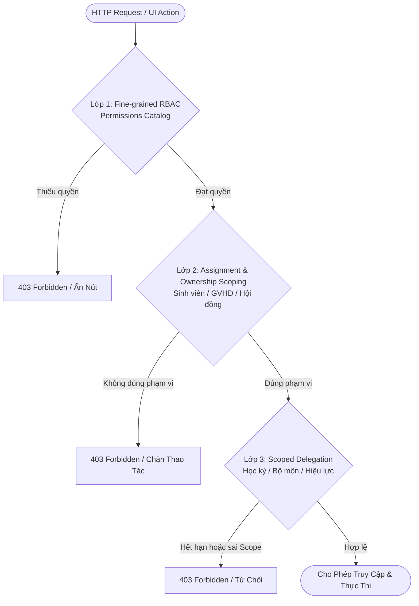
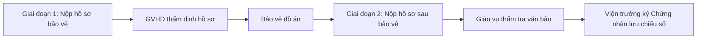

# Canonical Five-Persona Authorization Matrix (DACN RBAC)

Tài liệu này tổng hợp ma trận phân quyền chính thức cho hệ thống Quản lý Đồ án Tốt nghiệp (DACN). Kiến trúc phân quyền tuân thủ mô hình **Phân quyền 3 Lớp (Three-Layered Authorization Architecture)**, loại bỏ hoàn toàn các bypass cứng theo vai trò (`role === 'ADMIN'`) hoặc inject quyền giả lập trên giao diện người dùng.

---

## 1. Kiến Trúc Phân Quyền 3 Lớp (Layered Authorization)

1. **Lớp 1 (Fine-Grained RBAC Capability)**:
   - Toàn bộ các quyền năng (capabilities) được định nghĩa tại `backend/src/constants/permissions.js` và đồng bộ với `frontend/src/auth/featurePolicies.js`.
   - Mỗi API endpoint và UI Action đều yêu cầu các capability cụ thể.
2. **Lớp 2 (Assignment & Ownership Scoping)**:
   - **Sinh viên (Student Ownership)**: Chỉ được xem, nộp bài, ký xác nhận đối với hồ sơ đăng ký của chính mình (`studentId === req.user.id`).
   - **Giảng viên hướng dẫn (Mentor Scoping)**: Chỉ được phê duyệt, theo dõi tiến độ, tạo BM03, ký BM04, thẩm định lưu chiểu đối với sinh viên được phân công (`mentorId === req.user.id`).
   - **Hội đồng bảo vệ (Council Role Hierarchy)**: Phân định rạch ròi giữa Chủ tịch (`CHAIRMAN`), Thư ký (`SECRETARY`) và Ủy viên (`MEMBER`).
3. **Lớp 3 (Scoped Delegation & Context)**:
   - Ủy quyền học vụ chỉ có hiệu lực khi khớp chính xác mã học kỳ (`semesterId`), mã bộ môn (`department`), chưa hết hạn (`expiresAt > NOW()`) và ở trạng thái `ACTIVE`.

---

## 2. Danh Mục 5 Persona Chuẩn Hóa (Canonical Personas)

| Persona | Mã Vai Trò (`role`) | Đặc Trưng Nhận Diện | Trách Nhiệm Nghiệp Vụ |
| :--- | :--- | :--- | :--- |
| **1. STUDENT** | `STUDENT` | `role: 'STUDENT'` | Đăng ký đề tài, nộp đề cương BM01, nộp báo cáo BM02, ký biên bản BM03/BM04, nộp hồ sơ lưu chiểu 2 giai đoạn, tra cứu điểm. |
| **2. GVHD** | `LECTURER` | `role: 'LECTURER'` | Đề xuất đề tài, tiếp nhận SV hướng dẫn, chấm điểm tiến độ, lập biên bản BM03, ký BM04, thẩm định lưu chiểu Giai đoạn 1. |
| **2b. GVHD (Hội Đồng)** | `LECTURER` | Phân công `CHAIRMAN` / `SECRETARY` / `MEMBER` | Thẩm định đề cương (HĐ Đề cương), chấm điểm bảo vệ khóa luận BM05 (Ủy viên HĐ), tổng hợp điểm (Thư ký HĐ), phê duyệt lịch họp (Chủ tịch HĐ). |
| **3. GIAO_VU** | `ADMIN` | Quản trị viên phụ trách học vụ | Quản lý đợt đồ án & học kỳ, điều phối gán GVHD/sinh viên, duyệt danh mục đề tài, tổ chức HĐ đề cương & HĐ bảo vệ, khóa sổ điểm, hoàn trả sổ điểm (`DEFENSE_SCOREBOOK_RETURN`). |
| **4. VIEN_TRUONG** | `ADMIN` / `LECTURER` | Nhóm quyền `VIEN_TRUONG` hoặc quyền ký duyệt cấp Viện | Phê duyệt kết quả bảo vệ (`DEFENSE_RESULT_APPROVE`), công bố kết quả học kỳ (`RESULT_PUBLICATION_PUBLISH`), ký phụ lục BM02-A cấp Viện, ban hành quyết định gán đề tài, quản lý ủy quyền học vụ, ký Giấy chứng nhận lưu chiểu điện tử. |
| **5. QUAN_TRI_VIEN** | `ADMIN` | Quản trị kỹ thuật hệ thống | Quản trị người dùng (thêm, sửa, xóa, nhập Excel), quản trị nhóm quyền & phân bổ vai trò, quản trị bản tin hệ thống & thông báo, nội dung Portal. **Tuyệt đối không có bypass học vụ**. |

---

## 3. Ma Trận Quyền Xem Menu & Không Gian Làm Việc (Navigation & Workspace Matrix)

| Khối Chức Năng | Feature Key | Đường Dẫn Route | STUDENT | GVHD (Thường) | GVHD (Hội Đồng) | GIAO_VU | VIEN_TRUONG | QUAN_TRI_VIEN |
| :--- | :--- | :--- | :---: | :---: | :---: | :---: | :---: | :---: |
| **Hồ sơ của tôi** | `my-registration` | `/student/topics` | **✓** | ✗ | ✗ | ✗ | ✗ | ✗ |
| | `my-topics` | `/lecturer/topics` | ✗ | **✓** | **✓** | ✗ | ✗ | ✗ |
| | `my-submissions` | `/student/submissions` | **✓** | ✗ | ✗ | ✗ | ✗ | ✗ |
| | `my-archive` | `/student/submissions?tab=archive` | **✓** | ✗ | ✗ | ✗ | ✗ | ✗ |
| | `my-grades` | `/student/grades` | **✓** | ✗ | ✗ | ✗ | ✗ | ✗ |
| **Hướng dẫn & tiến độ** | `mentored-students` | `/lecturer/approvals` | ✗ | **✓** | **✓** | ✗ | ✗ | ✗ |
| | `progress-checkpoints`| `/lecturer/progress` | ✗ | **✓** | **✓** | ✗ | ✗ | ✗ |
| **Thẩm định & quyết định**| `outline-reviews` | `/lecturer/approvals?tab=bm01` | ✗ | ✗ | **✓** (HĐ Đề cương) | ✗ | ✗ | ✗ |
| **Hội đồng & bảo vệ** | `outline-councils` | `/admin/outline-councils` | ✗ | ✗ | ✗ | **✓** | ✗ | ✗ |
| | `defense-councils` | `/admin/defense-councils` | ✗ | ✗ | ✗ | **✓** | ✗ | ✗ |
| | `defense-grading` | `/lecturer/grading` | ✗ | ✗ | **✓** (HĐ Bảo vệ) | ✗ | ✗ | ✗ |
| | `defense-lock` | `/admin/grading` | ✗ | ✗ | ✗ | **✓** | ✗ | ✗ |
| **Kết quả & công bố** | `defense-result-approvals` | `/admin/grading?tab=approvals` | ✗ | ✗ | ✗ | ✗ | **✓** | ✗ |
| | `result-publications` | `/admin/grading?tab=publish` | ✗ | ✗ | ✗ | ✗ | **✓** | ✗ |
| | `rubric-config` | `/admin/rubric-management` | ✗ | ✗ | ✗ | **✓** | ✗ | ✗ |
| **Quản trị học vụ** | `project-periods` | `/admin/project-periods` | ✗ | ✗ | ✗ | **✓** | ✗ | ✗ |
| | `project-enrollments`| `/admin/project-enrollments` | ✗ | ✗ | ✗ | **✓** | ✗ | ✗ |
| | `all-topics` | `/admin/topics` | ✗ | ✗ | ✗ | **✓** | ✗ | ✗ |
| | `project-oversight` | `/admin/oversight` | ✗ | ✗ | ✗ | **✓** | **✓** | ✗ |
| | `academic-reports` | `/admin/reports` | ✗ | ✗ | ✗ | **✓** | **✓** | ✗ |
| **Quản trị hệ thống** | `users` | `/admin/users` | ✗ | ✗ | ✗ | ✗ | ✗ | **✓** |
| | `permissions` | `/admin/permissions` | ✗ | ✗ | ✗ | ✗ | ✗ | **✓** |
| | `announcements` | `/admin/announcements` | ✗ | ✗ | ✗ | ✗ | ✗ | **✓** |
| | `portal-content` | `/admin/portal` | ✗ | ✗ | ✗ | **✓** | ✗ | **✓** |
| | `notifications` | `/admin/notifications` | ✗ | ✗ | ✗ | **✓** | ✗ | **✓** |

---

## 4. Ma Trận Hành Động Chi Tiết (Action Capabilities Matrix)

### 4.1. Quy Trình Biểu Mẫu Học Vụ & Tiến Độ (BM01 → BM05)

| Biểu Mẫu / Quy Trình | Hành Động | Capability Bắt Buộc | STUDENT | GVHD Hướng Dẫn | Hội Đồng Bảo Vệ | GIAO_VU | VIEN_TRUONG | QUAN_TRI_VIEN |
| :--- | :--- | :--- | :---: | :---: | :---: | :---: | :---: | :---: |
| **BM01 (Đề cương)** | Nộp đề cương | `SUBMIT_BM01` | **✓** (Chính chủ) | ✗ | ✗ | ✗ | ✗ | ✗ |
| | Thẩm định & Cho điểm | `OUTLINE_REVIEW` | ✗ | ✗ | **✓** (Ủy viên HĐ ĐC) | ✗ | ✗ | ✗ |
| **BM02 (Giao đề tài)**| Ký & Nộp BM02 | `SUBMIT_BM02` | **✓** (Chính chủ) | ✗ | ✗ | ✗ | ✗ | ✗ |
| **BM02-A (Điều chỉnh)**| SV ký nộp đơn điều chỉnh | `BM02_SUBMIT` | **✓** (Chính chủ) | ✗ | ✗ | ✗ | ✗ | ✗ |
| | GVHD ký chấp thuận | `BM02_REVIEW` | ✗ | **✓** (GVHD phân công) | ✗ | ✗ | ✗ | ✗ |
| | Viện trưởng phê duyệt | `BM02_APPROVE_DEPARTMENT` | ✗ | ✗ | ✗ | ✗ | **✓** | ✗ |
| | Ban hành phụ lục điều chỉnh | `TITLE_ADJUSTMENT_APPENDIX_ISSUE` | ✗ | ✗ | ✗ | **✓** | **✓** | ✗ |
| **BM03 (Biên bản)** | Tạo lịch & biên bản trao đổi | `BM03_REVIEW` | ✗ | **✓** (GVHD phân công) | ✗ | ✗ | ✗ | ✗ |
| | SV xác nhận nội dung | `CHECKPOINT_SIGN` | **✓** (Chính chủ) | ✗ | ✗ | ✗ | ✗ | ✗ |
| **BM04 (Đánh giá)** | GVHD ký & gửi đánh giá | `BM04_SUBMIT` / `BM04_CREATE_AND_SIGN` | ✗ | **✓** (GVHD phân công) | ✗ | ✗ | ✗ | ✗ |
| | Xem xét giải trình không cho bảo vệ | `VIEW_BM04_EVALUATIONS` | ✗ | ✗ | ✗ | **✓** | **✓** | ✗ |
| **BM05 (Chấm bảo vệ)**| Nhập & Khóa điểm cá nhân | `DEFENSE_SCORE_SUBMIT` | ✗ | ✗ | **✓** (Chỉ thành viên HĐ) | ✗ | ✗ | ✗ |
| | Tổng hợp & Ký biên bản HĐ | `DEFENSE_SCORE_SUBMIT` | ✗ | ✗ | **✓** (Chủ tịch/Thư ký) | ✗ | ✗ | ✗ |

---

### 4.2. Khóa Điểm, Phê Duyệt & Công Bố Điểm Khóa Luận

| Nghiệp Vụ | Capability | STUDENT | GVHD | HĐ Bảo Vệ | GIAO_VU | VIEN_TRUONG | QUAN_TRI_VIEN | Ghi Chú An Toàn |
| :--- | :--- | :---: | :---: | :---: | :---: | :---: | :---: | :--- |
| **Khóa sổ điểm HĐ** | `RESULT_LOCK` | ✗ | ✗ | ✗ | **✓** | ✗ | ✗ | Chốt toàn bộ điểm của HĐ để chuyển tiếp lên Viện. |
| **Hoàn trả sổ điểm** | `DEFENSE_SCOREBOOK_RETURN` | ✗ | ✗ | ✗ | **✓** | **✓** | ✗ | Mở khóa có kiểm soát khi có sai sót nhập liệu. |
| **Phê duyệt kết quả** | `DEFENSE_RESULT_APPROVE` | ✗ | ✗ | ✗ | ✗ | **✓** | ✗ | **Chỉ Viện trưởng**, Admin kỹ thuật không được duyệt. |
| **Công bố kết quả HK**| `RESULT_PUBLICATION_PUBLISH`| ✗ | ✗ | ✗ | ✗ | **✓** | ✗ | Công bố công khai điểm toàn đợt đồ án ra Portal. |

---

### 4.3. Hồ Sơ Lưu Chiểu 2 Giai Đoạn (Two-Stage Archival Workflow)

1. **Giai đoạn 1 (Pre-defense Archival)**:
   - **Sinh viên**: `SUBMIT_PRE_DEFENSE_ARCHIVE` (Nộp file báo cáo, mã nguồn, giấy xác nhận GVHD).
   - **GVHD phụ trách**: `ARCHIVE_MENTOR_REVIEW` (Thẩm định tính hợp lệ của hồ sơ nộp bảo vệ).
2. **Giai đoạn 2 (Final Archival & Electronic Clearance)**:
   - **Sinh viên**: `SUBMIT_FINAL_ARCHIVE` (Nộp bản hoàn thiện sau chỉnh sửa theo góp ý của Hội đồng).
   - **Giáo vụ khoa**: `ARCHIVE_ACADEMIC_REVIEW` (Kiểm tra định dạng, nộp thư viện).
   - **Viện trưởng**: `ARCHIVE_CLEARANCE_SIGN` (Ký số điện tử Giấy chứng nhận hoàn thành lưu chiểu).

---

### 4.4. Quản Trị Hệ Thống & Quản Trị Người Dùng

| Chức Năng | Capability | QUAN_TRI_VIEN | GIAO_VU | VIEN_TRUONG | Giảng Viên / SV |
| :--- | :--- | :---: | :---: | :---: | :---: |
| Thêm người dùng mới | `USER_MANAGE` | **✓** | ✗ | ✗ | ✗ |
| Khóa / Mở khóa người dùng | `USER_MANAGE` | **✓** | ✗ | ✗ | ✗ |
| Nhập danh sách tài khoản Excel | `USER_IMPORT` | **✓** | ✗ | ✗ | ✗ |
| Quản lý nhóm quyền hệ thống | `PERMISSION_GROUP_MANAGE` | **✓** | ✗ | ✗ | ✗ |
| Gán quyền học vụ kiêm nhiệm | `PERMISSION_ASSIGN_ACADEMIC` | ✗ | **✓** | **✓** | ✗ |
| Thiết lập ủy quyền học vụ có thời hạn | `ACADEMIC_DELEGATION_MANAGE` | ✗ | ✗ | **✓** | ✗ |

> [!IMPORTANT]
> **Quy Tắc Tách Biệt Quyền Lực (Separation of Powers)**:
> - `QUAN_TRI_VIEN` quản lý tài khoản kỹ thuật và hạ tầng nhưng **không thể** tự ký phê duyệt học vụ, không thể chấm điểm thay Hội đồng và không thể công bố kết quả.
> - `VIEN_TRUONG` và `GIAO_VU` nắm giữ thẩm quyền học vụ nhưng **không thể** tùy tiện can thiệp sửa đổi cấu trúc nhóm quyền cốt lõi hay xóa tài khoản hệ thống.

---

## 5. Bằng Chứng Xác Thực Tự Động (Verification Evidence)

Toàn bộ ma trận trên đã được tự động hóa và vượt qua 100% các bộ kiểm thử tích hợp, runtime và E2E:

| Tầng Kiểm Thử | Tệp Kiểm Thử | Số Lượng Test | Trạng Thái | Thời Gian Thực Thi |
| :--- | :--- | :---: | :---: | :---: |
| **Backend Integration Matrix** | `backend/tests/integration/fivePersonaAuthorizationMatrix.test.js` | **27 / 27** | **PASS** | 3.06s |
| **Frontend Runtime Policy** | `frontend/runtime-tests/fivePersonaPolicies.spec.jsx` | **20 / 20** | **PASS** | 3.11s |
| **Frontend Playwright E2E** | `frontend/e2e/rbac-five-persona.spec.js` | **5 / 5** | **PASS** | 27.7s |
| **TỔNG CỘNG** | | **52 / 52** | **PASS (100%)** | |

---

## 6. Kết Luận

Ma trận phân quyền 5 Persona đã được triển khai nhất quán và chuẩn xác:
- **Tính trọn vẹn (Completeness)**: Bao quát toàn bộ các ca nghiệp vụ từ đăng ký đề tài, theo dõi tiến độ, thẩm định đề cương, tổ chức hội đồng, chấm điểm BM05, phê duyệt kết quả, công bố học kỳ đến hồ sơ lưu chiểu 2 giai đoạn.
- **Tính an toàn (Robustness)**: Ngăn chặn triệt để tình trạng leo thang quyền hạn (privilege escalation), loại trừ hoàn toàn các backdoor role-bypass.
- **Tuân thủ tiêu chuẩn đồ án**: Đảm bảo đúng chuẩn kiến trúc `TopicRegistration` (1 sinh viên / 1 đề tài, tối đa 10 SV/GVHD) và quy định ký số điện tử của Viện.

