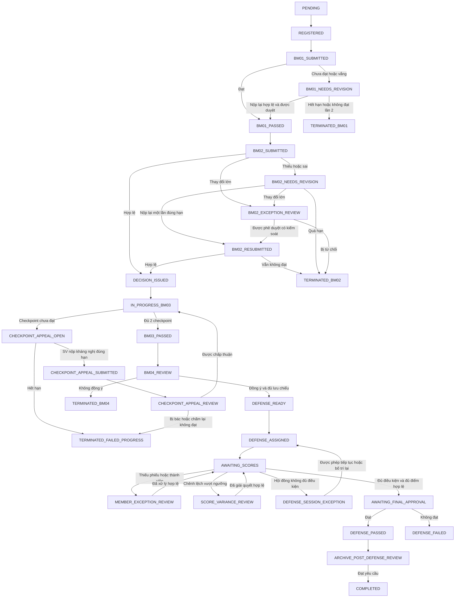
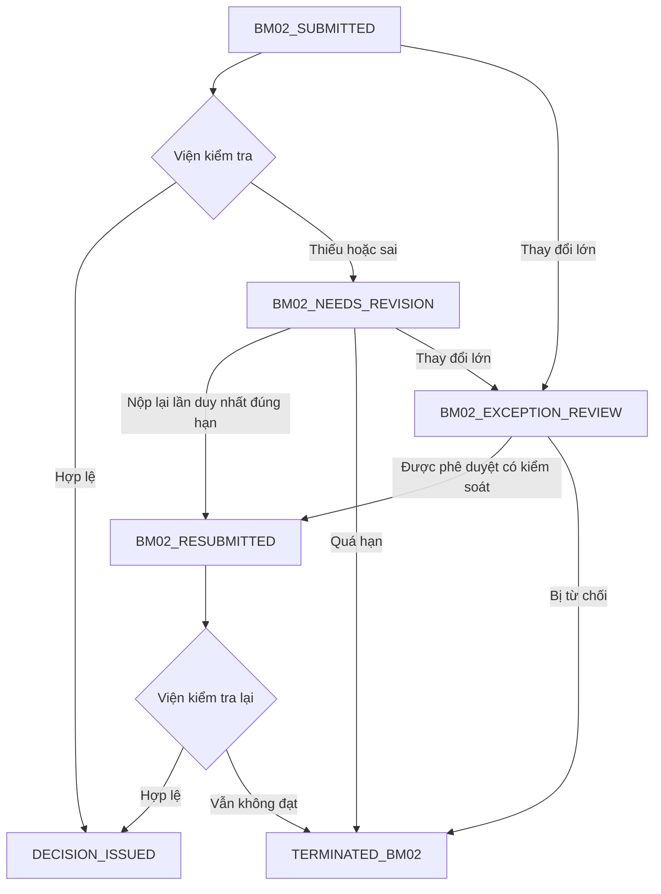
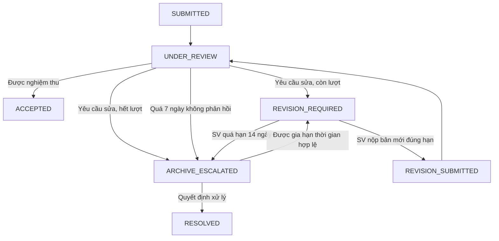

# Thiết kế hoàn chỉnh quy trình Đồ án Tốt nghiệp

- **Ngày:** 28/10/2026
- **Trạng thái:** Bản hiệu chỉnh sau phản biện, chờ người dùng rà soát trước khi lập kế hoạch triển khai
- **Phạm vi:** Chuẩn hóa quy trình, state machine, dữ liệu, phân quyền và xử lý ngoại lệ từ đăng ký đề tài đến lưu chiểu.

## 1. Mục tiêu

Thiết lập một nguồn chân lý cho `TopicRegistration` và các thực thể liên quan. Hệ thống phải chặn mọi đường tắt nghiệp vụ, bảo toàn lịch sử pháp lý và xử lý có kiểm soát các ngoại lệ: BM01 không đạt, kháng nghị checkpoint, chuyển GVHD, điều chỉnh Quyết định, thay đổi hội đồng, thiếu/chênh điểm, lưu chiểu quá hạn.

## 2. Quyết định nghiệp vụ đã chốt

1. Mỗi sinh viên chỉ có một lần nộp lại BM01. Không đạt lần nộp lại hoặc quá hạn thì dừng với `TERMINATED_BM01`.
2. BM02 thiếu/sai được Viện trả về một lần, kèm lý do và hạn sửa. Bản nộp lại tạo phiên bản BM02 mới; không đạt lần hai hoặc quá hạn thì dừng với `TERMINATED_BM02`. Thay đổi làm đổi bản chất đề tài đi qua `BM02_EXCEPTION_REVIEW`, không được coi là lỗi BM02 thông thường.
3. Mỗi checkpoint BM03 chỉ có một lần kháng nghị trong hạn. Admin/Viện trưởng phê duyệt thì chỉ mở lại checkpoint bị kháng nghị để GVHD chấm lại; quyết định cũ luôn được lưu.
4. Sau `DECISION_ISSUED`, không có luồng rút/hủy hồ sơ. Hồ sơ chỉ có thể đi tiếp hoặc dừng theo kết quả BM03, BM04, bảo vệ hoặc quy trình ngoại lệ có thẩm quyền.
5. Quyết định gốc không bị sửa/xóa. Sai sót hành chính được xử lý bằng `DecisionAmendment`, tham chiếu quyết định gốc và có người ký.
6. Chuyển GVHD cần Admin/Viện trưởng phê duyệt. GVHD mới kế thừa quyền còn hiệu lực từ thời điểm chuyển giao; BM04 đã ký không được chuyển hoặc sửa.
7. GVHD không bao giờ được chấm bảo vệ sinh viên mình hướng dẫn.
8. Ba thành viên hội đồng chấm độc lập và khóa phiếu riêng. Không tự động tính điểm từ thiếu phiếu; không quy điểm thiếu thành 0; không tự bỏ điểm thấp.
9. Chênh lệch vượt ngưỡng hoặc ngoại lệ thành viên phải có biên bản, người xử lý đúng thẩm quyền và lịch sử điểm gốc. Điểm cuối không tự động lấy trung vị, điểm Chủ tịch hoặc trung bình sau khi đã phát sinh bất đồng.
10. Lưu chiểu trước bảo vệ là điều kiện của `DEFENSE_READY`: báo cáo PDF, source/link repository, và slide hoặc video demo.
11. Hồ sơ lưu chiểu hậu bảo vệ là có phiên bản: SV có 14 ngày để hoàn thiện; GVHD/Admin có 7 ngày phản hồi; tối đa hai vòng sửa. Quá hạn hoặc GVHD/Admin không phản hồi đúng hạn chuyển `ARCHIVE_ESCALATED`; không tự nghiệm thu. Gia hạn thời gian không tăng số vòng sửa; tăng số vòng cần quyết định ngoại lệ có audit.
12. `DEFENSE_FAILED` là không đạt học phần và không thể trở thành `COMPLETED` chỉ bằng lưu chiểu.
13. Các trạng thái `TERMINATED_*` và `DEFENSE_FAILED` là terminal trong đợt hiện hành. Chỉ checkpoint có nhánh kháng nghị nêu trong đặc tả. Nếu quy chế cho phép làm lại, SV tạo `TopicRegistration` mới ở đợt sau, liên kết hồ sơ cũ để truy vết; không hồi sinh hay ghi đè hồ sơ cũ.

## 3. State machine chuẩn

`TopicRegistration` chỉ lưu trạng thái flow chính. Phiếu chấm, sự tham gia hội đồng, kháng nghị và lưu chiểu là thực thể phụ trợ; không nhồi trạng thái chi tiết của chúng vào một cột trạng thái đăng ký. Mỗi transition chính phải kiểm tra trạng thái thực thể con liên quan trong cùng transaction nghiệp vụ: ví dụ chỉ vào `AWAITING_FINAL_APPROVAL` khi `DefenseSession` hợp lệ và mọi `ScoreSheet` bắt buộc đã khóa.

### 3.1 State machine BM02

Chỉ Viện/người được phân quyền được trả BM02 về sửa. Mỗi lần trả về phải có danh sách lỗi cần sửa và deadline tính từ lúc thông báo thành công. Sửa lỗi thông thường giữ cùng `TopicRegistration`; thay đổi lớn chỉ được tiếp tục khi ngoại lệ được phê duyệt, nếu không kết thúc hồ sơ BM02. Sai sót được phát hiện sau `DECISION_ISSUED` luôn đi theo `DecisionAmendment`, không mở lại BM02.

### 3.2 State machine lưu chiểu hậu bảo vệ

`ProjectArchiveVersion` giữ state machine này độc lập; bản cũ không thể được nghiệm thu lại sau khi có bản thay thế, trừ một `ArchiveResolution` được phê duyệt. `COMPLETED` chỉ được kích hoạt khi phiên bản hiện hành là `ACCEPTED`, `TopicRegistration` là `ARCHIVE_POST_DEFENSE_REVIEW`, và toàn bộ điều kiện học vụ khác còn hợp lệ.

## 4. Invariant bắt buộc ở backend

| Mã | Điều kiện bất biến |
| --- | --- |
| INV-01 | Không chuyển sang `IN_PROGRESS_BM03` trước `DECISION_ISSUED`. |
| INV-02 | Không mở `BM04_REVIEW` nếu chưa `BM03_PASSED`. |
| INV-03 | Không tạo `DEFENSE_READY` nếu BM04 chưa chấp thuận hoặc lưu chiểu trước bảo vệ thiếu tối thiểu. |
| INV-04 | Không chốt điểm khi thiếu phiếu bắt buộc hoặc hội đồng không hợp lệ, trừ ngoại lệ được quy chế cho phép và đã phê duyệt. |
| INV-05 | Không tính điểm thiếu thành 0; không tự loại điểm của thành viên có điểm thấp. |
| INV-06 | Không chuyển `DEFENSE_FAILED` sang `COMPLETED` chỉ vì hoàn thành lưu chiểu. |
| INV-07 | Không xóa hoặc ghi đè Quyết định, phiếu chấm và lịch sử trạng thái đã xác nhận. |
| INV-08 | Không cho hai yêu cầu đồng thời chuyển hồ sơ sang hai nhánh không tương thích. |
| INV-09 | BM01 chỉ được nộp lại một lần và luôn gắn với kết quả BM01 bị yêu cầu sửa. |
| INV-10 | Mỗi checkpoint chỉ có tối đa một kháng nghị, gắn với checkpoint, quyết định cũ, hạn và người duyệt. |
| INV-11 | Chỉ thành viên hợp lệ tại thời điểm bảo vệ được tạo/khóa phiếu chấm; GVHD bị cấm. |
| INV-12 | Transition chạy trong transaction, kiểm tra trạng thái kỳ vọng và phiên bản để chống race condition. |
| INV-13 | Không ban hành QĐ nếu BM02 không phải phiên bản hiện hành đã được Viện chấp thuận. |
| INV-14 | Không chốt điểm khi thiếu `PeriodWorkflowPolicyVersion` bất biến hoặc không xác định được phiên bản policy áp dụng. |
| INV-15 | Không sửa phiếu đã khóa trừ quy trình mở khóa được policy cho phép, có thẩm quyền và audit. |
| INV-16 | Request nhạy cảm phải idempotent: ban hành QĐ, khóa phiếu, duyệt kết quả và transition không được tạo kết quả thứ hai khi client gửi lại. |

## 5. Dữ liệu và phân quyền

| Thực thể | Trách nhiệm |
| --- | --- |
| `TopicRegistration` | Trạng thái chính, `stateVersion`, mốc thời gian. |
| `RegistrationStateHistory` | Lịch sử transition append-only, actor, lý do, dữ liệu tham chiếu. |
| `CheckpointAppeal` | Một kháng nghị/checkpoint: quyết định cũ, chứng cứ, hạn, phê duyệt và kết quả chấm lại. |
| `BM02Submission` | Phiên bản BM02, người nộp/duyệt, kết quả, lý do trả về, hạn sửa, số lần sửa và liên kết bản trước. |
| `MentorTransfer` | GVHD cũ/mới, lý do, thời điểm hiệu lực, người duyệt. |
| `DecisionAmendment` | Quyết định điều chỉnh, tham chiếu QĐ gốc, lý do, danh sách hồ sơ tác động, dữ liệu được bổ sung và người ký. |
| `DefenseSession` | Buổi bảo vệ, trạng thái tổ chức/hủy/hoãn, thời điểm và liên kết hội đồng. |
| `CouncilMemberParticipation` | Có mặt, vắng, thay thế hoặc rời buổi của từng thành viên. |
| `ScoreSheet` | Vòng đời riêng của từng phiếu: `NOT_STARTED`, `PENDING`, `SUBMITTED`, `LOCKED`, `MISSING`. |
| `DefenseSessionException` | Sự cố buổi bảo vệ, hướng xử lý và quyết định có thẩm quyền. |
| `DefenseResolution` | Biên bản thiếu thành viên/chênh lệch, điểm gốc, giải trình, điểm cuối và phê duyệt. |
| `ProjectArchiveVersion` | Các phiên bản trước/sau bảo vệ, vòng phản hồi, hạn và kết quả nghiệm thu. |
| `PeriodWorkflowPolicyVersion` | Cấu hình bất biến từng đợt: hạn, ngưỡng chênh lệch, số phiếu tối thiểu, công thức điểm, vòng sửa và thẩm quyền. |

Mỗi `TopicRegistration` và sự kiện nhạy cảm phải tham chiếu `periodPolicyVersionId`, `policySnapshot` và `effectiveAt`. Thay đổi quy chế tạo phiên bản mới, không làm thay đổi cách đánh giá hồ sơ/sự kiện đã bắt đầu theo phiên bản cũ, trừ quyết định chuyển policy có thẩm quyền và được audit.

`DecisionAmendment` chỉ bổ sung hoặc thay thế hiệu lực pháp lý từ ngày hiệu lực; không tự đưa `TopicRegistration` lùi về trạng thái cũ. `MentorTransfer` chỉ thay quyền xử lý ở các bước chưa hoàn tất; không thay actor/lịch sử của BM03, BM04, điểm hoặc bản lưu chiểu đã được xác nhận.

- **SV:** nộp BM, kháng nghị một lần, nộp hồ sơ lưu chiểu.
- **GVHD hiện hành:** chấm BM03, ký BM04, nghiệm thu lưu chiểu; không chấm bảo vệ.
- **Thành viên hội đồng:** chỉ tạo/khóa phiếu của hồ sơ được phân công hợp lệ.
- **Chủ tịch:** lập biên bản xử lý; không tự ghi đè điểm thành viên.
- **Admin/Viện trưởng:** duyệt kháng nghị, chuyển GVHD, điều chỉnh QĐ, ngoại lệ hội đồng và chốt điểm theo policy.

## 6. Kế hoạch triển khai

### Giai đoạn 0 — Đặc tả và mapping dữ liệu

- Cập nhật tài liệu workflow, data architecture, RBAC thành nguồn chân lý mới.
- Lập mapping trạng thái cũ sang trạng thái mới; hồ sơ không suy luận được phải vào `MANUAL_REVIEW`.
- Chốt cấu hình mặc định và phiên bản đầu tiên của `PeriodWorkflowPolicyVersion`.

### Giai đoạn 1 — Guard P0 cho luồng hiện hữu

- Chỉ ban hành QĐ cho `BM02_SUBMITTED`.
- BM04 chỉ sau `BM03_PASSED` và do GVHD hiện hành ký.
- Xóa endpoint/UI/logic bypass; đưa dữ liệu bypass cũ vào `MANUAL_REVIEW`.
- Cấm GVHD chấm bảo vệ sinh viên mình hướng dẫn.
- Bắt buộc đủ phiếu và thành phần hội đồng trước khóa điểm.
- Chặn `DEFENSE_FAILED` đi vào `COMPLETED`; cấm rút sau QĐ.
- Bắt buộc đủ ba vai trò trước tạo/cập nhật/gán hội đồng.

### Giai đoạn 2 — State machine và migration

- Migration enum và các bảng trong mục 5.
- Thêm `stateVersion`, `RegistrationStateHistory`, `PeriodWorkflowPolicyVersion` và các khóa ngoại policy snapshot.
- Tạo một state-transition service duy nhất; controller không cập nhật `registration.status` trực tiếp.
- Migration thử trên bản sao DB, báo cáo mapping và rollback script.

### Giai đoạn 3 — Nghiệp vụ trước bảo vệ

- BM01 một lần sửa; BM02 có phiên bản, một lần sửa và luồng ngoại lệ thay đổi lớn; QĐ điều chỉnh.
- Đổi tên đúng trạng thái/hạn/GVHD hiệu lực.
- Kháng nghị checkpoint và chuyển GVHD.
- Kiểm tra bộ lưu chiểu trước bảo vệ trước `DEFENSE_READY`.

### Giai đoạn 4 — Hội đồng và kết quả bảo vệ

- Quản lý tham gia/thay thế thành viên và sự cố buổi bảo vệ.
- Phiếu chấm độc lập, thiếu điểm, chênh lệch và biên bản xử lý.
- Chốt `DEFENSE_PASSED` hoặc `DEFENSE_FAILED` theo policy.

### Giai đoạn 5 — Lưu chiểu hậu bảo vệ

- Version hóa lưu chiểu, state machine riêng, hạn 14/7 ngày, tối đa hai vòng sửa, escalation và gia hạn có lý do.
- Chỉ bản được nghiệm thu mới chuyển `COMPLETED`.

### Giai đoạn 6 — UI và nghiệm thu

- UI Student/Lecturer/Admin bám state machine; không có bypass hoặc trạng thái giả.
- Unit test invariant; integration test transition/race condition; E2E happy path và từng case ngoại lệ.
- UAT ba vai trò trên database migration thử trước production.

## 7. Tiêu chí nghiệm thu tổng thể

1. API không có đường nào vi phạm INV-01 đến INV-12.
2. Mọi thay đổi pháp lý/học vụ quan trọng đều append-only, có actor, thời gian, lý do và dữ liệu trước/sau.
3. UI không hiển thị hành động mà backend không chấp nhận.
4. Migration không làm mất hồ sơ; các bản ghi mơ hồ được phân loại để rà soát thủ công.
5. Mọi nhánh state machine và ngoại lệ có test tự động.

## 8. Ma trận nghiệm thu bổ sung

| Nhóm kiểm thử | Kết quả bắt buộc |
| --- | --- |
| BM02 | Không ban hành QĐ khi BM02 chưa hợp lệ; chỉ một lần sửa; bản cũ không bị ghi đè. |
| Policy | Không chốt điểm khi thiếu policy hoặc không xác định được version áp dụng. |
| Hội đồng | Thành viên vắng không bị tính 0; GVHD không chấm được SV mình hướng dẫn. |
| Chấm điểm | Không sửa phiếu đã khóa nếu không qua unlock có thẩm quyền. |
| Quyết định | Không sửa/xóa QĐ gốc khi lập `DecisionAmendment`. |
| Lưu chiểu | Không hoàn tất khi quá hạn, chưa nghiệm thu hợp lệ hoặc bản đã bị thay thế. |
| Đồng thời | Hai transition mâu thuẫn không thể cùng thành công. |
| Phân quyền | Gọi API trực tiếp không vượt được điều kiện UI đang kiểm tra. |
| Migration | Không mất dữ liệu, không tự suy diễn trạng thái không đủ bằng chứng. |
| Audit | Mỗi thao tác học vụ quan trọng có actor, thời gian, lý do và liên kết đối tượng liên quan. |
