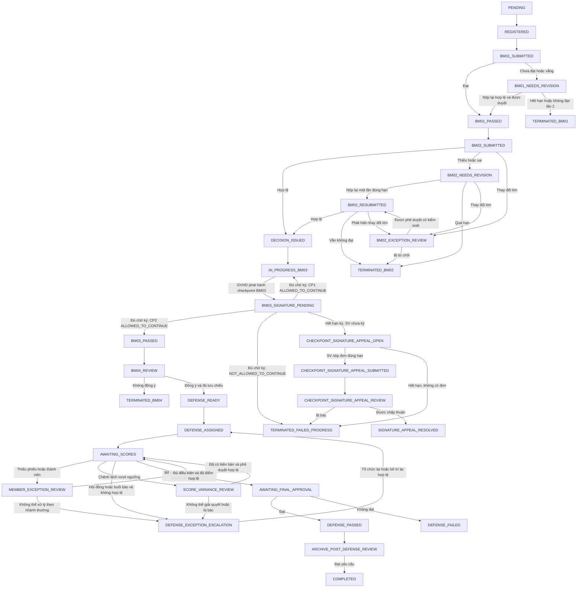
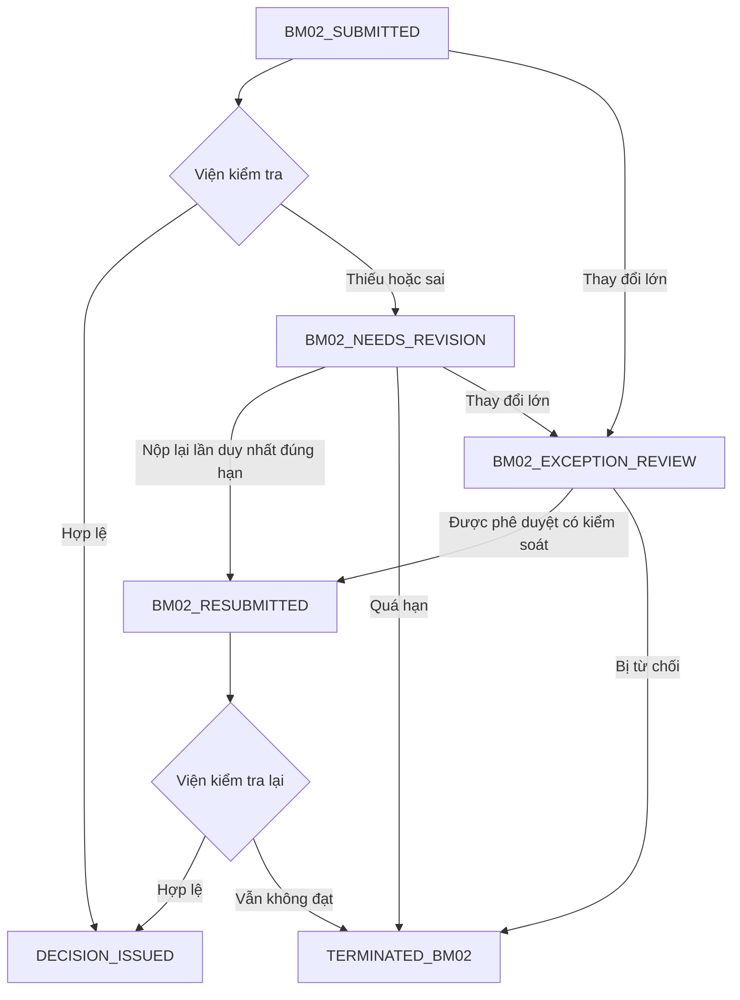
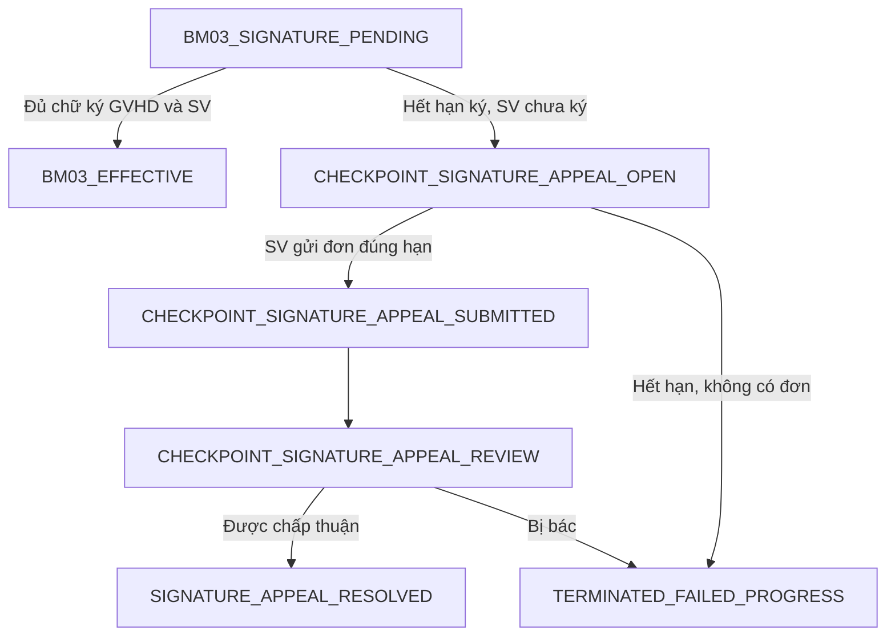
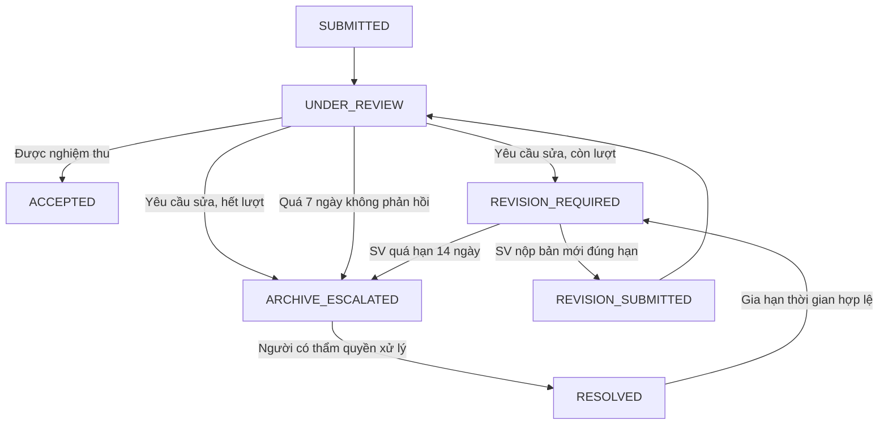

# Thiết kế hoàn chỉnh quy trình Đồ án Tốt nghiệp

- **Ngày:** 28/10/2026
- **Trạng thái:** Bản hiệu chỉnh sau phản biện, chờ người dùng rà soát trước khi lập kế hoạch triển khai
- **Phạm vi:** Chuẩn hóa quy trình, state machine, dữ liệu, phân quyền và xử lý ngoại lệ từ đăng ký đề tài đến lưu chiểu.

## 1. Mục tiêu

Thiết lập một nguồn chân lý cho `TopicRegistration` và các thực thể liên quan. Hệ thống phải chặn mọi đường tắt nghiệp vụ, bảo toàn lịch sử pháp lý và xử lý có kiểm soát các ngoại lệ: BM01 không đạt, kháng nghị checkpoint, chuyển GVHD, điều chỉnh Quyết định, thay đổi hội đồng, thiếu/chênh điểm, lưu chiểu quá hạn.

## 2. Quyết định nghiệp vụ đã chốt

1. Mỗi sinh viên chỉ có một lần nộp lại BM01. Không đạt lần nộp lại hoặc quá hạn thì dừng với `TERMINATED_BM01`.
2. BM02 thiếu/sai được Viện trả về một lần, kèm lý do và hạn sửa. Bản nộp lại tạo phiên bản BM02 mới; không đạt lần hai hoặc quá hạn thì dừng với `TERMINATED_BM02`. Mọi lần nộp lại, kể cả sau `BM02_EXCEPTION_REVIEW`, dùng chung quota một lần sửa; cấp thêm lượt cần quyết định ngoại lệ riêng có audit.
3. BM03 chỉ có kết luận `ALLOWED_TO_CONTINUE` hoặc `NOT_ALLOWED_TO_CONTINUE`, không có điểm số. BM03 chỉ hiệu lực khi GVHD và SV ký đầy đủ. Kháng nghị BM03 chỉ mở khi SV không ký đúng hạn; không có kháng nghị kết luận chuyên môn `NOT_ALLOWED_TO_CONTINUE`.
4. Sau `DECISION_ISSUED`, không có luồng rút/hủy hồ sơ. Hồ sơ chỉ có thể đi tiếp hoặc dừng theo kết quả BM03, BM04, bảo vệ hoặc quy trình ngoại lệ có thẩm quyền.
5. Quyết định gốc không bị sửa/xóa. Sai sót hành chính được xử lý bằng `DecisionAmendment`, tham chiếu quyết định gốc và có người ký.
6. Chuyển GVHD cần Admin/Viện trưởng phê duyệt. GVHD mới kế thừa quyền còn hiệu lực từ thời điểm chuyển giao; BM04 đã ký không được chuyển hoặc sửa.
7. GVHD không bao giờ được chấm bảo vệ sinh viên mình hướng dẫn.
8. Ba thành viên hội đồng chấm độc lập và khóa phiếu riêng. Không tự động tính điểm từ thiếu phiếu; không quy điểm thiếu thành 0; không tự bỏ điểm thấp.
9. Chênh lệch vượt ngưỡng hoặc ngoại lệ thành viên phải có biên bản, người xử lý đúng thẩm quyền và lịch sử điểm gốc. Điểm cuối không tự động lấy trung vị, điểm Chủ tịch hoặc trung bình sau khi đã phát sinh bất đồng.
10. Lưu chiểu trước bảo vệ là điều kiện của `DEFENSE_READY`: báo cáo PDF, source/link repository, và slide hoặc video demo.
11. Hồ sơ lưu chiểu hậu bảo vệ là có phiên bản: SV có 14 ngày để hoàn thiện; GVHD/Admin có 7 ngày phản hồi; tối đa hai vòng sửa. Quá hạn hoặc GVHD/Admin không phản hồi đúng hạn chuyển `ARCHIVE_ESCALATED`; không tự nghiệm thu. Gia hạn thời gian không tăng số vòng sửa; tăng số vòng cần quyết định ngoại lệ có audit.
12. `DEFENSE_FAILED` là không đạt học phần và không thể trở thành `COMPLETED` chỉ bằng lưu chiểu.
13. Các trạng thái `TERMINATED_*` và `DEFENSE_FAILED` là terminal trong đợt hiện hành. Chỉ checkpoint có nhánh kháng nghị nêu trong đặc tả. Nếu quy chế cho phép làm lại, SV tạo `TopicRegistration` mới ở đợt sau, liên kết hồ sơ cũ để truy vết; không hồi sinh hay ghi đè hồ sơ cũ.

## 3. State machine chuẩn

`TopicRegistration` chỉ lưu trạng thái flow chính. Phiếu chấm, sự tham gia hội đồng, kháng nghị và lưu chiểu là thực thể phụ trợ; không nhồi trạng thái chi tiết của chúng vào một cột trạng thái đăng ký. Mỗi transition chính phải kiểm tra trạng thái thực thể con liên quan trong cùng transaction nghiệp vụ: ví dụ chỉ vào `AWAITING_FINAL_APPROVAL` khi `DefenseSession` hợp lệ và mọi `ScoreSheet` bắt buộc đã khóa.

### 3.1 State machine BM02

`BM02_RESUBMITTED` là trạng thái chờ Viện kiểm tra lại, không phải transition tự động sang QĐ. Viện chỉ có thể: duyệt phiên bản hiện hành để ban hành QĐ; kết thúc `TERMINATED_BM02` nếu vẫn không hợp lệ; hoặc chuyển `BM02_EXCEPTION_REVIEW` nếu phát hiện thay đổi lớn và policy cho phép. Chỉ Viện/người được phân quyền được trả BM02 về sửa. Mỗi lần trả về phải có danh sách lỗi cần sửa và deadline tính từ lúc thông báo thành công. Sửa lỗi thông thường giữ cùng `TopicRegistration`; thay đổi lớn chỉ được tiếp tục khi ngoại lệ được phê duyệt, nếu không kết thúc hồ sơ BM02. Ngoại lệ không tự cấp thêm quota nộp lại. Sai sót được phát hiện sau `DECISION_ISSUED` luôn đi theo `DecisionAmendment`, không mở lại BM02.

### 3.2 State machine BM03 và chữ ký checkpoint

Mỗi `CheckpointEvaluation` chỉ lưu kết luận `ALLOWED_TO_CONTINUE` hoặc `NOT_ALLOWED_TO_CONTINUE`, nhận xét, minh chứng và chữ ký; không lưu điểm số. GVHD xuất BM03 và ký trước, hệ thống thông báo cho SV xem/ký. Khi có đủ hai chữ ký, kết luận có hiệu lực: checkpoint 1 đạt thì tiếp tục `IN_PROGRESS_BM03`, checkpoint 2 đạt thì `BM03_PASSED`, còn `NOT_ALLOWED_TO_CONTINUE` thì `TERMINATED_FAILED_PROGRESS`. Khi SV không ký đúng hạn, chỉ nhánh `CHECKPOINT_SIGNATURE_APPEAL_*` được mở. Kháng nghị được chấp thuận không tự tạo chữ ký SV hoặc mặc nhiên làm BM03 có hiệu lực; Admin/Viện trưởng phải lưu quyết định xử lý cụ thể, sau đó điều kiện hai chữ ký vẫn được áp dụng. Không mở lại checkpoint hoặc thay đổi kết luận chuyên môn chỉ vì kháng nghị.

### 3.3 State machine lưu chiểu hậu bảo vệ

`ProjectArchiveVersion` giữ state machine này độc lập; bản cũ không thể được nghiệm thu lại sau khi có bản thay thế, trừ một `ArchiveResolution` được phê duyệt. Mỗi phiên bản lưu `submittedAt`, `reviewStartedAt`, `reviewDeadlineAt`, `revisionDeadlineAt`, `reviewOutcome` và `policyVersionId`. Khi SV nộp bản sửa, tạo phiên bản mới và tính lại hạn phản hồi 7 ngày theo policy. Tối đa hai lần **SV nộp lại sau bản đầu tiên**. `RESOLVED` là kết thúc của vụ việc ngoại lệ, phải lưu outcome rõ ràng: gia hạn, yêu cầu tiếp tục hoàn thiện, hoặc quyết định học vụ khác theo quy chế. Outcome gia hạn mới được quay về `REVISION_REQUIRED`; outcome còn lại không tạo đường tắt để hoàn tất. Chỉ `ACCEPTED` của phiên bản hiện hành mới có thể kích hoạt `COMPLETED`.

### 3.4 Quy tắc deadline, chữ ký và checkpoint

Mọi yêu cầu sửa BM01/BM02, yêu cầu ký BM03 và phiên bản lưu chiểu phải lưu `deadlineAt`, `notifiedAt`, `submittedAt`, `policyVersionId` và lịch sử gia hạn. Hạn tính theo múi giờ của đợt (`Asia/Ho_Chi_Minh`), bắt đầu từ `notifiedAt`; ngày nghỉ chỉ ảnh hưởng nếu `PeriodWorkflowPolicyVersion` quy định. Không tự sửa deadline đã hết: mọi gia hạn cần actor có thẩm quyền, lý do, thời điểm hiệu lực và audit. Sự cố hệ thống được xử lý bằng quyết định gia hạn có lưu bằng chứng, không bằng suy luận tự động.

Nếu GVHD cần thay phiên bản BM03 trước khi ký đầy đủ, hệ thống tạo `CheckpointEvaluation` mới tham chiếu `supersedesEvaluationId`, thu hồi yêu cầu ký của bản cũ và lưu lịch sử. Không có phiên bản nào được dùng để quyết định tiến độ trước khi đủ hai chữ ký.

### 3.5 Phiên bảo vệ và hiệu lực phiếu chấm

`DefenseSession` có các trạng thái `SCHEDULED`, `STARTED`, `COMPLETED`, `POSTPONED`, `CANCELLED`. Khi phát sinh ngoại lệ, quyết định xử lý phải nêu rõ: bổ sung phiếu còn thiếu nếu thành viên đã thực sự tham gia và policy cho phép; thay thành viên kèm tổ chức lại buổi; hoặc hủy hiệu lực buổi cũ và tạo buổi mới. Không được hợp thức hóa phiếu của thành viên thay thế cho buổi mà người đó không tham gia.

Mỗi `ScoreSheet` và `ScoreObligation` gắn `defenseSessionId` và `isEffectiveForResult`. Khi buổi bị hủy hiệu lực, phiếu cũ được giữ audit nhưng `isEffectiveForResult = false`; buổi mới tạo nghĩa vụ và phiếu chấm mới. `DefenseResolution` chỉ cho phép trở về luồng chốt điểm khi `resolutionStatus = APPROVED`, có `decisionMakerId`, `decisionAt`, tham chiếu `originalScores`, `finalScore` và căn cứ/công thức theo policy. Nếu không giải quyết được, hồ sơ ở `DEFENSE_EXCEPTION_ESCALATION`, không vào `AWAITING_FINAL_APPROVAL`.

## 4. Invariant bắt buộc ở backend

| Mã | Điều kiện bất biến |
| --- | --- |
| INV-01 | Không chuyển sang `IN_PROGRESS_BM03` trước `DECISION_ISSUED`. |
| INV-02 | Không mở `BM04_REVIEW` nếu chưa `BM03_PASSED`. |
| INV-03 | Không tạo `DEFENSE_READY` nếu BM04 chưa chấp thuận hoặc lưu chiểu trước bảo vệ thiếu tối thiểu. |
| INV-04 | Không chốt điểm khi thiếu phiếu bắt buộc hoặc hội đồng không hợp lệ, trừ ngoại lệ được quy chế cho phép và đã phê duyệt. |
| INV-05 | Không tính điểm thiếu thành 0; không tự loại điểm của thành viên có điểm thấp. |
| INV-06 | Không chuyển `DEFENSE_FAILED` sang `COMPLETED` chỉ vì hoàn thành lưu chiểu. |
| INV-07 | Không xóa hoặc ghi đè Quyết định, phiếu chấm và lịch sử trạng thái đã xác nhận. |
| INV-08 | Không cho hai yêu cầu đồng thời chuyển hồ sơ sang hai nhánh không tương thích. |
| INV-09 | BM01 chỉ được nộp lại một lần và luôn gắn với kết quả BM01 bị yêu cầu sửa. |
| INV-10 | Mỗi checkpoint chỉ có tối đa một kháng nghị về việc SV không ký đúng hạn, gắn deadline, bằng chứng thông báo và người duyệt. |
| INV-11 | Chỉ thành viên hợp lệ tại thời điểm bảo vệ được tạo/khóa phiếu chấm; GVHD bị cấm. |
| INV-12 | Transition chạy trong transaction, kiểm tra trạng thái kỳ vọng và phiên bản để chống race condition. |
| INV-13 | Không ban hành QĐ nếu BM02 không phải phiên bản hiện hành đã được Viện chấp thuận. |
| INV-14 | Không chốt điểm khi thiếu `PeriodWorkflowPolicyVersion` bất biến hoặc không xác định được phiên bản policy áp dụng. |
| INV-15 | Không sửa phiếu đã khóa trừ quy trình mở khóa được policy cho phép, có thẩm quyền và audit. |
| INV-16 | Request nhạy cảm phải idempotent: ban hành QĐ, khóa phiếu, duyệt kết quả và transition không được tạo kết quả thứ hai khi client gửi lại. |
| INV-17 | BM02 ngoại lệ không tự cấp thêm lượt nộp lại; quota chỉ thay đổi bằng quyết định ngoại lệ riêng. |
| INV-18 | Ngoại lệ điểm/hội đồng bị bác hoặc chưa giải quyết không được đi vào `AWAITING_FINAL_APPROVAL`; phải ở `DEFENSE_EXCEPTION_ESCALATION`. |
| INV-19 | `COMPLETED` chỉ xuất phát từ `ACCEPTED` của `ProjectArchiveVersion` hiện hành. |
| INV-20 | Deadline và gia hạn phải dựa trên policy version, timezone, actor có thẩm quyền và audit. |
| INV-21 | Phiếu chấm chỉ có hiệu lực cho kết quả nếu thuộc `DefenseSession` hợp lệ và `isEffectiveForResult = true`. |
| INV-22 | Policy của hồ sơ được pin khi đăng ký; chuyển sang version khác cần quyết định phạm vi áp dụng có thẩm quyền, không hồi tố ngầm. |
| INV-23 | Các unique constraint và idempotency key phải bảo đảm không tạo hai QĐ gốc, hai kháng nghị hợp lệ/checkpoint hoặc hai phiếu hiệu lực/thành viên/buổi/loại chấm. |
| INV-24 | `CheckpointEvaluation` không có điểm số và chỉ có hiệu lực khi GVHD, SV đều ký; BM04 chỉ cần chữ ký GVHD. |

## 5. Dữ liệu và phân quyền

| Thực thể | Trách nhiệm |
| --- | --- |
| `TopicRegistration` | Trạng thái chính, `stateVersion`, `periodPolicyVersionId` được pin khi đăng ký, mốc thời gian. |
| `RegistrationStateHistory` | Lịch sử transition append-only, actor, lý do, dữ liệu tham chiếu. |
| `CheckpointSignatureAppeal` | Một kháng nghị/checkpoint khi SV không ký đúng hạn: deadline, bằng chứng thông báo, chứng cứ, phê duyệt và quyết định xử lý. |
| `CheckpointEvaluation` | Kết luận không điểm số, nhận xét, minh chứng, chữ ký GVHD/SV; phiên bản thay thế trước khi ký đầy đủ tham chiếu `supersedesEvaluationId`. |
| `BM02Submission` | Phiên bản BM02, người nộp/duyệt, kết quả, lý do trả về, hạn sửa, số lần sửa và liên kết bản trước. |
| `MentorTransfer` | GVHD cũ/mới, lý do, thời điểm hiệu lực, người duyệt. |
| `DecisionAmendment` | Quyết định điều chỉnh, tham chiếu QĐ gốc, lý do, danh sách hồ sơ tác động, dữ liệu được bổ sung và người ký. |
| `DefenseSession` | Buổi bảo vệ `SCHEDULED/STARTED/COMPLETED/POSTPONED/CANCELLED`, thời điểm và liên kết hội đồng. |
| `CouncilMemberParticipation` | Có mặt, vắng, thay thế hoặc rời buổi của từng thành viên. |
| `ScoreSheet` | Phiếu chấm gắn `defenseSessionId`, `isEffectiveForResult`: `DRAFT`, `SUBMITTED`, `LOCKED`, `UNLOCKED_FOR_CORRECTION`, `VOIDED_BY_APPROVED_ACTION`. |
| `ScoreObligation` | Nghĩa vụ chấm gắn `defenseSessionId`: `EXPECTED`, `FULFILLED`, `MISSING`, `EXCUSED_BY_APPROVED_EXCEPTION`. |
| `DefenseSessionException` | Sự cố buổi bảo vệ, hướng xử lý và quyết định có thẩm quyền. |
| `DefenseResolution` | Biên bản thiếu thành viên/chênh lệch: `resolutionStatus`, điểm gốc, giải trình, `finalScore`, căn cứ, `decisionMakerId`, `decisionAt`. |
| `ProjectArchiveVersion` | Các phiên bản trước/sau bảo vệ, vòng phản hồi, hạn và kết quả nghiệm thu. |
| `PeriodWorkflowPolicyVersion` | Cấu hình bất biến từng đợt: hạn, ngưỡng chênh lệch, số phiếu tối thiểu, công thức điểm, vòng sửa và thẩm quyền. |

Mỗi đợt có một policy version mặc định; `TopicRegistration` pin version tại thời điểm đăng ký (hoặc thời điểm bắt đầu đợt nếu quy chế yêu cầu) và sự kiện về sau mặc định kế thừa version đó. `PeriodWorkflowPolicyVersion` là bản cấu hình bất biến; chỉ lưu `policySnapshot` khi kiểm toán cần tái hiện dữ liệu quyết định ngoài nội dung version. Chuyển policy giữa chừng cần quyết định có thẩm quyền, nêu rõ hồ sơ/sự kiện chịu tác động; không hồi tố ngầm. Quy chế của trường luôn ưu tiên hơn thiết kế kỹ thuật.

Tầng dữ liệu phải thực thi `stateVersion`/optimistic locking hoặc khóa tương đương, transaction, idempotency key và unique constraint phù hợp. Tối thiểu: một QĐ gốc đang hiệu lực/hồ sơ; một kháng nghị hợp lệ/checkpoint; một phiếu hiệu lực/thành viên/buổi/loại chấm; một lần lock có cùng idempotency key. Service không được là hàng rào duy nhất.

`DecisionAmendment` chỉ bổ sung hoặc thay thế hiệu lực pháp lý từ ngày hiệu lực; không tự đưa `TopicRegistration` lùi về trạng thái cũ. `MentorTransfer` chỉ thay quyền xử lý ở các bước chưa hoàn tất; không thay actor/lịch sử của BM03, BM04, điểm hoặc bản lưu chiểu đã được xác nhận.

- **SV:** nộp BM, ký BM03, chỉ kháng nghị khi không ký đúng hạn, nộp hồ sơ lưu chiểu.
- **GVHD hiện hành:** phát hành/ký BM03, ký BM04, nghiệm thu lưu chiểu; không chấm bảo vệ.
- **Thành viên hội đồng:** chỉ tạo/khóa phiếu của hồ sơ được phân công hợp lệ.
- **Chủ tịch:** xác nhận tính đầy đủ của buổi bảo vệ, lập biên bản xử lý; không tự ghi đè điểm thành viên.
- **Admin/Viện trưởng:** duyệt kháng nghị, chuyển GVHD, điều chỉnh QĐ, ngoại lệ hội đồng và chốt/phê duyệt kết quả theo policy; không được tự thay điểm chuyên môn của giám khảo.

## 6. Kế hoạch triển khai

### Giai đoạn 0 — Đặc tả và mapping dữ liệu

- Cập nhật tài liệu workflow, data architecture, RBAC thành nguồn chân lý mới.
- Lập mapping trạng thái cũ sang trạng thái mới; hồ sơ không suy luận được phải vào `MANUAL_REVIEW`.
- Chốt cấu hình mặc định và phiên bản đầu tiên của `PeriodWorkflowPolicyVersion`.

### Giai đoạn 1 — Guard P0 cho luồng hiện hữu

- Chỉ ban hành QĐ khi phiên bản BM02 hiện hành đã được Viện chấp thuận, dù là lần nộp đầu hay nộp lại; backend kiểm tra `currentSubmissionId`, kết quả duyệt và policy version, đồng thời từ chối bản thay thế hoặc hồ sơ đang ngoại lệ.
- BM04 chỉ sau `BM03_PASSED` và do GVHD hiện hành ký.
- Xóa endpoint/UI/logic bypass; đưa dữ liệu bypass cũ vào `MANUAL_REVIEW`.
- Cấm GVHD chấm bảo vệ sinh viên mình hướng dẫn.
- Bắt buộc đủ phiếu và thành phần hội đồng trước khóa điểm.
- Chặn `DEFENSE_FAILED` đi vào `COMPLETED`; cấm rút sau QĐ.
- Bắt buộc đủ ba vai trò trước tạo/cập nhật/gán hội đồng.

### Giai đoạn 2 — State machine và migration

- Migration enum và các bảng trong mục 5.
- Thêm `stateVersion`, `RegistrationStateHistory`, `PeriodWorkflowPolicyVersion` và các khóa ngoại policy snapshot.
- Tạo một state-transition service duy nhất; controller không cập nhật `registration.status` trực tiếp.
- Migration thử trên bản sao DB, báo cáo mapping và rollback script.

### Giai đoạn 3 — Nghiệp vụ trước bảo vệ

- BM01 một lần sửa; BM02 có phiên bản, một lần sửa và luồng ngoại lệ thay đổi lớn; QĐ điều chỉnh.
- Đổi tên đúng trạng thái/hạn/GVHD hiệu lực.
- Chữ ký BM03 hai bên, kháng nghị do SV không ký đúng hạn và chuyển GVHD.
- Kiểm tra bộ lưu chiểu trước bảo vệ trước `DEFENSE_READY`.

### Giai đoạn 4 — Hội đồng và kết quả bảo vệ

- Quản lý tham gia/thay thế thành viên và sự cố buổi bảo vệ.
- Phiếu chấm độc lập, thiếu điểm, chênh lệch và biên bản xử lý.
- Chốt `DEFENSE_PASSED` hoặc `DEFENSE_FAILED` theo policy.

### Giai đoạn 5 — Lưu chiểu hậu bảo vệ

- Version hóa lưu chiểu, state machine riêng, hạn 14/7 ngày, tối đa hai vòng sửa, escalation và gia hạn có lý do.
- Chỉ bản được nghiệm thu mới chuyển `COMPLETED`.

### Giai đoạn 6 — UI và nghiệm thu

- UI Student/Lecturer/Admin bám state machine; không có bypass hoặc trạng thái giả.
- Unit test invariant; integration test transition/race condition; E2E happy path và từng case ngoại lệ.
- UAT ba vai trò trên database migration thử trước production.

## 7. Tiêu chí nghiệm thu tổng thể

1. API không có đường nào vi phạm INV-01 đến INV-24, kể cả ngoại lệ, tác vụ nền và request gửi lại.
2. Mọi thay đổi pháp lý/học vụ quan trọng đều append-only, có actor, thời gian, lý do và dữ liệu trước/sau.
3. UI không hiển thị hành động mà backend không chấp nhận.
4. Migration không làm mất hồ sơ; các bản ghi mơ hồ được phân loại để rà soát thủ công.
5. Mọi nhánh state machine và ngoại lệ có test tự động.

## 8. Ma trận nghiệm thu bổ sung

| Nhóm kiểm thử | Kết quả bắt buộc |
| --- | --- |
| BM02 | Không ban hành QĐ khi BM02 chưa hợp lệ; chỉ một lần sửa; bản cũ không bị ghi đè. |
| Policy | Không chốt điểm khi thiếu policy hoặc không xác định được version áp dụng. |
| Hội đồng | Thành viên vắng không bị tính 0; GVHD không chấm được SV mình hướng dẫn. |
| Chấm điểm | Không sửa phiếu đã khóa nếu không qua unlock có thẩm quyền. |
| Quyết định | Không sửa/xóa QĐ gốc khi lập `DecisionAmendment`. |
| Lưu chiểu | Không hoàn tất khi quá hạn, chưa nghiệm thu hợp lệ hoặc bản đã bị thay thế. |
| Đồng thời | Hai transition mâu thuẫn không thể cùng thành công. |
| Phân quyền | Gọi API trực tiếp không vượt được điều kiện UI đang kiểm tra. |
| Migration | Không mất dữ liệu, không tự suy diễn trạng thái không đủ bằng chứng. |
| Audit | Mỗi thao tác học vụ quan trọng có actor, thời gian, lý do và liên kết đối tượng liên quan. |
| Idempotency | Gửi lặp ban hành QĐ, khóa phiếu và duyệt kết quả trả kết quả nhất quán, không tạo bản ghi pháp lý thứ hai. |
| BM02 quota | Nộp lại BM02 sau khi hết quota bị từ chối, không tạo phiên bản hợp lệ mới. |
| QĐ đồng thời | Hai request ban hành QĐ đồng thời chỉ tạo một QĐ gốc. |
| Thay hội đồng | Thay thành viên sau khi bắt đầu không chuyển phiếu cũ sang thành viên mới. |
| Hủy buổi bảo vệ | Phiếu của buổi bị hủy được giữ audit, không mặc nhiên dùng cho buổi mới. |
| Chênh điểm | Ngoại lệ chưa được phê duyệt không thể chốt kết quả. |
| Lưu chiểu quá hạn | GVHD/Admin quá hạn phản hồi chuyển escalation, không tự nghiệm thu. |
| Gia hạn | Gia hạn sau deadline chỉ hiệu lực khi được phê duyệt và audit. |
| Policy giữa chừng | Thay policy khi hồ sơ đang chạy không âm thầm đổi policy áp dụng. |
| Bảo vệ không đạt | Hồ sơ `DEFENSE_FAILED` dù có archive `ACCEPTED` cũng không thành `COMPLETED`. |
| Kháng nghị chữ ký đồng thời | Hai request tạo kháng nghị khi SV không ký BM03 đồng thời chỉ ghi nhận một bản hợp lệ. |
| Chữ ký BM03 | Thiếu một trong hai chữ ký không làm checkpoint có hiệu lực; BM04 chỉ yêu cầu chữ ký GVHD. |

## 9. Quy tắc xuyên suốt

1. Không transition nào chỉ dựa vào trạng thái UI. Backend luôn kiểm tra trạng thái lưu, quyền actor, policy version và điều kiện thực thể con.
2. Terminal state không cho hồi sinh hồ sơ trong cùng đợt, nhưng vẫn cho phép append-only các quyết định điều chỉnh, biên bản hoặc bằng chứng kiểm toán. Các bản ghi bổ sung không được thay đổi lịch sử đã xác nhận hoặc tự đưa hồ sơ về luồng hoạt động.
