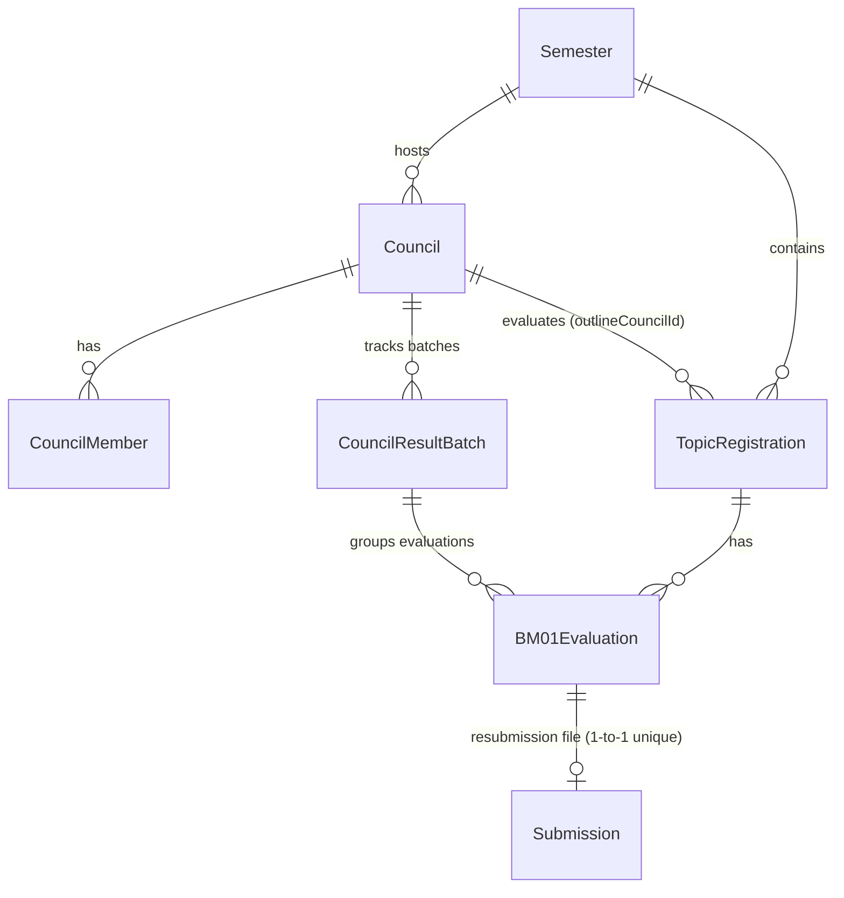
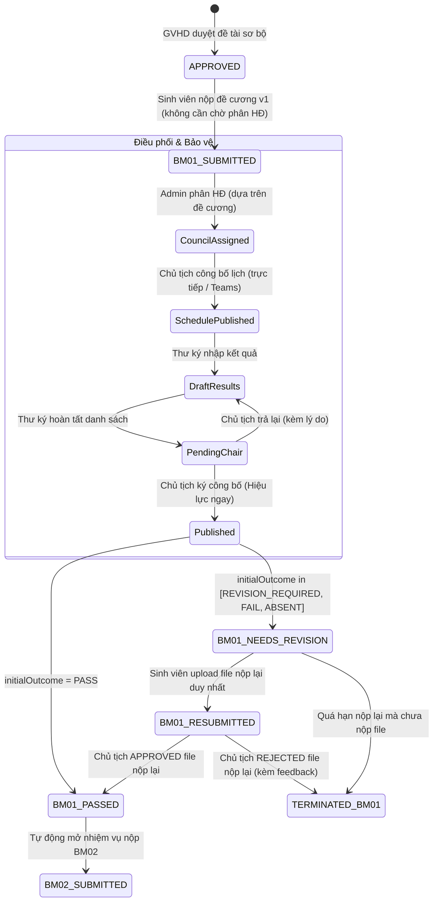

# Đặc Tả Thiết Kế: Hồ Sơ Đồ Án và Phân Hệ Xét Duyệt Đề Cương (BM01)

- **Ngày ban hành**: 2026-11-10
- **Trạng thái**: Chờ phê duyệt (Pending Approval)
- **Tài liệu tham chiếu**: [dac-ta-ky-thuat-ho-so-do-an-va-xet-duyet-de-cuong.md](file:///d:/DACN/dac-ta-ky-thuat-ho-so-do-an-va-xet-duyet-de-cuong.md)
- **Kiến trúc áp dụng**: Phương án 1 (Tiến hóa mở rộng trên CSDL hiện hữu, kết hợp phân tầng trạng thái độc lập).

---

## 1. Intent & The Why (Mục Đích & Bối Cảnh)

### Bối cảnh nghiệp vụ
Trong quy trình thực hiện đồ án tốt nghiệp, giai đoạn xét duyệt đề cương (BM01) là cửa ải học thuật đầu tiên và then chốt. Sau khi sinh viên đăng ký sơ bộ đề tài và được GVHD chấp thuận, sinh viên phải nộp đề cương để Hội đồng chuyên môn thẩm định tính khả thi, phương pháp nghiên cứu và hàm lượng khoa học. 

Trước đây, hệ thống chưa có phân hệ khép kín cho Hội đồng xét duyệt đề cương: thiếu quy trình cho Thư ký lập biên bản dự thảo, Chủ tịch chốt và công bố kết quả có hiệu lực tức thì, thiếu kiểm soát version file đề cương và cơ chế nộp lại duy nhất có khóa cứng nguyên tử.

### Mục tiêu cốt lõi
1. Xây dựng phân hệ Quản lý hồ sơ đồ án và Xét duyệt đề cương (BM01) tuân thủ nghiêm ngặt quy chế đào tạo đại học.
2. Đảm bảo tính toàn vẹn dữ liệu: không bao giờ ghi đè file cũ, lượt nộp lại là duy nhất (`maxSubmissions = 1`), bị khóa ngay khi upload hợp lệ đầu tiên hoàn tất.
3. Phân tách rõ ràng trách nhiệm 4 tác nhân:
   - **Admin**: Cấu hình thời gian đợt, thành lập Hội đồng xét duyệt đề cương, phân sinh viên, mở khóa kết quả theo ngoại lệ.
   - **Chủ tịch Hội đồng**: Công bố lịch bảo vệ (trực tiếp / Teams), đặt hạn nộp lại chung, công bố kết quả (hiệu lực ngay), duyệt/từ chối file nộp lại kèm nhận xét.
   - **Thư ký Hội đồng**: Nhập kết quả đánh giá dự thảo theo danh sách, chuyển Chủ tịch kiểm tra.
   - **Sinh viên**: Nộp đề cương ban đầu (trước khi phân hội đồng), tiếp thu góp ý và nộp lại đúng một lần nếu cần chỉnh sửa.

---

## 2. Goals, Non-Goals & Anti-Goals

### Goals (Mục tiêu đạt được)
- **G-01**: Cung cấp cấu hình đợt trên `Semester`: thời gian mở, hạn nộp chung toàn đợt, file mẫu, định dạng (`.docx`, `.pdf`) và dung lượng tối đa.
- **G-02**: Cho phép sinh viên nộp đề cương v1 ngay sau khi GVHD duyệt đề tài và đợt mở cổng nộp, không phụ thuộc vào việc đã được gán vào Hội đồng hay chưa.
- **G-03**: Cho phép Chủ tịch công bố lịch bảo vệ của Hội đồng (`IN_PERSON` hoặc `MICROSOFT_TEAMS`) sau khi kiểm tra điều kiện lịch bảo vệ phải sau hạn nộp chung của đợt và tất cả sinh viên được bảo vệ phải được gán vào Hội đồng.
- **G-04**: Quản lý đợt công bố kết quả qua bảng mới `CouncilResultBatch` theo vòng đời: `DRAFT` $\rightarrow$ `PENDING_CHAIR` $\rightarrow$ `PUBLISHED` $\rightarrow$ `REOPENED`.
- **G-05**: Mở rộng `BM01Evaluation` lưu chi tiết kết quả từng sinh viên: `initialOutcome` (`PASS`, `REVISION_REQUIRED`, `FAIL`, `ABSENT`), ý kiến nhận xét, yêu cầu chỉnh sửa, liên kết file nộp lại duy nhất và `revisionFeedback` khi Chủ tịch thẩm định file nộp lại.
- **G-06**: Tự động đồng bộ sang `RegistrationStatus`:
  - `PASS` $\rightarrow$ `BM01_PASSED` (tự động kích hoạt nhiệm vụ nộp đơn đăng ký đề tài chính thức BM02).
  - `REVISION_REQUIRED`, `FAIL`, `ABSENT` $\rightarrow$ `BM01_NEEDS_REVISION`.
  - Sinh viên nộp lại $\rightarrow$ `BM01_RESUBMITTED`.
  - Chủ tịch duyệt file nộp lại $\rightarrow$ `BM01_PASSED`; Chủ tịch từ chối hoặc hết hạn $\rightarrow$ `TERMINATED_BM01` (dừng đồ án trong đợt).
- **G-07**: Đảm bảo tính nguyên tử (atomicity) và chống race condition bằng Unique Constraint và Prisma Transaction.
- **G-08**: Bảo vệ tính toàn vẹn học vụ: Chặn Admin mở khóa kết quả nếu trong Hội đồng đã có sinh viên nộp/xử lý/duyệt đơn BM02 (`409 BM02_DEPENDENCY_EXISTS`).

### Non-Goals (Không thuộc phạm vi)
- Không chấm điểm bảo vệ đồ án cuối kỳ hoặc thành lập hội đồng bảo vệ cuối kỳ (đã được xử lý ở phân hệ bảo vệ).
- Không tự động gọi Graph API tạo Microsoft Teams meeting; phiên bản hiện tại lưu và xác thực HTTPS link do Chủ tịch cung cấp.
- Không tổ chức buổi họp bảo vệ đề cương bổ sung cho sinh viên phải nộp lại.

### Anti-Goals (Tuyệt đối không làm)
- **Không dồn toàn bộ trạng thái chi tiết của Hội đồng vào `RegistrationStatus`**: `RegistrationStatus` chỉ đóng vai trò trạng thái tổng hợp mức cao.
- **Không cho phép file nháp**: Bất kỳ file upload hợp lệ nào vào hệ thống đều trở thành bản nộp chính thức, bị khóa tức thì và không thể chỉnh sửa/thay thế.
- **Không ghi đè hoặc xóa lịch sử đánh giá**: Mọi lần đánh giá, mở khóa, công bố lại đều được lưu vết append-only phục vụ thanh tra đào tạo.
- **Không cho phép sinh viên nộp lại lần 2**: Chặn tuyệt đối ở tầng CSDL/Backend bằng Unique Constraint và transaction.
- **Không tự động âm thầm tạm treo đơn BM02 khi Admin mở khóa**: Phải fail-fast và yêu cầu thao tác độc lập có audit giải trình.

---

## 3. Constraints (Ràng Buộc Kỹ Thuật & Nghiệp Vụ)

1. **Ràng buộc Additive Migration**: Mọi thay đổi trong CSDL phải là additive; không xóa cột, không đổi tên bảng/cột cũ để không gây breaking change cho 66 test suites hiện hành.
2. **Ràng buộc quy chế 1 SV / 1 Đề tài**: Tuân thủ triệt để mô hình `TopicRegistration`, `maxStudents = 1`.
3. **Ràng buộc thời gian**:
   - `Semester.outlineSubmissionOpenAt < Semester.outlineSubmissionDeadline`.
   - `Council.defenseDate > Semester.outlineSubmissionDeadline`.
   - `Council.revisionSubmissionDeadline > CouncilResultBatch.chairPublishedAt`.
4. **Ràng buộc phân quyền theo Resource (Resource-based Authorization)**:
   - Chỉ Giảng viên có vai trò `CHAIR` của đúng `Council` đó mới được công bố lịch, công bố kết quả, trả hồ sơ, đặt hạn nộp lại và duyệt file nộp lại.
   - Chỉ `SECRETARY` hoặc `CHAIR` của đúng Hội đồng mới được nhập kết quả dự thảo.
   - Sinh viên chỉ được nộp đề cương của chính hồ sơ đồ án của mình.
5. **Ràng buộc Idempotency**: Mọi thao tác chuyển trạng thái nhạy cảm (`publish`, `secretary-complete`, `reopen`, `approve-resubmission`, `reject-resubmission`) phải hỗ trợ `Idempotency-Key` để ngăn chặn double-submission.

---

## 4. Approaches & Evaluation (Đánh Giá Phương Án)

### Các phương án đã cân nhắc
1. **Phương án 1 (Tiến hóa CSDL hiện hữu & Phân tầng trạng thái - ĐÃ CHỌN)**:
   - Tận dụng `Semester`, `TopicRegistration`, `Council(OUTLINE_REVIEW)`, `CouncilMember`, `BM01Evaluation`, `Submission`.
   - Bổ sung bảng `CouncilResultBatch` để điều phối vòng đời danh sách theo đợt.
   - Mở rộng `BM01Evaluation` lưu `initialOutcome` và unique relation tới file nộp lại.
   - Tái sử dụng `Task` loại `BM01`, quản lý 2 lần nộp qua 2 bản ghi `Submission` (v1 và v2) liên kết qua `submissionId` và `revisionSubmissionId`.
   - *Lý do chọn*: Tương thích 100% với hệ thống hiện hữu, tái sử dụng toàn bộ hạ tầng authentication, authorization, notification, và router đã ổn định; không gây phân mảnh dữ liệu.
2. **Phương án 2 (Cụm bảng độc lập song song - BỊ LOẠI)**:
   - Tạo mới `OutlineCouncil`, `DossierTask`, `DossierDocumentVersion`, `OutlineReviewResult`.
   - *Lý do loại*: Trùng lặp thực thể với `Council` và `TopicRegistration`, phát sinh rủi ro lệch pha dữ liệu giữa các bảng và phức tạp hóa bảo trì dài hạn.

---

## 5. Architectural Design & Implementation Details

### 5.1. Mô hình CSDL (Database Schema Extensions)



#### A. Mở rộng Model `Semester`
Bổ sung các trường cấu hình xét duyệt đề cương:
```prisma
// Trong model Semester:
outlineSubmissionOpenAt    DateTime? @map("outline_submission_open_at")
outlineSubmissionDeadline  DateTime? @map("outline_submission_deadline")
outlineTemplateFileUrl     String?   @map("outline_template_file_url")
outlineAllowedExtensions   String[]  @default([".docx", ".pdf"]) @map("outline_allowed_extensions")
outlineMaxFileSizeBytes    Int       @default(20971520) @map("outline_max_file_size_bytes") // 20 MB
```

#### B. Mở rộng Model `Council`
Bổ sung cấu hình phiên bảo vệ đề cương và hạn nộp lại:
```prisma
// Trong model Council:
meetingMode                CouncilMeetingMode? @default(IN_PERSON) @map("meeting_mode")
meetingUrl                 String?             @map("meeting_url")
schedulePublishedAt        DateTime?           @map("schedule_published_at")
revisionSubmissionDeadline DateTime?           @map("revision_submission_deadline")
rowVersion                 Int                 @default(1) @map("row_version")
resultBatches              CouncilResultBatch[]
```

#### C. Thêm Enum Mới
```prisma
enum CouncilMeetingMode {
  IN_PERSON
  MICROSOFT_TEAMS
}

enum CouncilBatchStatus {
  DRAFT
  PENDING_CHAIR
  PUBLISHED
  REOPENED
  SUPERSEDED
}

enum OutlineInitialOutcome {
  PASS
  REVISION_REQUIRED
  FAIL
  ABSENT
}

enum OutlineRevisionApprovalStatus {
  NOT_REQUIRED
  PENDING
  APPROVED
  REJECTED
}

enum AttendanceStatus {
  PRESENT
  ABSENT
  EXCUSED
}
```

#### D. Bổ sung Model `CouncilResultBatch`
Quản lý trạng thái danh sách kết quả theo Hội đồng:
```prisma
model CouncilResultBatch {
  id                    Int                 @id @default(autoincrement())
  councilId             Int                 @map("council_id")
  versionNumber         Int                 @default(1) @map("version_number")
  status                CouncilBatchStatus  @default(DRAFT)
  secretaryCompletedAt  DateTime?           @map("secretary_completed_at")
  secretaryCompletedById Int?               @map("secretary_completed_by_id")
  chairPublishedAt      DateTime?           @map("chair_published_at")
  chairPublishedById    Int?                @map("chair_published_by_id")
  returnedAt            DateTime?           @map("returned_at")
  returnedById          Int?                @map("returned_by_id")
  returnReason          String?             @map("return_reason")
  reopenedAt            DateTime?           @map("reopened_at")
  reopenedById          Int?                @map("reopened_by_id")
  reopenReason          String?             @map("reopen_reason")
  createdAt             DateTime            @default(now()) @map("created_at")
  updatedAt             DateTime            @updatedAt @map("updated_at")

  council               Council             @relation(fields: [councilId], references: [id], onDelete: Cascade)
  secretaryCompletedBy  User?               @relation("BatchSecretary", fields: [secretaryCompletedById], references: [id])
  chairPublishedBy      User?               @relation("BatchChair", fields: [chairPublishedById], references: [id])
  returnedBy            User?               @relation("BatchReturnedBy", fields: [returnedById], references: [id])
  reopenedBy            User?               @relation("BatchReopenedBy", fields: [reopenedById], references: [id])
  evaluations           BM01Evaluation[]

  @@unique([councilId, versionNumber])
  @@index([councilId, status])
  @@map("council_result_batches")
}
```

#### E. Mở rộng Model `BM01Evaluation`
Lưu kết quả chi tiết từng sinh viên, khóa cứng file nộp lại và lưu nhận xét thẩm định lại:
```prisma
// Bổ sung các trường vào BM01Evaluation:
councilId                   Int?                           @map("council_id")
batchId                     Int?                           @map("batch_id")
initialOutcome              OutlineInitialOutcome?         @map("initial_outcome")
attendanceStatus            AttendanceStatus?              @default(PRESENT) @map("attendance_status")
comment                     String?
revisionRequirements        String?                        @map("revision_requirements")
revisionSubmissionId        Int?                           @unique @map("revision_submission_id") // Unique 1-1 constraint!
revisionApprovalStatus      OutlineRevisionApprovalStatus? @default(NOT_REQUIRED) @map("revision_approval_status")
revisionReviewedAt          DateTime?                      @map("revision_reviewed_at")
revisionReviewedById        Int?                           @map("revision_reviewed_by_id")
revisionFeedback            String?                        @map("revision_feedback") // Lý do duyệt/từ chối của Chủ tịch

council                     Council?                       @relation(fields: [councilId], references: [id], onDelete: SetNull)
batch                       CouncilResultBatch?            @relation(fields: [batchId], references: [id], onDelete: SetNull)
revisionSubmission          Submission?                    @relation("BM01RevisionSubmission", fields: [revisionSubmissionId], references: [id], onDelete: Restrict)
revisionReviewedBy          User?                          @relation("BM01RevisionReviewedBy", fields: [revisionReviewedById], references: [id])
```

#### F. Cập nhật Enum `RegistrationStatus`
Thêm giá trị additive:
```prisma
// Thêm BM01_RESUBMITTED vào enum RegistrationStatus:
enum RegistrationStatus {
  ...
  BM01_SUBMITTED
  BM01_NEEDS_REVISION
  BM01_RESUBMITTED       // MỚI: Sinh viên đã nộp bản sửa đổi duy nhất
  BM01_PASSED
  ...
  TERMINATED_BM01        // Sinh viên bị từ chối đề cương hoặc quá hạn nộp lại
}
```

---

### 5.2. Luồng Nghiệp Vụ & Chuyển Đổi Trạng Thái (State Machine)



---

### 5.3. Chi Tiết Các Giao Dịch Backend Trọng Yếu

#### 1. Sinh viên nộp đề cương lần đầu (`POST /api/outline/submissions`)
- **Điều kiện**:
  - `TopicRegistration.status === 'APPROVED'`.
  - Thuộc đợt có `outlineSubmissionOpenAt <= now <= outlineSubmissionDeadline`.
  - Chưa sử dụng lần nộp v1 (kiểm tra `BM01Evaluation.submissionId === null`).
  - **Không bắt buộc sinh viên đã được phân Hội đồng**: file đề cương gắn liền với Hồ sơ đồ án (`TopicRegistration`).
  - File hợp lệ về MIME, extension (`.docx`, `.pdf`) và kích thước $\le$ `outlineMaxFileSizeBytes`.
- **Hành động trong Transaction**:
  1. Tạo `Submission` (version 1) gắn với `Task` loại `BM01`.
  2. Tạo/Cập nhật `BM01Evaluation` (attemptNo = 1, submissionId = submission.id, status = SUBMITTED).
  3. Cập nhật `TopicRegistration.status = 'BM01_SUBMITTED'`.

#### 2. Chủ tịch công bố lịch bảo vệ (`POST /api/councils/:id/schedule/publish`)
- **Điều kiện**:
  - Người thao tác là `CHAIR` của đúng Council đó.
  - Hội đồng có đủ Chủ tịch, Thư ký, thành viên và ít nhất 1 sinh viên.
  - **Bắt buộc**: Tất cả sinh viên được bảo vệ trong hội đồng phải có `outlineCouncilId === council.id`.
  - `defenseDate > Semester.outlineSubmissionDeadline`.
  - Nếu `meetingMode === 'IN_PERSON'`: bắt buộc có `location`.
  - Nếu `meetingMode === 'MICROSOFT_TEAMS'`: bắt buộc có `meetingUrl` (HTTPS hợp lệ).
- **Hành động**:
  1. Cập nhật `Council.schedulePublishedAt = now()`.
  2. Bắn thông báo outbox tới Sinh viên, GVHD và Thành viên hội đồng.

#### 3. Thư ký lưu nháp và hoàn tất kết quả
- **Lưu nháp từng sinh viên (`PUT /api/councils/:id/results/:registrationId`)**:
  - Quyền: `SECRETARY` hoặc `CHAIR`.
  - Cho phép lưu từng phần `initialOutcome`, `comment`, `revisionRequirements`, `attendanceStatus` khi batch ở `DRAFT` hoặc `REOPENED`.
- **Hoàn tất nhập kết quả (`POST /api/councils/:id/results/secretary-complete`)**:
  - Quyền: `SECRETARY` hoặc `CHAIR`.
  - **Validation**:
    + 100% sinh viên trong hội đồng phải có kết quả đánh giá.
    + Nếu `initialOutcome === 'REVISION_REQUIRED'`: bắt buộc `revisionRequirements` không được để trống.
  - **Hành động**: Chuyển `CouncilResultBatch.status = 'PENDING_CHAIR'`. Khóa quyền sửa của Thư ký.

#### 4. Chủ tịch trả lại danh sách kết quả (`POST /api/councils/:id/results/return`)
- **Điều kiện**: Người thao tác là `CHAIR`. Batch đang ở `PENDING_CHAIR`.
- **Validation**: Bắt buộc gửi kèm `returnReason` (lý do trả lại).
- **Hành động**:
  1. Chuyển `CouncilResultBatch.status = 'DRAFT'`.
  2. Ghi nhận `returnedAt = now()`, `returnedById`, `returnReason`.
  3. Mở lại quyền chỉnh sửa cho Thư ký và bắn thông báo cho Thư ký.

#### 5. Chủ tịch công bố kết quả (`POST /api/councils/:id/results/publish`)
- **Điều kiện**: Người thao tác là `CHAIR` của hội đồng. Batch đang ở `PENDING_CHAIR`.
- **Giao dịch nguyên tử (Atomic Transaction & Idempotent)**:
  1. Chuyển `CouncilResultBatch.status = 'PUBLISHED'`, ghi nhận `chairPublishedAt = now()`, `chairPublishedById`.
  2. Duyệt qua từng sinh viên:
     - Nếu `initialOutcome === 'PASS'`:
       + Cập nhật `BM01Evaluation.outcome = 'PASSED'`, `revisionApprovalStatus = 'NOT_REQUIRED'`.
       + Chuyển `TopicRegistration.status = 'BM01_PASSED'`.
       + Tự động tạo `Task` nộp đơn đăng ký đề tài chính thức BM02 (`SUBMIT_FORMAL_APPLICATION`).
     - Nếu `initialOutcome in ['REVISION_REQUIRED', 'FAIL', 'ABSENT']`:
       + Cập nhật `BM01Evaluation.outcome = 'NEEDS_REVISION'`, `revisionApprovalStatus = 'PENDING'`.
       + Chuyển `TopicRegistration.status = 'BM01_NEEDS_REVISION'`.
  3. Ghi audit log bất biến.
  4. Trả về kết quả công bố thành công.

#### 6. Chủ tịch thiết lập hạn nộp lại chung (`PUT /api/councils/:id/revision-deadline`)
- **Điều kiện**: Người thao tác là `CHAIR`. `deadline > now()`.
- **Hành động**:
  1. Cập nhật `Council.revisionSubmissionDeadline = deadline`.
  2. Tự động cập nhật `dueDate` của `Task` loại `BM01` cho tất cả sinh viên đang ở trạng thái `BM01_NEEDS_REVISION` thuộc hội đồng.
  3. Bắn thông báo cho sinh viên và GVHD.

#### 7. Sinh viên nộp lại đề cương duy nhất (`POST /api/outline/resubmissions`)
- **Điều kiện**:
  - Sinh viên sở hữu hồ sơ và đang ở trạng thái `BM01_NEEDS_REVISION`.
  - Thời gian hiện tại $\le$ `Council.revisionSubmissionDeadline`.
  - **Kiểm tra nguyên tử**: `BM01Evaluation.revisionSubmissionId === null` (chưa từng nộp lại).
- **Hành động trong Transaction**:
  1. Tạo `Submission` (version 2) gắn với cùng `Task` loại `BM01`.
  2. Cập nhật `BM01Evaluation.revisionSubmissionId = submission.id`. Unique constraint đảm bảo không thể có 2 bản ghi trỏ cùng lúc.
  3. Chuyển `TopicRegistration.status = 'BM01_RESUBMITTED'`.
  4. Bắn thông báo tới Chủ tịch hội đồng.
- *Lưu ý*: Upload hợp lệ đầu tiên bị khóa tức thì, không thể xóa hoặc thay thế.

#### 8. Chủ tịch xác nhận file nộp lại (`POST /api/councils/:id/resubmissions/:registrationId/review`)
- **Điều kiện**: Người thao tác là `CHAIR`. Sinh viên đang ở trạng thái `BM01_RESUBMITTED`.
- **Thao tác**:
  - Nếu `decision === 'APPROVE'`:
    + Cập nhật `BM01Evaluation.revisionApprovalStatus = 'APPROVED'`, `outcome = 'PASSED'`, `revisionFeedback`.
    + Chuyển `TopicRegistration.status = 'BM01_PASSED'`.
    + Tự động tạo nhiệm vụ nộp đơn đăng ký đề tài chính thức BM02.
  - Nếu `decision === 'REJECT'`:
    + Bắt buộc có `revisionFeedback` ghi rõ lý do học thuật không đạt.
    + Cập nhật `BM01Evaluation.revisionApprovalStatus = 'REJECTED'`, `outcome = 'TERMINATED'`, `revisionFeedback`.
    + Chuyển `TopicRegistration.status = 'TERMINATED_BM01'`.
    + Đóng hồ sơ đồ án của sinh viên trong đợt này.

#### 9. Xử lý quá hạn nộp lại (`POST /api/councils/:id/finalize-resubmissions`)
- **Cơ chế 2 lớp**:
  - *Lớp 1 (Lazy check)*: Khi sinh viên hoặc giảng viên truy vấn hồ sơ, nếu `status === 'BM01_NEEDS_REVISION'` và `now() > Council.revisionSubmissionDeadline` mà chưa nộp file (`revisionSubmissionId === null`), hệ thống tự động ghi nhận dừng đồ án `TERMINATED_BM01`.
  - *Lớp 2 (Chủ tịch chốt)*: Chủ tịch có nút "Chốt danh sách quá hạn nộp lại" để quét hàng loạt và đánh dấu `TERMINATED_BM01` cho tất cả các trường hợp bỏ lỡ hạn chót.

#### 10. Admin mở khóa kết quả (`POST /api/councils/:id/results/reopen`)
- **Điều kiện**: Người thao tác có quyền `ADMIN`. Bắt buộc gửi kèm `reason`.
- **Kiểm tra an toàn dữ liệu (Guard chống cascading corruption)**:
  1. Backend quét toàn bộ sinh viên trong Hội đồng.
  2. Nếu tồn tại bất kỳ sinh viên nào đã có hồ sơ BM02 (`SUBMITTED`, `APPROVED`, `RESUBMITTED`), **CHẶN MỞ KHÓA** và trả lỗi:
     ```json
     {
       "statusCode": 409,
       "error": "BM02_DEPENDENCY_EXISTS",
       "message": "Không thể mở khóa kết quả Hội đồng vì đã tồn tại dữ liệu đơn đăng ký đề tài BM02.",
       "blockingRegistrations": [
         { "registrationId": 12, "studentName": "Nguyễn Văn A", "bm02Status": "BM02_SUBMITTED" }
       ]
     }
     ```
  3. Admin/Khoa bắt buộc phải thu hồi hoặc xử lý đơn BM02 trước bằng một luồng ngoại lệ độc lập có lý do audit, không được tự động âm thầm xóa/treo BM02.
  4. Khi không còn phụ thuộc BM02: Chuyển `CouncilResultBatch.status = 'REOPENED'`, ghi nhận `reopenedAt = now()`, `reopenedById`, `reopenReason`. Thư ký và Chủ tịch thực hiện lại quy trình đánh giá và công bố.

---

### 5.4. Giao Diện Người Dùng (UI/UX)

1. **Cổng Sinh Viên (`StudentDashboardPage.jsx` & `SubmissionPage.jsx`)**:
   - Nộp đề cương v1 ngay trên trang nộp hồ sơ khi đợt mở cổng, không cần chờ xếp Hội đồng.
   - Khi được xếp Hội đồng: Thẻ thông tin phiên bảo vệ hiển thị thời gian, địa điểm hoặc nút tham gia "Tham gia Microsoft Teams".
   - Khu vực thông báo kết quả: Hiển thị kết luận ban đầu (`Đạt` / `Cần chỉnh sửa` / `Không đạt` / `Vắng mặt`), ý kiến nhận xét của Hội đồng và các yêu cầu sửa đổi.
   - Khu vực nộp lại duy nhất: Hiển thị hạn chót nộp lại của Hội đồng, ô upload file (kèm banner cảnh báo: "Bản nộp đầu tiên là bản chính thức và không thể thay thế"), nút nộp bị vô hiệu hóa ngay sau khi upload thành công.
2. **Cổng Giảng Viên - Hội Đồng (`CouncilOutlinePage.jsx` hoặc Tab Hội đồng Đề cương)**:
   - Dành cho Chủ tịch: Card công bố lịch bảo vệ (chọn trực tiếp / Teams), nút Đặt hạn nộp lại chung, nút Công bố kết quả chính thức, nút Trả lại thư ký, và Drawer thẩm định file nộp lại (Duyệt / Từ chối kèm nhận xét). Nút "Chốt danh sách quá hạn" để quét các sinh viên không nộp bài.
   - Dành cho Thư ký: Bảng nhập kết quả đánh giá (chọn `initialOutcome`, nhập nhận xét và yêu cầu chỉnh sửa), nút Lưu nháp từng sinh viên, nút Hoàn tất nhập kết quả chuyển Chủ tịch.
3. **Cổng Quản Trị Viên (`CouncilAssignmentPage.jsx` & `ProjectPeriodPage.jsx`)**:
   - Quản trị cấu hình nộp đề cương theo đợt học kỳ: Thời gian mở, hạn nộp chung toàn đợt, upload file mẫu.
   - Điều phối Hội đồng thẩm định đề cương: Two-column matcher ghép sinh viên vào Hội đồng `OUTLINE_REVIEW` dựa trên đề tài và file đề cương đã nộp.
   - Nút hành động ngoại lệ "Mở khóa kết quả Hội đồng" kèm modal bắt buộc nhập lý do mở khóa, hiển thị modal cảnh báo chi tiết nếu vướng phụ thuộc đơn BM02.

---

## 6. What's Left to the Builder (Nhiệm Vụ Của Đội Ngũ Triển Khai)

1. **Prisma Migration**:
   - Tạo migration additive bổ sung các trường vào `Semester`, `Council`, `BM01Evaluation`, và tạo bảng `CouncilResultBatch`.
   - Kiểm tra `npx prisma validate` và generate Prisma Client.
2. **Backend Services & Routes**:
   - Viết `outlineReviewService.js` chứa toàn bộ 10 nghiệp vụ chuyển trạng thái nguyên tử.
   - Viết các route controller trong `outlineController.js` và bổ sung middleware xác thực vai trò Hội đồng (`requireCouncilRole('CHAIR')`, `requireCouncilRole('SECRETARY')`).
   - Cập nhật `registrationTransitionService` để quản lý chuyển trạng thái `BM01_SUBMITTED`, `BM01_NEEDS_REVISION`, `BM01_RESUBMITTED`, `BM01_PASSED`, `TERMINATED_BM01`.
3. **Frontend Integration**:
   - Tích hợp API vào `outlineService.js` trên frontend.
   - Cập nhật giao diện sinh viên `SubmissionPage.jsx` hiển thị stepper đề cương và form nộp file duy nhất.
   - Hoàn thiện giao diện Hội đồng cho Giảng viên (Thư ký nhập biên bản, Chủ tịch ký duyệt và công bố).
4. **Unit & Integration Tests**:
   - Viết test suite chuyên biệt `tests/integration/outlineReviewWorkflow.test.js` bao phủ 100% các nhánh nghiệp vụ (PASS, REVISION $\rightarrow$ RESUBMIT $\rightarrow$ APPROVE/REJECT, OVERDUE, Reopen Dependency Guard, và Idempotency).
