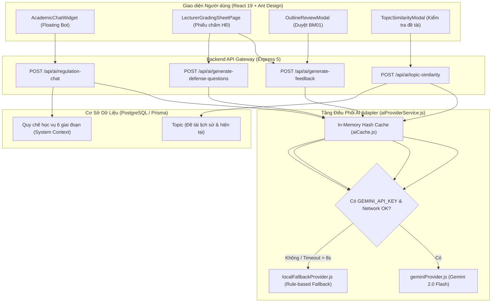

# Thiết Kế Chi Tiết: Bộ Tứ Tiện Ích Trí Tuệ Nhân Tạo Học Vụ Toàn Diện (Academic AI Assistant Suite)

**Ngày:** 12/11/2026  
**Trạng thái:** Đã thống nhất thiết kế (Phương án 1 - Mở rộng trên Nền tảng Hybrid Adapter có sẵn)  
**Phạm vi:** Backend AI Adapter, REST Endpoints, Frontend UI Components & Chatbot Widget  

---

## 1. Bối Cảnh & Mục Tiêu

### 1.1. Hiện trạng
Hệ thống Quản lý Đồ án & Khóa luận Tốt nghiệp (DACN) đã vận hành toàn vẹn 6 giai đoạn học vụ chuẩn hóa. Tuy nhiên, trong quá trình giảng dạy, hướng dẫn và chấm bảo vệ thực tế, các bên tham gia vẫn gặp những trở ngại đáng kể:
1. **Giảng viên hướng dẫn & Hội đồng**: Phải viết nhận xét chi tiết cho hàng chục sinh viên ở nhiều cột mốc (Duyệt đề cương BM01, Đánh giá tiến độ BM03, Phiếu nhận xét BM04, và Biên bản chấm bảo vệ). Việc soạn thảo văn bản học thuật tốn rất nhiều thời gian.
2. **Thành viên Hội đồng phản biện**: Thường phải đọc lướt nhanh báo cáo đồ án dày 70–100 trang trong thời gian ngắn để nghĩ các câu hỏi phản biện xác đáng, phân loại theo độ khó để kiểm tra sinh viên.
3. **Sinh viên**: Thường xuyên thắc mắc về các quy định, thời hạn (deadline), điều kiện dừng đề tài, thủ tục nộp lại v2, hoặc quy chuẩn nộp lưu chiểu 14 ngày, gây áp lực giải đáp liên tục lên Giáo vụ và GVHD.
4. **Kiểm tra tính mới đề tài**: Cần so khớp ngữ nghĩa đề tài mới với cả kho đề tài các năm trước lẫn các đề tài đang được thực hiện trong kỳ hiện tại để tránh trùng lặp ý tưởng.

### 1.2. Mục tiêu (Goals)
1. **AI Feedback Generator**: Tự động sinh nhận xét học thuật chuẩn mực cho GVHD và Hội đồng dựa trên điểm số đã chấm và ghi chú nhanh, kèm phân tích ưu điểm/nhược điểm và nút áp dụng 1 chạm.
2. **AI Defense Question Generator**: Tự động sinh 3–5 câu hỏi phản biện chuyên sâu cho Hội đồng bảo vệ phân theo 3 cấp độ (Kiến thức nền tảng, Thử thách kỹ thuật, Hướng mở rộng).
3. **Academic Regulation Chatbot Widget**: Bong bóng chat thông minh nổi ở góc màn hình (`AcademicChatWidget`), giải đáp 24/7 mọi quy chế học vụ (BM01 $\rightarrow$ BM04, lưu chiểu 14 ngày, điều kiện dừng, nộp lại v2 duy nhất) dựa trên dữ liệu chuẩn của Viện.
4. **Enhanced Semantic Topic Similarity**: So sánh ngữ nghĩa đề tài mới với kho đề tài lịch sử và các đề tài đang tuyển/thực hiện trong học kỳ hiện tại, chỉ ra % trùng lặp, điểm giống/khác và gợi ý 3 tên đề tài tăng tính mới.
5. **Zero-Crash Guarantee (Kiến trúc Hybrid Adapter)**: Toàn bộ 4 tính năng đều tự động kết nối Google Gemini 2.0 Flash API khi có internet và tự động chuyển mạch sang Local Rule-based Intelligence khi offline, đảm bảo hệ thống không bao giờ bị lỗi 500 khi demo.

---

## 2. Các Phương Án Đã Cân Nhắc (Approaches)

### 2.1. Phương án A: Tách RAG chuyên sâu với Vector Database độc lập (pgvector / ChromaDB)
- **Mô tả**: Cài đặt extension `pgvector` hoặc dựng server ChromaDB cục bộ, vector hóa quy chế và toàn bộ đề tài thành embeddings vector, thực hiện tìm kiếm k-NN.
- **Đánh đổi**: Nặng nề, phụ thuộc vào extension CSDL có thể không có trên Supabase free tier hoặc máy chấm thi offline, dễ lỗi kết nối khi demo, đi ngược lại tiêu chí "dễ, nhanh gọn".

### 2.2. Phương án B: Mở rộng trên Nền tảng Hybrid Adapter có sẵn kết hợp Mini AI Local (Đã chọn ⭐)
- **Mô tả**:
  * **Mini AI Local Embeddings (`@xenova/transformers` - `Xenova/all-MiniLM-L6-v2`)**: Xây dựng module `localEmbeddingService.js` chạy mô hình Sentence-Transformers thuần JS/WASM trực tiếp trên backend Node.js. Vector hóa đề tài thành dense vector 384 chiều và tính toán Cosine Similarity trong 5-10ms mà không cần GPU hay Python.
  * **Cloud Generative AI (Gemini 2.0 Flash API)**: Đảm nhận các tác vụ sinh văn bản học thuật tinh tế, nhận xét đa chiều, gợi ý câu hỏi phản biện 3 cấp độ và Chatbot hỏi đáp quy chế.
  * **Zero-Crash Rule-based Fallback**: Dự phòng 100% không bao giờ ném lỗi 500 khi mất mạng hoặc chưa nạp API key.
- **Lý do chọn**: Vừa chứng minh hàm lượng kỹ thuật tự chạy mô hình AI trực tiếp trong đồ án, vừa có chất lượng ngôn ngữ vượt trội từ Gemini Flash, lại bảo đảm demo mượt mà 100% không lỗi.

---

## 3. Kiến Trúc Hệ Thống & Hợp Đồng Dữ Liệu (API Contracts)



---

## 4. Chi Tiết Tính Năng Kỹ Thuật

### 4.1. Tiện ích 1: AI Sinh Nhận Xét Học Vụ (`POST /api/ai/generate-feedback`)
- **Mục đích**: Hỗ trợ GVHD và Hội đồng sinh đoạn văn nhận xét học thuật chuẩn chỉnh.
- **Request Body**:
  ```json
  {
    "contextType": "BM01" | "BM03" | "BM04" | "DEFENSE",
    "topicTitle": "Xây dựng hệ thống phát hiện gian lận giao dịch...",
    "studentName": "Nguyễn Văn A",
    "scores": {
      "formatScore": 8.5,
      "contentScore": 7.5,
      "applicabilityScore": 8.0,
      "attitudeScore": 9.0
    },
    "notes": "Lập trình tốt, cần bổ sung phần thực nghiệm đo lường hiệu năng"
  }
  ```
- **Response Body**:
  ```json
  {
    "success": true,
    "data": {
      "feedback": "Sinh viên thể hiện tinh thần làm việc nghiêm túc, hoàn thành tốt khối lượng công việc được giao...",
      "strengths": [
        "Nắm vững kiến thức chuyên môn và cấu trúc hệ thống",
        "Thái độ chuyên cần và chủ động trong nghiên cứu"
      ],
      "improvements": [
        "Cần bổ sung số liệu thực nghiệm đo lường chi tiết hơn trong báo cáo"
      ],
      "provider": "gemini-2.0-flash" | "local_fallback"
    }
  }
  ```

### 4.2. Tiện ích 2: AI Gợi Ý Câu Hỏi Phản Biện Cho Hội Đồng (`POST /api/ai/generate-defense-questions`)
- **Mục đích**: Hỗ trợ thành viên Hội đồng bảo vệ đặt câu hỏi đánh giá sinh viên.
- **Request Body**:
  ```json
  {
    "topicTitle": "Nghiên cứu ứng dụng Deep Learning trong phân loại ảnh y tế",
    "description": "Mục tiêu xây dựng mô hình CNN phân loại ảnh X-quang phổi...",
    "technologies": "Python, PyTorch, ResNet-50, FastAPI",
    "major": "Khoa học Dữ liệu & AI"
  }
  ```
- **Response Body**:
  ```json
  {
    "success": true,
    "data": {
      "questions": [
        {
          "level": "FOUNDATION",
          "levelLabel": "Kiến thức nền tảng",
          "question": "Em hãy giải thích lý do lựa chọn kiến trúc ResNet-50 thay vì các mạng CNN cổ điển như VGG?",
          "purpose": "Đánh giá mức độ hiểu biết bản chất thuật toán và lý thuyết học sâu của sinh viên."
        },
        {
          "level": "TECHNICAL_CHALLENGE",
          "levelLabel": "Thách thức kỹ thuật",
          "question": "Dữ liệu ảnh y tế thường gặp hiện tượng mất cân bằng lớp (imbalanced data), em đã xử lý bài toán này như thế nào trong quá trình huấn luyện?",
          "purpose": "Kiểm tra kỹ năng giải quyết vấn đề thực tế trong quy trình tiền xử lý và huấn luyện."
        },
        {
          "level": "FUTURE_EXPANSION",
          "levelLabel": "Hướng phát triển & Ứng dụng",
          "question": "Nếu triển khai mô hình này vào môi trường bệnh viện thực tế, em sẽ tối ưu độ trễ suy luận (inference latency) bằng giải pháp gì?",
          "purpose": "Đánh giá tầm nhìn ứng dụng thực tiễn và khả năng mở rộng sản phẩm."
        }
      ],
      "provider": "gemini-2.0-flash" | "local_fallback"
    }
  }
  ```

### 4.3. Tiện ích 3: Trợ Lý Hỏi Đáp Quy Chế Học Vụ (`POST /api/ai/regulation-chat`)
- **Mục đích**: Chatbot giải đáp tự động các quy chế, mốc thời gian và thủ tục đồ án.
- **Request Body**:
  ```json
  {
    "message": "Nếu đề cương BM01 của em bị hội đồng đánh giá chưa đạt thì có được nộp lại không?",
    "history": [
      { "role": "user", "content": "Chào bot" },
      { "role": "model", "content": "Xin chào! Tôi có thể hỗ trợ gì về quy chế đồ án cho bạn?" }
    ]
  }
  ```
- **Response Body**:
  ```json
  {
    "success": true,
    "data": {
      "reply": "Theo quy chế của Viện, nếu đề cương BM01 v1 bị Hội đồng đánh giá 'Cần chỉnh sửa', bạn được phép nộp lại duy nhất 01 lần (bản v2) trong thời hạn quy định. Bản nộp lại là căn cứ cuối cùng để Chủ tịch Hội đồng phê duyệt ĐẠT hoặc DỪNG ĐỀ TÀI.",
      "relatedRegulations": [
        "BM01: Đề cương chi tiết đồ án tốt nghiệp",
        "Quy định nộp lại v2 duy nhất (1 lần)"
      ],
      "suggestedQuickQuestions": [
        "Thời hạn nộp lại đề cương v2 là bao lâu?",
        "Nếu dừng đề tài ở bước BM01 thì xử lý thế nào?",
        "Khi nào được nộp đơn BM02 chính thức?"
      ],
      "provider": "gemini-2.0-flash" | "local_fallback"
    }
  }
  ```

### 4.4. Tiện ích 4: Mở Rộng Semantic Topic Similarity
- Tận dụng `POST /api/ai/topic-similarity` đã có. Mở rộng truy vấn CSDL: Lấy toàn bộ đề tài có trạng thái `APPROVED`, `COMPLETED`, `IN_PROGRESS` trong cả học kỳ hiện tại lẫn các học kỳ quá khứ, nâng cao độ tin cậy khi so sánh tính mới.

---

## 5. Quy Chuẩn Giao Diện (UI/UX) & Tuân Thủ Rule 2.6

1. **Floating Chatbot Widget (`AcademicChatWidget.jsx`)**:
   - Nằm ở góc dưới cùng bên phải màn hình (`fixed bottom-6 right-6 z-50`).
   - Nút mở chatbot: Sử dụng component `<Button shape="circle" icon={<MessageOutlined />} />` có badge thông báo hỗ trợ học vụ.
   - Khi mở: Cửa sổ chat kích thước $380 \times 520\text{px}$, giao diện Ant Design Card tinh gọn, hiển thị lịch sử chat, các gợi ý câu hỏi nhanh (Quick Question Chips), và thanh nhập câu hỏi.
2. **Nút Sinh Nhận Xét & Thẻ Câu Hỏi Phản Biện**:
   - Sử dụng prop `icon={<BulbOutlined />}` hoặc `icon={<QuestionCircleOutlined />}`.
   - Nhãn nút: `"AI Gợi ý nhận xét"`, `"Gợi ý câu hỏi phản biện"` (100% không chứa ký tự thô hay emoji theo Rule 2.6).
3. **Mã hóa**: 100% tệp lưu ở định dạng **UTF-8 (no BOM)**.

---

## 6. Chiến Lược Kiểm Thử & Xác Thực (Verification Strategy)

1. **Backend Unit & Integration Tests**:
   - Unit test kiểm tra các hàm sinh nhận xét, sinh câu hỏi và chatbot trong cả 2 trường hợp: Gemini online và Local fallback offline.
   - Integration test kiểm tra 3 API endpoints mới (`/generate-feedback`, `/generate-defense-questions`, `/regulation-chat`) với token hợp lệ, payload thiếu dữ liệu, và in-memory cache debouncing.
2. **Frontend UI Tests**:
   - Kiểm tra `AcademicChatWidget.jsx` render đúng vị trí, gửi tin nhắn và hiển thị câu trả lời.
   - Kiểm tra các nút bấm trên phiếu chấm bảo vệ và duyệt đề cương tuân thủ Rule 2.6.
3. **Full Regression & Build**:
   - Chạy toàn bộ 96+ backend test suites.
   - Chạy toàn bộ 177+ frontend tests.
   - Chạy `npm run build` xác nhận 0 lỗi.

