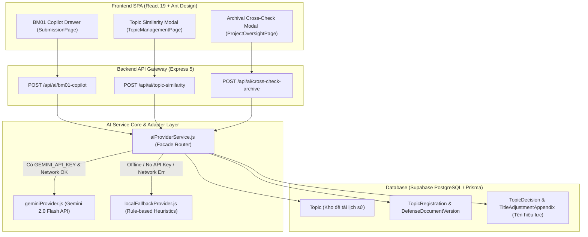

# Thiết Kế Chi Tiết: Bộ Ba Tiện Ích Trí Tuệ Nhân Tạo Học Vụ (Academic AI Suite)

**Ngày:** 12/11/2026  
**Mục tiêu:** Xây dựng bộ ba tiện ích AI hỗ trợ quy trình đồ án tốt nghiệp theo kiến trúc Hybrid Adapter (Cloud Gemini API + Local Fallback Lab):
1. **BM01 Copilot**: Đọc đề cương BM01, kiểm tra mức độ đầy đủ và tính logic 5 chiều, đưa ra cảnh báo & gợi ý hoàn thiện trước khi nộp.
2. **Phát hiện tương đồng đề tài (Semantic Topic Similarity)**: So sánh ngữ nghĩa với kho đề tài các năm trước, chỉ ra mức độ trùng lặp, điểm giống/khác và gợi ý đề tài tối ưu.
3. **Đối soát hồ sơ lưu chiểu (Archival Dossier Cross-Check)**: Bóc tách thông tin trang bìa tài liệu lưu chiểu (Word/PDF/PPTX), đối chiếu với tên đề tài chính thức (BM02/BM02-A), MSSV, GVHD trước khi Giáo vụ duyệt.

---

## 1. Bối Cảnh & Mục Tiêu

### 1.1. Hiện trạng
Sau khi hoàn tất toàn trình 6 giai đoạn học vụ (từ BM01 đến nộp lưu chiểu và cấp Giấy chứng nhận hoàn thành), hệ thống DACN đã sở hữu dữ liệu học vụ chuẩn hóa, toàn vẹn và bất biến. Tuy nhiên, vẫn còn những khâu đòi hỏi công sức rà soát thủ công lớn:
- **Đề cương BM01**: Sinh viên thường viết thiếu logic giữa Tên đề tài, Mục tiêu, Phạm vi và Phương pháp thực hiện, khiến GVHD và Hội đồng đề cương phải trả về yêu cầu sửa đổi nhiều lần (`BM01_NEEDS_REVISION`).
- **Đề tài trùng lặp**: Giảng viên và sinh viên khó tra cứu toàn bộ hàng trăm đề tài của các khóa trước; việc kiểm tra từ khóa thuần túy (keyword search) không phát hiện được các đề tài có ý tưởng giống nhau nhưng được viết bằng các từ đồng nghĩa khác nhau.
- **Đối soát lưu chiểu**: Giáo vụ phải mở thủ công từng file Báo cáo PDF/Word của từng sinh viên để soi xem trang bìa có in đúng tên đề tài trong Quyết định giao đề tài BM02 hoặc Phụ lục điều chỉnh tên BM02-A hay không, dễ dẫn đến sai sót hành chính trước khi Viện trưởng ký giấy xác nhận.

### 1.2. Mục tiêu (Goals)
1. **BM01 Copilot**: Tự động đánh giá đề cương BM01 trên 5 tiêu chí logic, đưa ra điểm hoàn thiện và danh sách khuyến nghị cụ thể trước khi sinh viên nộp chính thức.
2. **Kiểm tra tương đồng đề tài**: Đánh giá độ tương đồng ngữ nghĩa ($0\% - 100\%$), đối chiếu với kho đề tài lịch sử trong CSDL, bóc tách điểm giống / điểm khác và gợi ý 3 tên đề tài chuẩn khoa học.
3. **Đối soát lưu chiểu tự động**: Đối chiếu chính xác tên đề tài trên file báo cáo với tên có hiệu lực pháp lý (`resolveEffectiveTopicTitle`), kiểm tra MSSV, Họ tên sinh viên, GVHD và tính nhất quán giữa các file nộp.
4. **Kiến trúc Hybrid Adapter an toàn**: Mặc định ưu tiên kết nối Google Gemini 2.0 Flash API (xử lý nhanh, đọc PDF/Word native, miễn phí), tự động chuyển mạch sang Local Rule-based Provider khi không có internet hoặc chưa nạp API key, bảo đảm 100% không crash hệ thống.

---

## 2. Các Phương Án Kỹ Thuật Đã Cân Nhắc

1. **Phương án A (Chỉ dùng Cloud API - Gemini Flash)**:
   - Ưu điểm: Nhanh, thông minh, hỗ trợ đa phương thức (Multimodal PDF/Word) xuất sắc, không tốn tài nguyên máy chủ.
   - Nhược điểm: Phụ thuộc vào internet; nếu mất mạng trong phòng bảo vệ offline sẽ không demo được.
2. **Phương án B (Chỉ dùng Local AI qua Ollama / FastEmbed)**:
   - Ưu điểm: Hoàn toàn offline.
   - Nhược điểm: Cần GPU/RAM lớn (tối thiểu 8GB-16GB RAM trống); tốc độ sinh chậm; xử lý file PDF phức tạp dễ lỗi layout; khó triển khai đồng loạt trên mọi máy tính chấm thi.
3. **Phương án C (Kiến trúc Hybrid Adapter - Đã chọn)**:
   - Xây dựng tầng `backend/src/services/ai/aiProviderService.js` với các methods trừu tượng.
   - Kiểm tra cấu hình `GEMINI_API_KEY`: Nếu hợp lệ và có mạng, gọi Gemini 2.0 Flash. Nếu không, tự động fallback sang Local Rule-based Intelligence & Keyword Heuristics Provider.
   - *Lý do chọn:* Đáp ứng trọn vẹn cả tiêu chí thông minh vượt trội khi online lẫn độ ổn định tuyệt đối khi offline.

---

## 3. Kiến Trúc Hệ Thống & Hợp Đồng Dữ Liệu (Data Contracts)



---

## 4. Chi Tiết Tính Năng & API Endpoints

### 4.1. Tiện ích 1: BM01 Copilot (`POST /api/ai/bm01-copilot`)
- **Đầu vào (Request Body)**:
  ```json
  {
    "registrationId": 12,
    "outlineContent": {
      "topicTitle": "Xây dựng hệ thống phát hiện xâm nhập mạng sử dụng Deep Learning",
      "researchContext": "Bối cảnh an toàn thông tin hiện nay...",
      "objectives": "Xây dựng mô hình CNN-LSTM phân loại gói tin độc hại với độ chính xác trên 95%...",
      "scope": "Thực nghiệm trên tập dữ liệu NSL-KDD và CIC-IDS2017 trong môi trường lab...",
      "methodology": "Tiền xử lý dữ liệu, trích xuất đặc trưng, huấn luyện mô hình kết hợp CNN và LSTM...",
      "expectedDeliverables": "Source code hệ thống, mô hình đã huấn luyện, bài báo cáo tốt nghiệp."
    }
  }
  ```
- **Xử lý**:
  - Đánh giá 5 chiều logic:
    1. *Tên đề tài $\leftrightarrow$ Mục tiêu*: Tên đề tài có bao quát đúng mục tiêu cụ thể không?
    2. *Mục tiêu $\leftrightarrow$ Phạm vi*: Mục tiêu có vượt quá phạm vi đồ án tốt nghiệp hay quá hạn hẹp không?
    3. *Mục tiêu $\leftrightarrow$ Phương pháp*: Phương pháp đề xuất có khả thi để đạt được mục tiêu không?
    4. *Phương pháp $\leftrightarrow$ Sản phẩm dự kiến*: Sản phẩm có đo lường được kết quả của phương pháp không?
    5. *Tính hoàn thiện học thuật*: Định dạng, mức độ chi tiết và tính rõ ràng.
- **Đầu ra (Response Body)**:
  ```json
  {
    "success": true,
    "data": {
      "overallScore": 8.5,
      "status": "GOOD",
      "summary": "Đề cương có tính logic cao giữa mục tiêu và phương pháp thực hiện. Tuy nhiên cần làm rõ hơn chỉ số đánh giá thực nghiệm.",
      "dimensions": [
        { "name": "Tính logic Tên - Mục tiêu", "status": "PASS", "feedback": "Mục tiêu thể hiện rõ ràng định hướng đã nêu ở tên đề tài." },
        { "name": "Tính khả thi Phương pháp", "status": "PASS", "feedback": "Mô hình CNN-LSTM phù hợp với dữ liệu chuỗi thời gian gói tin." },
        { "name": "Phạm vi & Dữ liệu", "status": "WARNING", "feedback": "Tập dữ liệu CIC-IDS2017 rất lớn, cần nêu rõ tỷ lệ chia tập train/test." },
        { "name": "Sản phẩm dự kiến", "status": "PASS", "feedback": "Sản phẩm bàn giao cụ thể, có thể nghiệm thu được." }
      ],
      "actionableSuggestions": [
        "Nên bổ sung cấu hình môi trường phần cứng dự kiến dùng để huấn luyện mô hình.",
        "Xác định rõ các độ đo đánh giá mô hình: Precision, Recall, F1-Score bên cạnh Accuracy."
      ],
      "provider": "gemini-2.0-flash"
    }
  }
  ```

---

### 4.2. Tiện ích 2: Phát Hiện Tương Đồng Đề Tài (`POST /api/ai/topic-similarity`)
- **Đầu vào (Request Body)**:
  ```json
  {
    "title": "Nghiên cứu và ứng dụng Computer Vision trong giám sát an toàn giao thông đô thị",
    "summary": "Sử dụng YOLOv8 và DeepSORT để đếm phương tiện và phát hiện phương tiện vượt đèn đỏ qua camera giao thông.",
    "semesterId": 1
  }
  ```
- **Xử lý**:
  - Truy vấn CSDL danh sách các đề tài đã duyệt / đã bảo vệ ở các học kỳ trước trong cùng chuyên ngành (`Topic` table).
  - So sánh đối chiếu ngữ nghĩa đa chiều giữa đề tài mới và các đề tài cũ.
  - Phân loại mức độ tương đồng:
    * `NOVEL` ($< 40\%$): Đề tài có tính mới cao, không trùng lặp.
    * `MODERATE_SIMILARITY` ($40\% - 70\%$): Có sự tương đồng về hướng tiếp cận hoặc công nghệ, cần làm rõ điểm khác biệt.
    * `HIGH_DUPLICATE_RISK` ($> 70\%$): Nguy cơ trùng lặp ý tưởng nghiêm trọng với đề tài cũ.
- **Đầu ra (Response Body)**:
  ```json
  {
    "success": true,
    "data": {
      "maxSimilarityPercentage": 75,
      "riskLevel": "HIGH_DUPLICATE_RISK",
      "verdict": "Đề tài có nguy cơ trùng lặp cao với một đề tài đã thực hiện ở Học kỳ 1 2024-2025.",
      "matchedTopics": [
        {
          "topicId": 45,
          "title": "Nhận diện phương tiện vi phạm luật giao thông qua camera an ninh sử dụng YOLOv8",
          "mentorName": "TS. Lê Hoàng C",
          "semester": "HK1 2024-2025",
          "similarityPercentage": 75,
          "similarities": "Cùng sử dụng mô hình YOLOv8 trên luồng video camera giao thông để phát hiện lỗi vi phạm.",
          "differences": "Đề tài mới có bổ sung thuật toán DeepSORT để theo dõi hành trình xe và đếm mật độ lưu thông."
        }
      ],
      "refinedTitleSuggestions": [
        "Hệ thống đa tác vụ giám sát mật độ và phát hiện phương tiện vượt đèn đỏ theo thời gian thực sử dụng YOLOv8-DeepSORT",
        "Tích hợp DeepSORT và mạng nơ-ron tích chập trong phân tích dòng giao thông đô thị thông minh",
        "Ứng dụng thị giác máy tính nâng cao trong định danh hành trình và giám sát an toàn giao thông tại nút giao"
      ],
      "provider": "gemini-2.0-flash"
    }
  }
  ```

---

### 4.3. Tiện ích 3: Đối Soát Hồ Sơ Lưu Chiểu Tự Động (`POST /api/ai/cross-check-archive`)
- **Đầu vào (Request Body)**:
  ```json
  {
    "registrationId": 12
  }
  ```
- **Xử lý**:
  - Truy vấn CSDL phân giải tên đề tài có hiệu lực chính thức qua `resolveEffectiveTopicTitle` (ưu tiên Phụ lục BM02-A `ISSUED` mới nhất $\rightarrow$ Quyết định giao đề tài BM02 $\rightarrow$ Tên gốc).
  - Lấy thông tin sinh viên (`fullName`, `code`), GVHD (`fullName`, `academicTitle`).
  - Lấy metadata và đường dẫn của 4 file lưu chiểu đã tải lên (`REPORT_PDF`, `REPORT_WORD`, `SLIDE_PPTX`, `DEMO_VIDEO`).
  - AI đọc trang bìa tài liệu và đối soát từng trường dữ liệu.
- **Đầu ra (Response Body)**:
  ```json
  {
    "success": true,
    "data": {
      "overallStatus": "MATCHED",
      "effectiveOfficialTitle": "Phân tích mã độc sử dụng học sâu",
      "checklist": [
        {
          "field": "Tên đề tài trên bìa Báo cáo",
          "expected": "Phân tích mã độc sử dụng học sâu",
          "extracted": "Phân tích mã độc sử dụng học sâu",
          "status": "EXACT_MATCH"
        },
        {
          "field": "Mã số sinh viên (MSSV)",
          "expected": "21001234",
          "extracted": "21001234",
          "status": "EXACT_MATCH"
        },
        {
          "field": "Họ tên sinh viên",
          "expected": "Trần Văn An",
          "extracted": "Trần Văn An",
          "status": "EXACT_MATCH"
        },
        {
          "field": "Họ tên Giảng viên hướng dẫn",
          "expected": "TS. Phạm Minh Tuấn",
          "extracted": "TS. Phạm Minh Tuấn",
          "status": "EXACT_MATCH"
        },
        {
          "field": "Tính đồng bộ giữa Word, PDF và Slide",
          "status": "CONSISTENT",
          "notes": "Các tệp đều phản ánh cùng tên đề tài và thông tin tác giả thống nhất."
        }
      ],
      "discrepancies": [],
      "academicAffairsGuidance": "Hồ sơ lưu chiểu hoàn toàn chuẩn xác về mặt định dạng bìa và tính pháp lý. Đủ điều kiện để Giáo vụ duyệt thủ tục.",
      "provider": "gemini-2.0-flash"
    }
  }
  ```

---

## 5. Thiết Kế Giao Diện UI/UX & Tương Tác

1. **Giao Diện BM01 Copilot (`BM01CopilotDrawer.jsx`)**:
   - Tích hợp tại `SubmissionPage.jsx` và `HybridBMFormModal.jsx`.
   - Nút kích hoạt: `<Button icon={<RobotOutlined />} type="dashed">Đánh giá đề cương với AI</Button>` (tuân thủ Rule 2.6).
   - Hiển thị Drawer bên phải với:
     * Gauge tiến độ / Điểm tổng quan ($8.5/10$).
     * Danh sách 4 chiều logic với thẻ tag màu: Đạt (Xanh), Cảnh báo (Vàng), Chưa đạt (Đỏ).
     * Hộp gợi ý hành động cụ thể có nút copy hoặc áp dụng nhanh.
2. **Giao Diện Kiểm Tra Trùng Lặp Đề Tài (`TopicSimilarityModal.jsx`)**:
   - Tích hợp tại `TopicManagementPage.jsx`, `TopicApprovalPage.jsx` và `ProjectEnrollmentPage.jsx`.
   - Nút kích hoạt: `<Button icon={<AuditOutlined />}>Kiểm tra tính mới AI</Button>`.
   - Hiển thị Modal so sánh trực quan: Thanh Progress Bar độ tương đồng, bảng đối chiếu với đề tài khóa trước, và 3 gợi ý tên đề tài có thể bấm "Chọn tên này" để tự điền vào ô input tên đề tài.
3. **Giao Diện Đối Soát Lưu Chiểu Giáo Vụ (`ArchivalCrossCheckModal.jsx`)**:
   - Tích hợp tại `ProjectOversightPage.jsx` (Tab Kho lưu chiểu) và `ArchiveSubmissionModal.jsx`.
   - Nút trong bảng lưu chiểu của Giáo vụ: `<Button size="small" icon={<ScanOutlined />}>AI Đối soát</Button>`.
   - Hiển thị bảng đối chiếu 2 cột: **Thông tin pháp lý hệ thống** đối chiếu với **Thông tin AI đọc từ file scan/PDF**, kèm kết luận màu xanh lục nếu khớp $100\%$ hoặc cảnh báo đỏ nếu phát hiện lệch tên đề tài.

---

## 6. Phân Quyền & Bảo Mật (RBAC & Safety)

1. **Kiểm tra quyền truy cập API**:
   - `POST /api/ai/bm01-copilot`: Sinh viên sở hữu hồ sơ, GVHD hướng dẫn đề tài, hoặc Admin/Giáo vụ.
   - `POST /api/ai/topic-similarity`: Toàn bộ người dùng đăng nhập (Sinh viên, Giảng viên, Admin).
   - `POST /api/ai/cross-check-archive`: Giáo vụ/Admin (`FINAL_DOCUMENT_REVIEW`), GVHD duyệt lưu chiểu, và sinh viên xem trước kết quả đối soát của chính mình.
2. **Bảo vệ API Key & Rate Limiting**:
   - API Key được lưu bí mật tại biến môi trường `GEMINI_API_KEY` ở backend, tuyệt đối không lộ xuống frontend client.
   - Cơ chế debounce / in-memory cache theo `hash(payload)`: Nếu người dùng bấm liên tục cùng một nội dung đề cương hoặc đề tài trong vòng 5 phút, backend trả về kết quả cache ngay lập tức để tiết kiệm quota API.

---

## 7. Kế Hoạch Kiểm Thử & Nghiệm Thu (Verification Plan)

1. **Unit & Integration Tests Backend**:
   - `backend/tests/integration/aiSuiteWorkflow.test.js`:
     * Test BM01 Copilot trả về đủ 5 chiều phân tích và gợi ý.
     * Test Topic Similarity phân loại chính xác đề tài mới (<40%) và đề tài trùng lặp (>70%).
     * Test Archival Cross-Check phát hiện chính xác khi tên đề tài trên file khớp hoặc không khớp với BM02-A.
     * Test cơ chế Fallback tự động khi không có API key / ngắt mạng (chạy an toàn, trả kết quả hợp lệ mà không ném lỗi 500).
2. **Frontend Component Tests**:
   - `frontend/src/pages/__tests__/aiSuiteComponents.test.js`:
     * Kiểm tra cấu trúc các components `BM01CopilotDrawer`, `TopicSimilarityModal`, `ArchivalCrossCheckModal`.
     * Tuân thủ 100% Rule 2.6 UI Button Standards (không chèn ký tự thô / emoji vào nhãn nút bấm).
     * Chuẩn mã hóa UTF-8 (no BOM).
3. **Kiểm thử hệ thống**:
   - Toàn bộ backend test suite và frontend test suite tiếp tục đạt 100% PASS.
   - Bản dựng `npm run build` thành công 0 lỗi.

