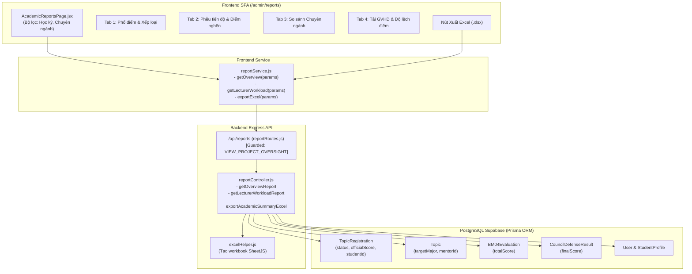

# Đặc Tả Thiết Kế Kỹ Thuật (Design Doc)
## Trung Tâm Báo Cáo Thống Kê Học Vụ Chuyên Sâu (Academic BI & Reporting Hub)

- **Ngày ban hành:** 12/11/2026
- **Trạng thái:** DRAFT - Chờ phê duyệt (Pending Approval)
- **Phương án lựa chọn:** Trang Báo Cáo Phân Tích Chuyên Biệt (`/admin/reports`)
- **Tài liệu nền tảng:**
  - [CLAUDE.md](file:///d:/DACN/CLAUDE.md)
  - [AGENTS.md](file:///d:/DACN/AGENTS.md)
  - [Package 1 Plan & Spec](file:///d:/DACN/docs/superpowers/specs/2026-11-12-package-1-security-and-fake-data-remediation-design.md)
  - [Package 2 Plan & Spec](file:///d:/DACN/docs/superpowers/specs/2026-11-12-package-2-state-history-timeline-and-missing-management-design.md)

---

## 1. Bối Cảnh & Mục Tiêu Nghiệp Vụ (Context & Business Goals)

Sau khi hoàn thiện chuỗi quy trình học vụ 6 giai đoạn và triệt tiêu 100% dữ liệu giả trong Gói 1 và Gói 2, toàn bộ dữ liệu học vụ từ đề cương, nhật ký gặp, điểm quá trình BM04, điểm bảo vệ hội đồng và nộp lưu chiểu đã được lưu trữ thực tế, có cấu trúc và bất biến trong CSDL PostgreSQL.

Tuy nhiên, lãnh đạo Viện Công nghệ Số (Viện trưởng, Phó Viện trưởng), Giáo vụ và Trưởng các Bộ môn hiện đang thiếu một **Trung tâm Báo cáo Học vụ Chuyên sâu (Academic BI & Reporting Hub)** để:
1. Xem bức tranh tổng thể đa chiều về kết quả tốt nghiệp của từng học kỳ và từng chuyên ngành.
2. Phân tích phổ điểm chính thức và đối chiếu độ chênh lệch giữa điểm GVHD đánh giá quá trình (BM04) với điểm Hội đồng chấm bảo vệ.
3. Phát hiện điểm nghẽn học vụ thông qua Phễu tiến độ (Funnel) 6 giai đoạn (tỷ lệ rơi rụng ở BM01, BM03 hay BM04).
4. Xuất file Excel (.xlsx) bảng tổng hợp kết quả đồ án tốt nghiệp chính thức để lưu trữ và báo cáo Nhà trường/Phòng Đào tạo.

---

## 2. Mục Tiêu & Giới Hạn (Goals & Non-Goals)

### 2.1. Mục tiêu (Goals)
1. **Bộ API Thống kê Tổng hợp Đa Chiều (Backend BI APIs)**:
   - `GET /api/reports/overview`: Thống kê tổng quan học kỳ, phổ điểm và tỷ lệ xếp loại (Xuất sắc, Giỏi, Khá, Trung bình, Chưa đạt), so sánh các chuyên ngành, và phễu tiến độ chuyển đổi qua 6 mốc.
   - `GET /api/reports/lecturer-workload`: Thống kê tải hướng dẫn của từng giảng viên (số lượng SV, tỷ lệ hoàn thành, điểm BM04 TB, điểm Hội đồng TB, độ lệch điểm $\Delta$).
   - `GET /api/reports/export-excel`: Xuất file Excel (.xlsx) danh sách tổng hợp kết quả đồ án của học kỳ (hỗ trợ lọc theo chuyên ngành).
2. **Giao diện Báo cáo Chuyên sâu (Frontend UI Hub)**:
   - Trang riêng biệt [`frontend/src/pages/admin/AcademicReportsPage.jsx`](file:///d:/DACN/frontend/src/pages/admin/AcademicReportsPage.jsx) tại route `/admin/reports`.
   - Điều hướng: Thêm mục **"Báo Cáo & Thống Kê"** trên thanh Menu Quản trị (`AppLayout.jsx` và `NAVIGATION_REGISTRY`).
   - 4 Tab phân tích dữ liệu:
     * **Tab 1 - Phổ điểm & Xếp loại**: Biểu đồ phân bổ điểm, thống kê điểm cao nhất, thấp nhất, trung bình và bảng tỷ lệ xếp loại tốt nghiệp.
     * **Tab 2 - Phễu tiến độ & Điểm nghẽn**: Biểu đồ phễu 6 mốc học vụ (Đăng ký $\rightarrow$ BM01 $\rightarrow$ BM02 $\rightarrow$ BM03 $\rightarrow$ BM04 $\rightarrow$ Bảo vệ $\rightarrow$ Hoàn thành) kèm tỷ lệ chuyển đổi %.
     * **Tab 3 - So sánh Chuyên ngành**: Bảng so sánh chỉ số giữa các ngành (KTPM, HTTT, KHMT, ATTT, CNTT).
     * **Tab 4 - Tải hướng dẫn & Giảng viên**: Bảng theo dõi kết quả hướng dẫn của từng thầy/cô.
   - Nút **"Xuất Báo Cáo Excel (.xlsx)"** tải file thực tế về máy tính.
3. **Tuân thủ quy chuẩn**:
   - Phân quyền bảo mật: Yêu cầu quyền `PROJECT_OVERSIGHT_MANAGE` hoặc `VIEW_PROJECT_OVERSIGHT` hoặc role `ADMIN` / `VIEN_TRUONG`.
   - Chuẩn nút bấm Rule 2.6: Dùng `@ant-design/icons` và text tiếng Việt thuần túy.
   - Dữ liệu 100% thực tế từ CSDL Prisma (Zero mock).

### 2.2. Giới hạn (Non-Goals)
- Không can thiệp hoặc sửa đổi dữ liệu điểm/trạng thái (đây là module phân tích Read-Only và Export).
- Không cần cài thêm thư viện ngoài (sử dụng thư viện `xlsx` đã có sẵn trong Backend và Ant Design 5 trong Frontend).

---

## 3. Kiến Trúc Kỹ Thuật (Architecture & Flow)



---

## 4. Đặc Tả Giao Diện Lập Trình (API Specifications)

### 4.1. `GET /api/reports/overview`
- **Mô tả:** Lấy số liệu tổng hợp về tiến độ, phổ điểm và xếp loại học vụ cho học kỳ được chọn.
- **Query params:** `semesterId` (number, optional, mặc định là active semester), `major` (string, optional).
- **Phân quyền:** Quyền `VIEW_PROJECT_OVERSIGHT` hoặc `PROJECT_OVERSIGHT_MANAGE` hoặc role `ADMIN`.
- **Dữ liệu trả về (Response):**
  ```json
  {
    "success": true,
    "data": {
      "semester": { "id": 1, "name": "Học kỳ 1 2026-2027" },
      "kpis": {
        "totalStudents": 45,
        "completedCount": 38,
        "completionRate": 84.4,
        "averageScore": 8.12,
        "maxScore": 9.6,
        "minScore": 4.5
      },
      "gradeDistribution": [
        { "grade": "EXCELLENT", "label": "Xuất sắc (8.5 - 10)", "count": 18, "percent": 40.0, "color": "#10B981" },
        { "grade": "GOOD", "label": "Giỏi (7.0 - 8.4)", "count": 15, "percent": 33.3, "color": "#0F766E" },
        { "grade": "FAIR", "label": "Khá (5.5 - 6.9)", "count": 4, "percent": 8.9, "color": "#F59E0B" },
        { "grade": "AVERAGE", "label": "Trung bình (4.0 - 5.4)", "count": 1, "percent": 2.2, "color": "#64748B" },
        { "grade": "FAILED", "label": "Chưa đạt (< 4.0 / Vắng)", "count": 7, "percent": 15.6, "color": "#EF4444" }
      ],
      "funnel": [
        { "step": "ENROLLED", "label": "Đăng ký đề tài", "count": 45, "rate": 100 },
        { "step": "BM01_PASSED", "label": "Đề cương Đạt", "count": 43, "rate": 95.6 },
        { "step": "DECISION_ISSUED", "label": "Giao đề tài chính thức", "count": 42, "rate": 93.3 },
        { "step": "BM03_PASSED", "label": "Hoàn thành tiến độ BM03", "count": 40, "rate": 88.9 },
        { "step": "DEFENSE_READY", "label": "Đủ điều kiện bảo vệ", "count": 39, "rate": 86.7 },
        { "step": "COMPLETED", "label": "Bảo vệ & Lưu chiểu thành công", "count": 38, "rate": 84.4 }
      ],
      "majors": [
        { "major": "Kỹ thuật Phần mềm", "studentCount": 20, "completedCount": 18, "avgScore": 8.25 },
        { "major": "Hệ thống Thông tin", "studentCount": 15, "completedCount": 12, "avgScore": 7.95 },
        { "major": "Khoa học Dữ liệu", "studentCount": 10, "completedCount": 8, "avgScore": 8.1 }
      ]
    }
  }
  ```

### 4.2. `GET /api/reports/lecturer-workload`
- **Mô tả:** Lấy danh sách thống kê tải hướng dẫn và đánh giá của tất cả giảng viên trong học kỳ.
- **Query params:** `semesterId` (number, optional).
- **Phân quyền:** Quyền `VIEW_PROJECT_OVERSIGHT` hoặc `PROJECT_OVERSIGHT_MANAGE` hoặc role `ADMIN`.
- **Dữ liệu trả về (Response):**
  ```json
  {
    "success": true,
    "data": [
      {
        "lecturerId": 12,
        "fullName": "TS. Nguyễn Văn A",
        "email": "nva@university.edu.vn",
        "department": "Kỹ thuật Phần mềm",
        "assignedCount": 8,
        "completedCount": 8,
        "completionRate": 100.0,
        "avgMentorScore": 8.5,
        "avgCouncilScore": 8.35,
        "variance": 0.15
      }
    ]
  }
  ```

### 4.3. `GET /api/reports/export-excel`
- **Mô tả:** Xuất file Excel (.xlsx) bảng tổng hợp kết quả tốt nghiệp của toàn bộ học kỳ.
- **Headers:** `Content-Type: application/vnd.openxmlformats-officedocument.spreadsheetml.sheet`, `Content-Disposition: attachment; filename="Bang_Tong_Hop_Ket_Qua_Tot_Nghiep_<HocKy>.xlsx"`.
- **Cấu trúc bảng tính (Sheets):**
  - Cột: STT | Mã SV | Họ và tên | Chuyên ngành | Tên đề tài | GVHD | Điểm Quá trình (BM04) | Điểm Hội đồng | Điểm Tổng kết | Xếp loại | Trạng thái

---

## 5. Đặc Tả Giao Diện Frontend (`/admin/reports`)

- **Component:** `frontend/src/pages/admin/AcademicReportsPage.jsx`
- **Bố cục giao diện**:
  1. **Top Bar**:
     - Tiêu đề: "Báo Cáo & Thống Kê Học Vụ Chuyên Sâu"
     - Select chọn Học kỳ (`semesterList`).
     - Select lọc Chuyên ngành (Tất cả / KTPM / HTTT / KHDL / ATTT).
     - Nút: `<Button type="primary" icon={<DownloadOutlined />} onClick={handleExportExcel} loading={exporting}>Xuất Báo Cáo Excel</Button>`.
  2. **4 Thẻ Thống Kê Nhanh (KPI Banner)**:
     - Thẻ 1: Tổng sinh viên tham gia (`totalStudents`).
     - Thẻ 2: Tỷ lệ hoàn thành đồ án (`completionRate%`).
     - Thẻ 3: Điểm trung bình toàn viện (`averageScore`).
     - Thẻ 4: Tỷ lệ Xuất sắc & Giỏi (`excellenceRate%`).
  3. **Ant Design `<Tabs>` gồm 4 Tab**:
     - `Tab 1: Phổ điểm & Xếp loại`: Thanh phân bổ trực quan theo màu sắc chuẩn + Bảng chi tiết từng mức điểm.
     - `Tab 2: Phễu tiến độ học vụ`: Thanh tiến trình tỷ lệ rơi rụng qua 6 giai đoạn + Cảnh báo giai đoạn có tỷ lệ dừng cao.
     - `Tab 3: So sánh Chuyên ngành`: Bảng thống kê so sánh số lượng và điểm trung bình theo từng ngành.
     - `Tab 4: Tải GVHD & Độ lệch điểm`: Bảng thống kê từng giảng viên, có tag cảnh báo nếu độ lệch điểm GVHD vs Hội đồng $> 1.5$ điểm.

---

## 6. Kế Hoạch Kiểm Thử & Tiêu Chí Nghiệm Thu

1. **Backend Integration Tests (`packageReports.test.js`)**:
   - Kiểm tra `GET /api/reports/overview` tính toán chính xác phổ điểm và phễu tiến độ.
   - Kiểm tra `GET /api/reports/lecturer-workload` tính đúng số lượng SV và điểm trung bình của GVHD.
   - Kiểm tra `GET /api/reports/export-excel` trả về buffer Excel hợp lệ với header attachment.
   - Kiểm tra phân quyền: Chặn tài khoản không có quyền xem báo cáo (403 `FORBIDDEN`).
2. **Frontend Component Tests (`academicReportsPage.test.js`)**:
   - Kiểm tra `reportService` export đầy đủ 3 methods.
   - Kiểm tra `AcademicReportsPage.jsx` kết nối đầy đủ các Tab và nút Xuất Excel.
   - Kiểm tra Rule 2.6 (không chèn emoji hay ký tự thô vào Button text).
3. **Toàn Tuyến**:
   - 100% tests backend và frontend PASS.
   - Build production `npm run build` thành công 0 lỗi.
   - UTF-8 no BOM.

