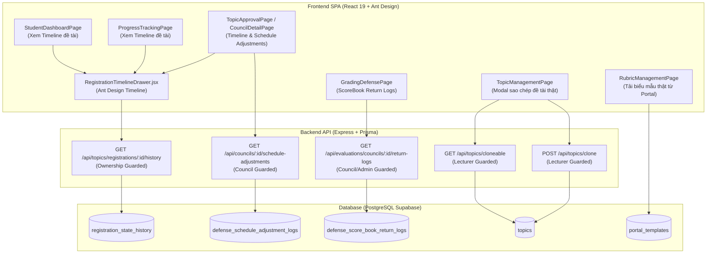

# Đặc Tả Thiết Kế Kỹ Thuật (Design Doc)
## Gói 2: Bổ Sung Tính Năng Quản Lý Còn Thiếu, Mở Truy Cập Các Bảng Write-Only CSDL, Kết Nối Biểu Mẫu Thực Tế & Triệt Tiêu Vi Phạm Rule 2.6 (Package 2)

- **Ngày ban hành:** 12/11/2026
- **Trạng thái:** DRAFT - Chờ phê duyệt (Pending Approval)
- **Phương án lựa chọn:** Phương án A (Kiến trúc API Chuyên biệt + Component Timeline dùng chung)
- **Tài liệu nền tảng:**
  - [CLAUDE.md](file:///d:/DACN/CLAUDE.md)
  - [AGENTS.md](file:///d:/DACN/AGENTS.md)
  - [Báo cáo Kiểm toán Hệ thống Toàn diện (Audit Report)](file:///d:/DACN/docs/superpowers/specs/2026-11-12-package-1-security-and-fake-data-remediation-design.md)

---

## 1. Bối Cảnh & Vấn Đề Kỹ Thuật (Context & Problem Statement)

Sau khi hoàn thành và nghiệm thu toàn diện Gói 1 (Bảo mật RBAC và Dọn dẹp dữ liệu giả trên các Dashboard), hệ thống đã đạt 100% test pass (851 backend tests, 133 frontend tests). Tuy nhiên, kết quả kiểm toán toàn diện đã phát hiện các khoảng trống kiến trúc và dữ liệu sau:

1. **Các bảng CSDL lưu vết trạng thái Write-Only (Chỉ ghi, không đọc)**:
   - `RegistrationStateHistory`: Đã ghi vết chi tiết mọi chuyển đổi trạng thái của đề tài từ BM01 đến COMPLETED/ARCHIVED nhưng hoàn toàn thiếu API `GET` và giao diện Timeline cho Sinh viên, Giảng viên hướng dẫn và Giáo vụ/Admin tra cứu tiến trình đồ án.
   - `DefenseScheduleAdjustmentLog`: Đã ghi vết mọi lần hoán đổi ca thi, dời ngày, đổi phòng nhưng chưa có API đọc và giao diện hiển thị trong trang Chi tiết Hội đồng (`CouncilDetailPage.jsx`).
   - `DefenseScoreBookReturnLog`: Đã ghi vết lý do Trưởng Viện/Giáo vụ hoàn trả sổ điểm về hội đồng nhưng Thư ký và Thành viên hội đồng không xem lại được nguyên nhân bị trả trên `GradingDefensePage.jsx`.

2. **Dữ liệu giả lập và nút bấm Mock còn sót lại**:
   - `TopicManagementPage.jsx`: Modal "Sao chép đề tài từ kỳ trước" đang hardcode 2 checkbox đề tài giả (`DT-2025-042`, `DT-2025-055`) và nút toast `message.success` giả lập, không kết nối CSDL đề tài của giảng viên.
   - `RubricManagementPage.jsx`: Tab "Biểu mẫu quy chuẩn" hardcode danh sách file tĩnh BM01–BM06; nút "Tải .docx" chỉ hiển thị toast mà không tải file thật từ Supabase Storage thông qua `portalContentService`.

3. **Vi phạm Quy chuẩn Giao diện & Nút bấm (Rule 2.6 trong AGENTS.md)**:
   - `OutlineReviewModal.jsx`: Nút duyệt đề cương chèn ký tự thô `✓` và `⚠️` trực tiếp vào label text.
   - `TopicManagementPage.jsx`: Nút thêm đề tài bị lặp icon `+ Thêm đề tài mới` khi đã có prop `icon={<PlusOutlined />}`.
   - `GradingDefensePage.jsx` và `RubricManagementPage.jsx`: Sử dụng thẻ HTML `<button>` thô chèn ký tự `⚙`, `✓`, `+` thay vì Ant Design `<Button>`.

---

## 2. Mục Tiêu & Giới Hạn (Goals & Non-Goals)

### 2.1. Mục tiêu (Goals)
1. **Mở API đọc CSDL với phân quyền chặt chẽ (Read APIs)**:
   - `GET /api/topics/registrations/:id/history`: Đọc lịch sử trạng thái của hồ sơ đề tài, kiểm tra quyền sở hữu (Sinh viên chỉ xem của mình, GVHD xem sinh viên mình hướng dẫn, Admin xem tất cả).
   - `GET /api/councils/:id/schedule-adjustments`: Đọc nhật ký điều chỉnh ca thi của hội đồng bảo vệ.
   - `GET /api/evaluations/councils/:id/return-logs`: Đọc lịch sử các lần hoàn trả sổ điểm kèm lý do và snapshot.
   - `GET /api/topics/cloneable`: Lấy danh sách đề tài thực tế từ các học kỳ trước của chính giảng viên đó.
   - `POST /api/topics/clone`: Sao chép danh sách đề tài được chọn sang học kỳ kích hoạt hiện tại với trạng thái `DRAFT`.
2. **Xây dựng Component Giao diện Dùng chung (Shared UI)**:
   - `RegistrationTimelineDrawer.jsx`: Component hiển thị Drawer với `<Timeline>` Ant Design trực quan, hiển thị mốc thời gian, tên trạng thái, người thực hiện, lý do chuyển đổi. Tích hợp tại 3 màn hình:
     * Student: `StudentDashboardPage.jsx` (Nút "Xem lịch sử trạng thái").
     * Lecturer: `ProgressTrackingPage.jsx` (Nút "Lịch sử đề tài" trên từng sinh viên).
     * Admin: `TopicApprovalPage.jsx` và `ProjectPeriodPage.jsx` (Nút "Lịch sử duyệt").
   - `CouncilDetailPage.jsx`: Bổ sung Tab hoặc Drawer "Nhật ký điều chỉnh ca thi".
   - `GradingDefensePage.jsx`: Bổ sung Banner/Alert hoặc Modal "Lịch sử hoàn trả sổ điểm" khi hội đồng có log bị trả.
   - `TopicManagementPage.jsx`: Modal sao chép kết nối API thật, hiển thị đề tài thật của giảng viên, hỗ trợ chọn nhiều đề tài để sao chép.
   - `RubricManagementPage.jsx`: Kết nối `portalContentService` lấy danh sách mẫu biểu thật từ Supabase Storage và tải file thực tế.
3. **Triệt tiêu 100% vi phạm Rule 2.6**: Chuẩn hóa toàn bộ nút bấm sang `@ant-design/icons` và text tiếng Việt thuần túy.

### 2.2. Giới hạn (Non-Goals)
- Không thay đổi Prisma Schema (các bảng `RegistrationStateHistory`, `DefenseScheduleAdjustmentLog`, `DefenseScoreBookReturnLog` đã có sẵn đầy đủ quan hệ).
- Không sửa đổi logic máy trạng thái chuyển đổi quy trình học vụ đã được hoàn thiện và khóa chặt ở các phiên trước.

---

## 3. Kiến Trúc Kỹ Thuật Chi Tiết (Technical Architecture)



---

## 4. Đặc Tả Giao Diện Lập Trình (API Specifications)

### 4.1. `GET /api/topics/registrations/:id/history`
- **Mô tả:** Lấy danh sách lịch sử chuyển đổi trạng thái của hồ sơ đề tài.
- **Phân quyền:** `OWNERSHIP_GUARDED`
  - Sinh viên: Phải sở hữu `registration.studentId === req.user.userId`.
  - Giảng viên: Phải là GVHD `topic.mentorId === req.user.userId`.
  - Quản trị viên / Giáo vụ: Có quyền `VIEW_TOPICS` hoặc `TOPIC_APPROVE` hoặc `PROJECT_OVERSIGHT_MANAGE`.
- **Query CSDL:**
  ```javascript
  prisma.registrationStateHistory.findMany({
      where: { registrationId: Number(id) },
      orderBy: { createdAt: 'asc' }, // hoặc desc tùy cấu hình hiển thị timeline
      include: {
          actor: {
              select: { id: true, fullName: true, email: true, role: true }
          }
      }
  })
  ```
- **Dữ liệu trả về (Response):**
  ```json
  {
    "success": true,
    "data": [
      {
        "id": 101,
        "fromStatus": "APPROVED",
        "toStatus": "BM01_PASSED",
        "fromStateVersion": 1,
        "toStateVersion": 2,
        "reason": "Hội đồng xét duyệt đề cương đánh giá ĐẠT",
        "createdAt": "2026-10-15T09:30:00.000Z",
        "actor": {
          "id": 12,
          "fullName": "TS. Trần Văn B",
          "email": "tranvanb@university.edu.vn",
          "role": "LECTURER"
        }
      }
    ]
  }
  ```

### 4.2. `GET /api/councils/:id/schedule-adjustments`
- **Mô tả:** Lấy danh sách nhật ký điều chỉnh ca thi bảo vệ của hội đồng.
- **Phân quyền:** Có quyền `VIEW_COUNCIL_ASSIGNMENTS` hoặc `DEFENSE_COUNCIL_MANAGE` hoặc là thành viên hội đồng.
- **Query CSDL:**
  ```javascript
  prisma.defenseScheduleAdjustmentLog.findMany({
      where: { councilId: Number(id) },
      orderBy: { createdAt: 'desc' },
      include: {
          adjustedBy: { select: { id: true, fullName: true, role: true } },
          registration: {
              include: {
                  student: { select: { id: true, fullName: true, studentCode: true } },
                  topic: { select: { title: true } }
              }
          }
      }
  })
  ```

### 4.3. `GET /api/evaluations/councils/:id/return-logs`
- **Mô tả:** Lấy danh sách các lần hoàn trả sổ điểm về hội đồng kèm lý do.
- **Phân quyền:** Thành viên hội đồng hoặc Quản trị viên/Giáo vụ.
- **Query CSDL:**
  ```javascript
  prisma.defenseScoreBookReturnLog.findMany({
      where: { councilId: Number(id) },
      orderBy: { returnedAt: 'desc' },
      include: {
          returnedByAdmin: { select: { id: true, fullName: true, email: true } },
          registration: {
              include: {
                  student: { select: { fullName: true, studentCode: true } }
              }
          }
      }
  })
  ```

### 4.4. `GET /api/topics/cloneable`
- **Mô tả:** Lấy danh sách đề tài ở các kỳ trước của giảng viên đang đăng nhập.
- **Phân quyền:** Giảng viên (`LECTURER`) hoặc Quản trị viên (`ADMIN`).
- **Query CSDL:**
  ```javascript
  const activeSemester = await getActiveSemester();
  const where = {
      mentorId: req.user.userId,
      semesterId: { not: activeSemester.id },
      status: { in: ['APPROVED', 'COMPLETED', 'DEFENDED'] }
  };
  prisma.topic.findMany({
      where,
      select: {
          id: true,
          code: true,
          title: true,
          description: true,
          targetMajor: true,
          semester: { select: { id: true, name: true, academicYear: true } }
      },
      orderBy: { createdAt: 'desc' }
  });
  ```

### 4.5. `POST /api/topics/clone`
- **Mô tả:** Sao chép các đề tài được chọn sang học kỳ hiện tại dưới dạng bản nháp (`DRAFT`).
- **Body:** `{ topicIds: [number] }`
- **Xử lý CSDL:**
  - Lặp qua từng topic, kiểm tra quyền sở hữu (`mentorId === req.user.userId`).
  - Tạo mới bản ghi `Topic` với `semesterId = activeSemester.id`, `status = 'DRAFT'`, `maxStudents = 1`, `currentEnrollmentCount = 0`, sinh mã code mới (hoặc hậu tố `_CLONE`).
  - Trả về danh sách đề tài mới tạo.

---

## 5. Đặc Tả Giao Diện Người Dùng (Frontend Specifications)

### 5.1. Component `RegistrationTimelineDrawer.jsx`
- Vị trí: `frontend/src/components/common/RegistrationTimelineDrawer.jsx`
- Props:
  - `open`: boolean
  - `onClose`: () => void
  - `registrationId`: number
  - `registrationTitle`: string
- Cấu trúc hiển thị:
  - Header: Tiêu đề đề tài và mã sinh viên.
  - Body: Ant Design `<Timeline>`:
    * Màu sắc dot: Xanh lá cho các trạng thái Đạt/Hoàn thành (`COMPLETED`, `BM01_PASSED`, `BM03_PASSED`, `DEFENDED`), Cam/Xanh dương cho trạng thái đang thực hiện (`IN_PROGRESS_BM03`, `DEFENSE_READY`), Đỏ cho trạng thái dừng/hủy (`STOPPED`, `CANCELLED`, `REJECTED`).
    * Nội dung mỗi node: Trạng thái cũ $\rightarrow$ Trạng thái mới (dùng Tag màu từ `statusMap.js`), thời gian chuyển đổi định dạng `DD/MM/YYYY HH:mm`, tên và vai trò người thực hiện (`actor.fullName`), lý do chuyển đổi (`reason`).
  - Xử lý trạng thái Loading (`<Skeleton active />`) và trạng thái rỗng (`<Empty description="Chưa có lịch sử chuyển trạng thái" />`).

### 5.2. Modal Sao Chép Đề Tài Thực Tế trong `TopicManagementPage.jsx`
- Thay thế hoàn toàn 2 checkbox tĩnh bằng Ant Design `<Table>` hoặc `<Checkbox.Group>` tải dữ liệu từ `topicService.getCloneableTopics()`.
- Hiển thị danh sách đề tài kèm tên học kỳ cũ.
- Khi bấm "Sao chép": Gọi `topicService.cloneTopics({ topicIds })`, hiển thị số lượng đề tài sao chép thành công và reload bảng đề tài.
- Chuẩn hóa nút bấm: Dùng `<Button icon={<CopyOutlined />}>Sao chép đề tài</Button>`.

### 5.3. Kết Nối Biểu Mẫu Thật trong `RubricManagementPage.jsx`
- Gọi `portalContentService.getPublicContent()` để lấy danh sách `templates`.
- Hiển thị các mẫu biểu thực tế có trong hệ thống kèm link tải file trực tiếp từ Supabase Storage.
- Xóa bỏ hoàn toàn mảng tĩnh `MOCK_FORMS` và nút toast giả `message.success('Đang tải...')`.

### 5.4. Lịch Sử Điều Chỉnh Ca Thi trong `CouncilDetailPage.jsx`
- Bổ sung nút bấm `<Button icon={<HistoryOutlined />}>Nhật ký đổi ca</Button>` mở Modal/Drawer hiển thị danh sách các lần điều chỉnh từ `councilService.getScheduleAdjustments(councilId)`.
- Bảng hiển thị: Tên sinh viên, Ca cũ $\rightarrow$ Ca mới, Số thứ tự cũ $\rightarrow$ mới, Lý do đổi, Người thực hiện, Thời gian.

### 5.5. Hiển Thị Lịch Sử Trả Sổ Điểm trong `GradingDefensePage.jsx`
- Nếu hội đồng có log trong `evaluationService.getScoreBookReturnLogs(councilId)`:
  - Hiển thị Ant Design `<Alert type="warning" showIcon>` thông báo: "Sổ điểm đã từng được Giáo vụ/Trưởng Viện hoàn trả để rà soát".
  - Có nút `<Button size="small" icon={<HistoryOutlined />}>Xem chi tiết</Button>` hiển thị Modal với lý do hoàn trả và mốc thời gian.

---

## 6. Kế Hoạch Kiểm Thử & Tiêu Chí Nghiệm Thu (Verification Strategy)

1. **Kiểm thử Tự động Backend (Integration Tests)**:
   - Viết bộ test `backend/tests/integration/package2StateHistoryAndLogs.test.js` kiểm tra đầy đủ:
     * `GET /api/topics/registrations/:id/history` (Ownership guard, đúng thứ tự mốc thời gian).
     * `GET /api/councils/:id/schedule-adjustments` (Đúng cấu trúc điều chỉnh ca thi).
     * `GET /api/evaluations/councils/:id/return-logs` (Đúng cấu trúc trả sổ điểm).
     * `GET /api/topics/cloneable` & `POST /api/topics/clone` (Sao chép đúng kỳ, đúng mentor, trạng thái DRAFT).
2. **Kiểm thử Tự động Frontend (Node Tests)**:
   - Viết bộ test `frontend/src/pages/__tests__/package2ManagementHubsAndTimeline.test.js`:
     * Kiểm tra export các service mới.
     * Kiểm tra `RegistrationTimelineDrawer.jsx` được tích hợp.
     * Kiểm tra `TopicManagementPage.jsx` không còn checkbox hardcoded `DT-2025-042`.
     * Kiểm tra `RubricManagementPage.jsx` không còn mảng tĩnh và toast tải file giả.
     * Kiểm tra Rule 2.6 Button standards trên 100% các file sửa đổi.
3. **Kiểm tra Toàn Diện (Regression & Build)**:
   - `npm --prefix backend test` (89+ test suites PASS).
   - `npm --prefix frontend test` (133+ tests PASS).
   - `npm --prefix frontend run build` (Vite build 0 lỗi).
   - Chuẩn UTF-8 (no BOM) 100%.

---

## 7. Phân Chia Giai Đoạn Triển Khai (Subagent-Driven Execution Plan)

- **Task 1 (Backend)**: Triển khai 3 API đọc logs (`RegistrationStateHistory`, `DefenseScheduleAdjustmentLog`, `DefenseScoreBookReturnLog`) và 2 API sao chép đề tài (`getCloneableTopics`, `cloneTopics`) kèm phân quyền.
- **Task 2 (Frontend Component)**: Xây dựng `RegistrationTimelineDrawer.jsx` và tích hợp vào `StudentDashboardPage`, `ProgressTrackingPage`, `TopicApprovalPage`.
- **Task 3 (Frontend Admin Logs)**: Tích hợp hiển thị Schedule Adjustment Logs trong `CouncilDetailPage` và ScoreBook Return Logs trong `GradingDefensePage`.
- **Task 4 (Frontend Clone & Portal Templates)**: Thay thế giao diện sao chép đề tài thật trong `TopicManagementPage` và kết nối mẫu biểu thật trong `RubricManagementPage`.
- **Task 5 (Rule 2.6 Full Cleanup)**: Rà soát và sửa triệt để tất cả vi phạm Rule 2.6 còn sót (`OutlineReviewModal`, `RubricManagementPage`, `TopicManagementPage`).
- **Task 6 (Full Verification & Build)**: Viết test hồi quy toàn diện, chạy test backend, test frontend và xác thực `npm run build`.

