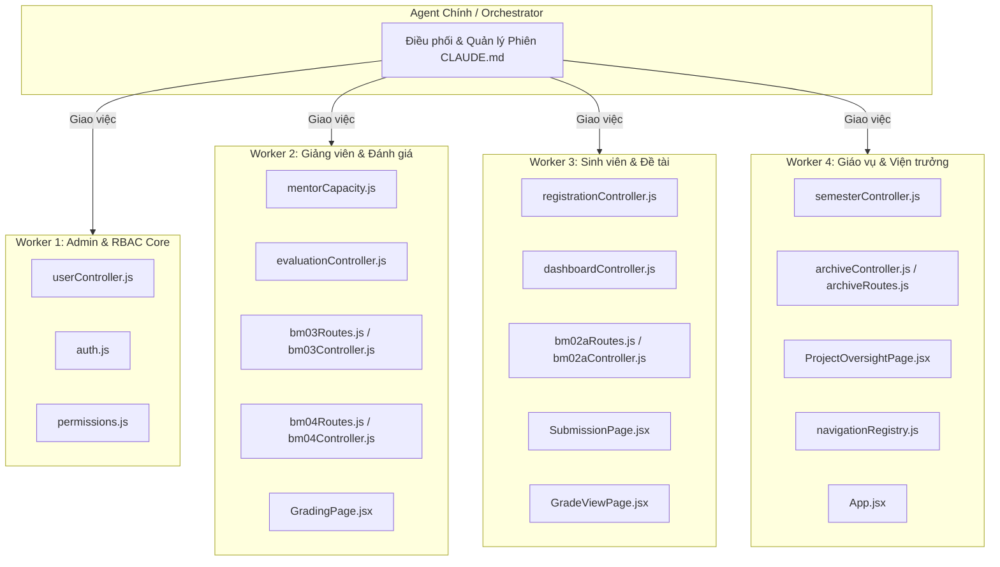

# Tài Liệu Thiết Kế Kỹ Thuật (Design Spec)
## Khắc Phục Toàn Diện Lỗ Hổng Bảo Mật, Quyền Truy Cập & Toàn Vẹn Quy Trình 5 Vai Trò

- **Ngày ban hành**: 15/11/2026
- **Trạng thái**: Đã phê duyệt (Approved)
- **Tác giả**: AI Agent Orchestrator & Codex Audit Team
- **Mã tài liệu**: `SPEC-2026-11-15-FIVE-ROLE-REMEDIATION`

---

## 1. Bối Cảnh & Mục Tiêu

### 1.1. Bối cảnh
Kết quả audit độc lập theo 5 vai trò nghiệp vụ (*Sinh viên, Giảng viên/GVHD, Admin, Giáo vụ, Viện trưởng*) đã xác nhận: dù frontend build thành công và các bài test mock cơ bản đang xanh, hệ thống đang tồn tại **nhiều lỗ hổng bảo mật P0 (IDOR, rò rỉ điểm số, leo thang đặc quyền Admin qua Excel)** và **các điểm đứt gãy nghiệp vụ trọng yếu (bị chặn ban hành QĐ đề tài, đếm thiếu quota 10 SV, bypass lưu chiểu và lỗi runtime UI)**.

### 1.2. Mục tiêu kỹ thuật
1. **Triệt tiêu lỗ hổng bảo mật P0**:
   - Chặn tuyệt đối khả năng tạo tài khoản `ADMIN` qua Import Excel và ngăn chặn hạ cấp/ghi đè tài khoản quản trị khi import trùng.
   - Che giấu kết quả bảo vệ `defenseResult` cho đến khi Hội đồng chính thức công bố.
   - Bổ sung lớp kiểm tra sở hữu dữ liệu (Ownership Check) trên toàn bộ các route GET của BM02-A, BM03, BM04 và Defense Dossier.
   - Bảo đảm nguyên tắc chấm độc lập BM05; khắc phục lỗi ghi đè `where.OR` khi lọc theo `councilId`.
2. **Khôi phục tính toàn vẹn quy trình học vụ**:
   - Mở khóa luồng ban hành Quyết định giao đề tài BM02 (cho phép xử lý hồ sơ `BM02_APPROVED`).
   - Bổ sung đầy đủ các trạng thái hoạt động vào bộ đếm trần 10 sinh viên / GVHD.
   - Loại bỏ cơ chế bypass legacy sang `COMPLETED` tại bước lưu chiểu; bắt buộc tuân thủ 2 tầng thẩm định và phê duyệt của Viện trưởng.
   - Giới hạn ủy quyền học vụ (`AcademicDelegation`) đúng theo phạm vi `semesterId`.
3. **Đồng bộ phân quyền (RBAC) & Khắc phục lỗi giao diện**:
   - Khôi phục quyền và menu "Điều phối & Gán sinh viên" cho Giáo vụ (`GIAO_VU`).
   - Sửa các lỗi `ReferenceError` vỡ giao diện trên `SubmissionPage`, `GradeViewPage`, `GradingPage`.
   - Sửa deep-link thông báo lưu chiểu về route chính thức `/lecturer/progress`.
4. **Kiến trúc thực thi không xung đột (Zero File Collision)**:
   - Phân chia nhiệm vụ cho 4 Worker Subagent hoạt động độc lập trên các file riêng biệt.

---

## 2. Kiến Trúc Phân Chia Subagent (Zero File Collision Architecture)



| Worker Subagent | Phạm vi sở hữu tệp (Tuyệt đối không trùng lặp) |
| :--- | :--- |
| **Worker 1: Admin & RBAC Core** | - `backend/src/controllers/userController.js`<br>- `backend/src/middlewares/auth.js`<br>- `backend/src/constants/permissions.js` |
| **Worker 2: Giảng viên & Đánh giá** | - `backend/src/constants/mentorCapacity.js`<br>- `backend/src/controllers/evaluationController.js`<br>- `backend/src/routes/bm03Routes.js`<br>- `backend/src/controllers/bm03Controller.js`<br>- `backend/src/routes/bm04Routes.js`<br>- `backend/src/controllers/bm04Controller.js`<br>- `frontend/src/pages/lecturer/GradingPage.jsx` |
| **Worker 3: Sinh viên & Đề tài** | - `backend/src/controllers/registrationController.js`<br>- `backend/src/controllers/dashboardController.js`<br>- `backend/src/routes/bm02aRoutes.js`<br>- `backend/src/controllers/bm02aController.js`<br>- `frontend/src/pages/student/SubmissionPage.jsx`<br>- `frontend/src/pages/student/GradeViewPage.jsx` |
| **Worker 4: Giáo vụ & Viện trưởng** | - `backend/src/controllers/semesterController.js`<br>- `backend/src/controllers/archiveController.js`<br>- `backend/src/routes/archiveRoutes.js`<br>- `frontend/src/pages/admin/ProjectOversightPage.jsx`<br>- `frontend/src/config/navigationRegistry.js`<br>- `frontend/src/App.jsx` |

---

## 3. Đặc Tả Chi Tiết Từng Gói Công Việc (Work Packages)

### 3.1. Gói 1: Worker 1 — Admin & RBAC Core
- **Tệp 1: `backend/src/controllers/userController.js`**:
  - Tại `importUsersExcel` ([L966](file:///d:/DACN/backend/src/controllers/userController.js#L966)):
    * Ràng buộc cứng: chỉ chấp nhận `role === 'STUDENT'` hoặc `role === 'LECTURER'`.
    * Nếu client gửi `role === 'ADMIN'` hoặc bất kỳ role nào khác $\rightarrow$ Trả về mã lỗi HTTP 400 `ADMIN_IMPORT_FORBIDDEN` ("Không được phép import tài khoản Quản trị viên qua file Excel").
  - Tại xử lý `onDuplicate === 'UPDATE'` ([L1111-L1124](file:///d:/DACN/backend/src/controllers/userController.js#L1111-L1124) và [L1269-L1280](file:///d:/DACN/backend/src/controllers/userController.js#L1269-L1280)):
    * Kiểm tra: Nếu `existing.role === 'ADMIN'` hoặc tài khoản hiện tại sở hữu các nhóm quyền quản trị đặc quyền $\rightarrow$ Bỏ qua việc cập nhật trường `role`, giữ nguyên role quản trị hiện hữu; hoặc trả về cảnh báo an toàn không cho phép hạ cấp tài khoản.
- **Tệp 2: `backend/src/middlewares/auth.js`**:
  - Tại hàm nạp ủy quyền học vụ ([L107-L117](file:///d:/DACN/backend/src/middlewares/auth.js#L107-L117)):
    * Trích xuất `currentSemesterId` (từ context đợt đồ án đang hoạt động hoặc query/header).
    * Bổ sung điều kiện lọc: `OR: [{ semesterId: null }, { semesterId: currentSemesterId }]`. Ngăn chặn ủy quyền của học kỳ này bị kích hoạt cho học kỳ khác.
- **Tệp 3: `backend/src/constants/permissions.js`**:
  - Bổ sung quyền `VIEW_PROJECT_ENROLLMENTS` vào danh sách `permissions` của nhóm chức vụ `GIAO_VU` ([L398-L415](file:///d:/DACN/backend/src/constants/permissions.js#L398-L415)).

### 3.2. Gói 2: Worker 2 — Giảng Viên & Đánh Giá BM03/BM04/BM05
- **Tệp 1: `backend/src/constants/mentorCapacity.js`**:
  - Cập nhật mảng `ACTIVE_REGISTRATION_STATUSES` bao gồm toàn bộ các trạng thái đang hoạt động:
    ```javascript
    const ACTIVE_REGISTRATION_STATUSES = [
        'REGISTERED', 'PENDING', 'APPROVED', 'IN_PROGRESS',
        'BM01_SUBMITTED', 'BM01_PASSED', 'BM01_NEEDS_REVISION', 'BM01_RESUBMITTED',
        'BM02_OPEN', 'BM02_SUBMITTED', 'BM02_NEEDS_REVISION', 'BM02_REVISION_REQUIRED',
        'BM02_RESUBMITTED', 'BM02_APPROVED', 'BM02_EXCEPTION_REVIEW',
        'DECISION_ISSUED', 'IN_PROGRESS_BM03', 'BM03_SIGNATURE_PENDING',
        'CHECKPOINT_SIGNATURE_APPEAL_OPEN', 'CHECKPOINT_SIGNATURE_APPEAL_SUBMITTED',
        'CHECKPOINT_SIGNATURE_APPEAL_REVIEW', 'SIGNATURE_APPEAL_RESOLVED',
        'BM03_PASSED', 'BM04_REVIEW', 'DEFENSE_READY', 'DEFENSE_ELIGIBLE',
        'ELIGIBLE_BY_INSTITUTE', 'STOP_REVIEW_PENDING', 'AWAITING_SCORES',
        'AWAITING_FINAL_APPROVAL', 'DEFENDED', 'DEFENSE_PASSED', 'PENDING_INSTITUTE_SIGNATURE',
        'ARCHIVE_INCOMPLETE', 'ARCHIVE_REJECTED', 'SUBMITTED', 'COMPLETED'
    ];
    ```
- **Tệp 2: `backend/src/controllers/evaluationController.js`**:
  - Tại `getGradingStudents` ([L400-L416](file:///d:/DACN/backend/src/controllers/evaluationController.js#L400-L416)):
    * Không ghi đè `where.OR`. Nếu có `councilId`, kết hợp qua `where.AND`:
      ```javascript
      const conditions = [];
      if (role === 'LECTURER') {
          conditions.push({
              OR: [
                  { council: { members: { some: { lecturerId: userId } } } },
                  { defenseCouncil: { members: { some: { lecturerId: userId } } } },
              ]
          });
      }
      if (parsedCouncilId) {
          conditions.push({
              OR: [
                  { councilId: parsedCouncilId },
                  { defenseCouncilId: parsedCouncilId },
              ]
          });
      }
      if (conditions.length > 0) {
          where.AND = conditions;
      }
      ```
  - Tại API xem chi tiết phiếu chấm điểm BM05: Đảm bảo ủy viên chỉ đọc được phiếu chấm do chính mình lập; chỉ trả về tổng hợp điểm khi sổ điểm đã bị khóa và công bố.
- **Tệp 3 & 4: `backend/src/routes/bm03Routes.js` & `backend/src/controllers/bm03Controller.js`**:
  - Tại `getBM03RecordController` ([L45](file:///d:/DACN/backend/src/controllers/bm03Controller.js#L45)):
    * Bổ sung kiểm tra Ownership: Người gọi phải là sinh viên sở hữu (`registration.studentId === req.user.id`), GVHD của đề tài (`topic.mentorId === req.user.id`), thành viên hội đồng bảo vệ, hoặc người dùng có quyền quản trị/giám sát (`VIEW_PROJECT_OVERSIGHT`, `BM03_STOP_REVIEW`). Nếu không thỏa mãn $\rightarrow$ Trả về 403 `FORBIDDEN_RESOURCE`.
- **Tệp 5 & 6: `backend/src/routes/bm04Routes.js` & `backend/src/controllers/bm04Controller.js`**:
  - Tại `getBM04RecordController` ([L45](file:///d:/DACN/backend/src/controllers/bm04Controller.js#L45)):
    * Bổ sung kiểm tra Ownership tương tự: Sinh viên chỉ xem được BM04 của chính mình; Giảng viên chỉ xem được BM04 do mình hướng dẫn hoặc khi là thành viên hội đồng được phân công.
- **Tệp 7: `frontend/src/pages/lecturer/GradingPage.jsx`**:
  - Tại [L175](file:///d:/DACN/frontend/src/pages/lecturer/GradingPage.jsx#L175): Thay thế `fetchDefenseData` bằng hàm refetch chính xác của query hoặc tải lại danh sách hội đồng.

### 3.3. Gói 3: Worker 3 — Sinh Viên & Đề Tài
- **Tệp 1: `backend/src/controllers/registrationController.js`**:
  - Tại `getMyCurrentRegistration` ([L496-L508](file:///d:/DACN/backend/src/controllers/registrationController.js#L496-L508)):
    * Kiểm tra: Nếu `registration.defenseResult` tồn tại nhưng `defenseResult.isPublished !== true` $\rightarrow$ Xóa trường `defenseResult` hoặc đặt thành `null` trước khi trả về client sinh viên.
- **Tệp 2: `backend/src/controllers/dashboardController.js`**:
  - Tại `getStudentDashboard` ([L618-L831](file:///d:/DACN/backend/src/controllers/dashboardController.js#L618-L831)):
    * Tương tự, che giấu toàn bộ thông tin điểm thi, xếp loại và nhận xét bảo vệ trong `registration.defenseResult` nếu chưa được Hội đồng công bố chính thức.
- **Tệp 3 & 4: `backend/src/routes/bm02aRoutes.js` & `backend/src/controllers/bm02aController.js`**:
  - Tại các endpoint `GET /bm02a/requests/:id` và `GET /bm02a/registrations/:registrationId` ([L53-L69](file:///d:/DACN/backend/src/routes/bm02aRoutes.js#L53-L69)):
    * Thêm guard kiểm tra: Nếu người dùng là sinh viên (`role === 'STUDENT'`), bắt buộc `request.registration.studentId === req.user.id`.
- **Tệp 5: `frontend/src/pages/student/SubmissionPage.jsx`**:
  - Tại `handleViewBM04` ([L251](file:///d:/DACN/frontend/src/pages/student/SubmissionPage.jsx#L251)):
    * Xóa dòng gọi hàm không tồn tại `setBm04Record(res.data);` (chỉ giữ `setBm04Evaluation(res.data)` và `setBm04ViewerOpen(true)`).
- **Tệp 6: `frontend/src/pages/student/GradeViewPage.jsx`**:
  - Tại [L112](file:///d:/DACN/frontend/src/pages/student/GradeViewPage.jsx#L112): Thay thế `onClick={fetchGrades}` bằng `onClick={() => gradesQuery.refetch()}`.
  - Tại [L440](file:///d:/DACN/frontend/src/pages/student/GradeViewPage.jsx#L440): Thay thế `fetchArchive(selectedRegistration.id)` bằng `archiveQuery.refetch()`.

### 3.4. Gói 4: Worker 4 — Giáo Vụ & Viện Trưởng
- **Tệp 1: `backend/src/controllers/semesterController.js`**:
  - Tại `issueTopicAssignmentDecisions` ([L441](file:///d:/DACN/backend/src/controllers/semesterController.js#L441)):
    * Mở rộng query: `status: { in: ['BM02_SUBMITTED', 'BM02_RESUBMITTED', 'BM02_APPROVED'] }`. Cho phép ban hành quyết định giao đề tài cho tất cả các hồ sơ BM02 đã đạt yêu cầu.
- **Tệp 2 & 3: `backend/src/controllers/archiveController.js` & `backend/src/routes/archiveRoutes.js`**:
  - Tại `reviewArchive` ([L363-L373](file:///d:/DACN/backend/src/controllers/archiveController.js#L363-L373)):
    * Vô hiệu hóa việc gán thẳng `status: 'COMPLETED'`. Khi GVHD nghiệm thu đạt, chuyển trạng thái sang `ARCHIVE_INCOMPLETE` hoặc `PENDING_INSTITUTE_REVIEW` để chờ Giáo vụ kiểm tra hồ sơ lưu chiểu và Viện trưởng ký Giấy chứng nhận hoàn thành.
  - Tại `getDefenseDossier` ([L897](file:///d:/DACN/backend/src/controllers/archiveController.js#L897)):
    * Kiểm tra người gọi có phải là sinh viên đề tài, GVHD, thành viên hội đồng hoặc có quyền `ARCHIVE_ACADEMIC_AFFAIRS_REVIEW` / `FINAL_DOCUMENT_REVIEW` / `VIEW_PROJECT_OVERSIGHT`.
  - Tại [L814](file:///d:/DACN/backend/src/controllers/archiveController.js#L814): Sửa deep-link thông báo `referenceUrl: '/lecturer/progress'`.
- **Tệp 4: `frontend/src/pages/admin/ProjectOversightPage.jsx`**:
  - Tại [L131](file:///d:/DACN/frontend/src/pages/admin/ProjectOversightPage.jsx#L131):
    ```javascript
    const canReviewArchive = (user?.permissions || []).includes('FINAL_DOCUMENT_REVIEW') ||
                             (user?.permissions || []).includes('ARCHIVE_ACADEMIC_AFFAIRS_REVIEW');
    ```
- **Tệp 5 & 6: `frontend/src/config/navigationRegistry.js` & `frontend/src/App.jsx`**:
  - Cho phép người dùng có nhóm quyền `GIAO_VU` hoặc quyền `VIEW_PROJECT_ENROLLMENTS` truy cập menu và route "Điều phối & Gán sinh viên" ([L193](file:///d:/DACN/frontend/src/App.jsx#L193)).
  - Bổ sung quyền hiển thị menu Giám sát tiến độ cho Giáo vụ và Viện trưởng.

---

## 4. Kế Hoạch Xác Minh & Kiểm Thử (Verification Strategy)

1. **Kiểm tra biên dịch & mã nguồn**:
   - `npm --prefix frontend run build` bảo đảm 0 lỗi biên dịch.
   - Sửa dứt điểm 3 lỗi `ReferenceError` runtime.
2. **Kiểm thử tự động tích hợp (Integration Tests)**:
   - Viết test case chống import `ADMIN` và chống demote tài khoản đặc quyền.
   - Viết negative tests chống IDOR trên các route BM02-A, BM03, BM04, Dossier.
   - Kiểm tra API trả về của sinh viên không có dữ liệu `defenseResult` chưa công bố.
   - Kiểm tra `ACTIVE_REGISTRATION_STATUSES` đầy đủ giúp bộ đếm không vượt quá 10 SV.

---

## 5. Phê Duyệt & Chuyển Sang Kế Hoạch Thực Thi
Tài liệu thiết kế kỹ thuật này đã khóa toàn bộ phạm vi và cơ chế phân bổ tệp. Bước tiếp theo là chuyển sang viết kế hoạch chi tiết (`writing-plans`) và kích hoạt 4 Worker Subagent song song.

